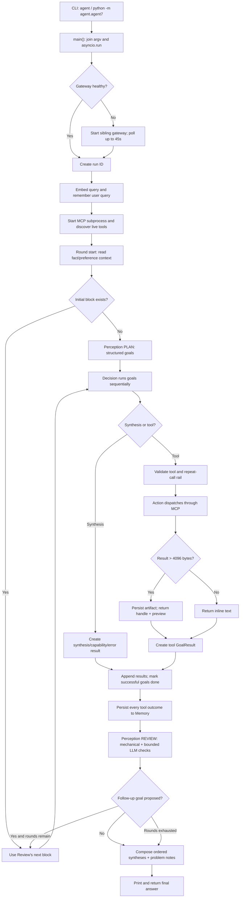

# AI Agent CLI — Workflow

## Overview

The current agent is a Python command-line program built around a bounded,
block-oriented loop:

```text
PLAN → EXECUTE → RECORD → REVIEW → repeat or finish
```

The CLI accepts one user query, starts or connects to the shared LLM gateway,
opens a stdio MCP subprocess, retrieves persistent context, asks Perception to
plan a block of goals, and asks Decision to execute those goals sequentially.
Tool results are dispatched through Action and persisted by Memory. Perception
then reviews all work completed so far and either emits another block or ends
the run, after which the orchestrator composes and prints the final answer.

This trace is grounded in the current source. It intentionally supersedes the
older iteration-level workflow described in
`docs/AGENT OVERVIEWS/WORKFLOW_REPORT.md`.

## Entry point(s)

### Primary CLI entry

- `pyproject.toml:26` declares the console script:
  `agent = "agent.agent7:main"`.
- `src/agent/agent7.py:272` defines `main()`.
- `src/agent/agent7.py:274` joins all CLI arguments into one query. With no
  arguments, it uses the built-in Tokyo/Kolkata time-difference example.
- `src/agent/agent7.py:275` enters the asynchronous workflow with
  `asyncio.run(run(query))`.
- `src/agent/agent7.py:278` also makes
  `python -m agent.agent7 "..."` a valid entry path.

### Secondary web entry

The FastAPI UI is an alternative trigger, not the main thread traced below.
`POST /chat` calls `asyncio.run(agent7.run(agent_msg))` at
`src/agent/app_planner.py:544` and `src/agent/app_planner.py:560`. From that
handoff onward, it uses the same `run()` workflow.

### Invocation verification

The documented `uv run agent` command was executed during this trace. In the
current worktree it fails before `main()` with:

```text
ModuleNotFoundError: No module named 'agent'
```

The `.venv/bin/agent` wrapper exists, but the `agent` package is not currently
installed into that environment. Running the module with `PYTHONPATH=src`
reaches `run()`, then attempts gateway startup. This is an environment/setup
defect, not a different execution path.

## Main thread (step-by-step)

1. **Convert the command into one query** (`src/agent/agent7.py:272`) —
   `main()` configures warning-level logging, joins `sys.argv[1:]`, supplies a
   demonstration query when no text is provided, and calls `asyncio.run()`.
   This creates the one event loop used by the agent and the asynchronous MCP
   client.

2. **Resolve and ensure the shared gateway** (`src/agent/agent7.py:140`,
   `src/agent/gateway.py:21`, `src/agent/gateway.py:67`) — importing the gateway
   module walks upward until it finds an `AI Code` directory containing both
   `llm_gateway/` and `mcp_server/`, unless `AI_CODE_ROOT` overrides it.
   `run()` then calls `ensure_gateway()`. The gateway health check requests
   `http://localhost:8107/v1/providers`; if unavailable, the code starts the
   sibling gateway process, writes its output to `llm_gateway/gateway.log`, and
   polls for up to 45 seconds. This centralizes LLM and embedding availability
   before planning begins.

3. **Create run-scoped state and precompute the query vector**
   (`src/agent/agent7.py:142`, `src/agent/agent7.py:148`) — the orchestrator
   creates an eight-character `run_id`, starts timing, and asks the gateway for
   a `retrieval_query` embedding. The vector is retained in `query_vec` and
   reused by every memory read, avoiding a duplicate embedding request per
   review round. If this request fails, the run continues and Memory can retry
   embedding during each read.

4. **Persist the user's query as durable memory**
   (`src/agent/agent7.py:156`, `src/agent/cognition/memory.py:308`) —
   `memory.remember()` asks the LLM to classify the free-form query as a typed
   `MemoryItem`, preserving concrete names, dates, numbers, keywords, structured
   values, and optional expiry. Embeddable kinds receive a
   `retrieval_document` vector. `_persist_item()` atomically appends the record
   to `data/state/memory.json` and updates the FAISS index under a thread lock
   plus an OS file lock (`src/agent/cognition/memory.py:252`). This write is
   best-effort at the orchestration boundary: `run()` logs and continues if it
   fails.

   Side quest, reconnected: if classification fails,
   `_fallback_remember()` stores the raw query as a fact and still attempts an
   embedding (`src/agent/cognition/memory.py:284`). Control then returns to
   startup and proceeds to MCP initialization.

5. **Launch and initialize the MCP tool subprocess**
   (`src/agent/agent7.py:163`, `src/agent/agent7.py:169`) — the agent launches
   the sibling `mcp_server/mcp_server.py` with the MCP server's own virtual
   environment and opens a stdio JSON-RPC session. It performs the MCP
   initialization handshake, lists the tools currently registered by the
   server, and converts each tool's name, description, and input schema into
   the format accepted by the LLM gateway (`src/agent/agent7.py:42`).

   Side quest, reconnected: the sibling MCP server auto-imports tool packages,
   checks for duplicate names, and registers every discovered function with
   FastMCP (`../mcp_server/mcp_server.py:46`,
   `../mcp_server/mcp_server.py:54`, `../mcp_server/mcp_server.py:58`). The
   resulting live registry—not a hard-coded list in the agent—is returned to
   Decision, and the main thread resumes with a ready `ClientSession`.

6. **Enter the bounded block loop and retrieve context**
   (`src/agent/agent7.py:177`) — the orchestrator allows at most eight rounds.
   At the start of each round it converts the last twelve results into compact
   history records and calls `memory.read()` for `fact` and `preference` items
   only (`src/agent/agent7.py:121`, `src/agent/agent7.py:182`). Prior
   `tool_outcome` items are deliberately excluded from cross-run context to
   reduce self-conditioning (`src/agent/agent7.py:35`).

   Memory searches FAISS first, using inner product over L2-normalized vectors,
   which is cosine similarity (`src/agent/cognition/memory.py:184`,
   `src/agent/services/vector_index.py:110`). It reloads and, when needed,
   rebuilds the persisted index so changes made by the separate MCP process are
   visible (`src/agent/cognition/memory.py:98`). Expired items and disallowed
   kinds are filtered. If vector search returns no items, Memory falls back to
   keyword overlap over the query and recent history
   (`src/agent/cognition/memory.py:218`).

7. **Plan the first executable block**
   (`src/agent/agent7.py:193`, `src/agent/cognition/perception.py:170`) — only
   when `block` is initially `None`, Perception receives the user query and a
   descriptor-only snapshot of memory. The planning prompt asks for concrete
   intent-level goals, not tool names. Questions must end in a synthesis goal;
   discoverable-but-not-yet-known work stops at discovery so Review can plan
   the next concrete block later.

   Perception validates the structured LLM response as `_PlanOutput`, assigns
   stable `g:` IDs, and resolves requested artifact indices into `art:` handles
   (`src/agent/cognition/perception.py:160`). If the model fails or returns no
   goals, Perception creates one fallback goal containing the original query
   (`src/agent/cognition/perception.py:194`,
   `src/agent/cognition/perception.py:199`). The resulting `Block` is appended
   to `blocks_so_far`, returning control to the round executor.

8. **Execute every goal in the block sequentially**
   (`src/agent/agent7.py:200`, `src/agent/cognition/decision.py:288`) —
   `decision.run_block()` loops over goals in order. Each goal sees persistent
   memory, all prior-round results, and results produced earlier in its current
   block. Sequential execution is important because a later synthesis goal can
   use the outputs of earlier tool goals.

   Before each Decision call, `_resolve_attached()` loads only the artifacts
   named on that goal (`src/agent/cognition/decision.py:124`). Attached text is
   bounded to a 20,000-character head and 10,000-character tail for large
   artifacts (`src/agent/cognition/decision.py:108`). Decision then asks the LLM
   to choose exactly one outcome: return plain-text synthesis or call exactly
   one available MCP tool (`src/agent/cognition/decision.py:167`).

9. **Normalize synthesis or guard and dispatch one tool call**
   (`src/agent/cognition/decision.py:207`) — if the LLM returns no tool calls,
   `_synthesis_result()` maps ordinary text to a successful synthesis, empty
   text to an error, and a `CAPABILITY_GAP:` prefix to a typed capability gap
   (`src/agent/cognition/decision.py:140`).

   If the LLM requests a tool, Decision uses only the first call, verifies that
   its name exists in the live MCP tool list, and prevents the same
   name-and-arguments call from running three times within the recent call
   window (`src/agent/cognition/decision.py:213`,
   `src/agent/cognition/decision.py:227`). Valid calls are handed to
   `action.execute()`. This is where the main thread crosses the MCP boundary.

10. **Execute through Action and externalize large results**
    (`src/agent/cognition/action.py:67`) — Action rejects `art:` handles used as
    path or URL arguments, then calls the selected MCP tool through the active
    session (`src/agent/cognition/action.py:77`,
    `src/agent/cognition/action.py:90`). It collapses MCP content parts into
    text and a best-effort content type.

    Results larger than 4,096 UTF-8 bytes are written to the
    content-addressable artifact store, keyed by SHA-256
    (`src/agent/cognition/action.py:94`,
    `src/agent/services/artifacts.py:42`). Action returns a short descriptor and
    the `art:` handle instead of injecting the full payload into later prompts.
    Smaller results return inline. Control reconnects to Decision, which wraps
    the outcome in `GoalResult`, marking empty or `ERROR:` output as an error
    (`src/agent/cognition/decision.py:268`).

11. **Record results and tool outcomes at the loop boundary**
    (`src/agent/agent7.py:210`) — the orchestrator appends all round results and
    marks goals with any `ok` result as done. It then records every tool result
    through `memory.record_outcome()`, including errors, because the filter is
    based on result kind rather than status (`src/agent/agent7.py:219`).
    `record_outcome()` deterministically creates a `tool_outcome` memory item,
    embeds its descriptor, and stores the artifact handle when present
    (`src/agent/cognition/memory.py:396`). Synthesis results are not written to
    persistent memory here.

12. **Review all accumulated work for bounded gaps**
    (`src/agent/agent7.py:235`, `src/agent/cognition/perception.py:284`) —
    Perception first computes mechanical findings for goals with no result,
    errored/empty results, and capability gaps
    (`src/agent/cognition/perception.py:208`). A separate structured LLM review
    is limited to three semantic checks: discovery, insufficient evidence, and
    uncovered requirements. This division keeps deterministic failures out of
    the model's judgment call.

    If no finding proposes follow-up work, Review returns `finished=True`
    (`src/agent/cognition/perception.py:339`). Otherwise it creates a new block
    with fresh goal IDs, preserving artifact routing for retries and resolving
    artifact indices for genuinely new goals
    (`src/agent/cognition/perception.py:344`). The orchestrator either breaks on
    `finished`, or appends `next_block` and resumes at Step 6 for another round.

13. **Compose, print, and return the final answer**
    (`src/agent/agent7.py:243`, `src/agent/agent7.py:256`) —
    `compose_answer()` selects successful synthesis results, restores original
    goal order, joins their descriptors, and appends concise notes for errors
    and capability gaps (`src/agent/agent7.py:63`). If there are only successful
    tool results it returns `Done.`. If no final answer exists after the loop,
    the orchestrator emits a fixed max-round failure message. It prints the
    final answer with total elapsed time and also returns the string to its
    caller, allowing the same workflow to serve the CLI or FastAPI chat route.

## Branches & error handling

| Decision point | Branches and effect |
|---|---|
| Workspace discovery | `AI_CODE_ROOT` wins when set. Otherwise the gateway module walks ancestors for both sibling services. No match raises during import. |
| Gateway health | A successful `/v1/providers` request proceeds immediately. Failure starts the gateway and polls 45 times; timeout raises and aborts before the run banner. |
| Initial query embedding | Success is cached for all rounds. Failure is logged; Memory retries per read and can ultimately use keywords. |
| Query memory write | Classifier failure uses a deterministic fact write. Any exception escaping `remember()` is caught by `run()`, so MCP startup still proceeds. |
| MCP startup/session | There is no local recovery wrapper around process launch, initialization, or tool discovery. Failure exits `run()`. |
| Initial planning | Valid structured goals create the block. LLM failure or an empty goal list becomes one goal equal to the original query. |
| Artifact attachment | Existing handles load bytes. Missing handles are logged and omitted; Decision still runs with the remaining inputs. |
| Decision output | Plain text becomes synthesis; `CAPABILITY_GAP:` becomes a typed gap; empty text becomes an error; only the first returned tool call is considered. |
| Tool validation | An unavailable tool name becomes a capability gap without MCP dispatch. The third identical recent call is blocked as a capability gap. |
| Action dispatch | `art:` supplied as `path` or `url` returns an inline `ERROR:` result. Exceptions from `action.execute()` become error `GoalResult` objects. |
| Tool payload size | Results at or below 4,096 bytes remain inline. Larger results become SHA-256-addressed artifacts plus previews. |
| Review LLM | Failure produces three “skipped” semantic findings and relies on mechanical findings. If mechanical findings propose nothing, this can finish the run. |
| Review result | `finished=True` composes the answer. `finished=False` with a block repeats. The defensive `finished=False`/no-block case composes current results and exits. |
| Eight-round bound | Exhaustion falls through to composition. If composition is still empty, a fixed “unable to produce an answer” response is returned. |

## Assumptions made / not traced

- **Trace target:** because no feature-specific flow was named, the main thread
  is the primary CLI query-to-final-answer path.
- **Web UI:** traced only to its handoff into `agent7.run()`. Browser rendering,
  session mutation, file upload, and Gemini file handling are separate flows.
- **MCP tools:** traced through discovery and generic dispatch. Individual tool
  implementations—web search, file operations, finance, document processing,
  media, and knowledge tools—are intentionally not expanded because Decision
  can select any of them dynamically.
- **LLM gateway:** traced through the agent's bridge, process startup, and client
  calls. Provider routing and the gateway's internal HTTP handlers are in the
  sibling `llm_gateway` project and are not expanded here.
- **Third-party internals:** MCP JSON-RPC, FastMCP, Pydantic, HTTPX, NumPy, and
  FAISS library internals are treated as external implementation details.
- **Concurrency:** `run_block()` is sequential. The artifact and memory services
  contain cross-thread/process locks, but high-contention behavior was not
  load-tested in this trace.

## Data & side effects

| Data or system | Read/write behavior |
|---|---|
| CLI arguments | Read once and joined into the user query. |
| LLM gateway | Health-checked over localhost; may be started as a sibling process; receives chat and embedding requests. |
| `llm_gateway/gateway.log` | Opened for append when the agent starts the gateway. |
| MCP server | Started as a child process using stdio; tools are discovered and called over MCP. |
| `data/state/memory.json` | Atomically rewritten when queries and tool outcomes are persisted. |
| `data/state/index.faiss` | Read, rebuilt on drift, appended to, and atomically persisted. |
| `data/state/index_ids.json` | Maintains FAISS-position-to-memory-ID mapping. |
| `data/state/memory.lock` | Used for process-level serialization of memory/index changes. |
| `data/state/artifacts/*.bin` | Stores large MCP results by SHA-256 digest. |
| `data/state/artifacts/*.json` | Stores artifact metadata sidecars. |
| In-memory run state | `blocks_so_far`, `results_so_far`, and the last 12 normalized tool-call keys live only for the current invocation. |
| Console | Receives detailed stage, result, review, timing, warning, and final-answer logs. |

## Diagram



## Open questions / gaps

1. **The declared console script is currently unusable in this worktree.**
   `uv run agent` resolves `.venv/bin/agent`, but that environment cannot import
   `agent`. The package installation/setup needs repair before the documented
   command reaches `main()`.
2. **Gateway startup writes outside this repository.** A sandboxed run reached
   `ensure_gateway()` but could not append to the sibling
   `llm_gateway/gateway.log` without broader filesystem permission.
3. **Tool failures are persisted.** The loop calls `memory.record_outcome()` for
   every result whose kind is `tool`, regardless of `status`. This may be
   intentional observability, but it means failed outputs enter persistent
   `tool_outcome` memory.
4. **Goal completion is broad.** A goal is marked done when any result for its
   ID is `ok`; Review, rather than the `done` flag alone, determines whether the
   overall request is complete.
5. **The live MCP surface is dynamic.** Exact available tools depend on what the
   sibling server auto-discovers at startup. A separate tool-registry workflow
   trace would be required to document each tool's internal path accurately.
