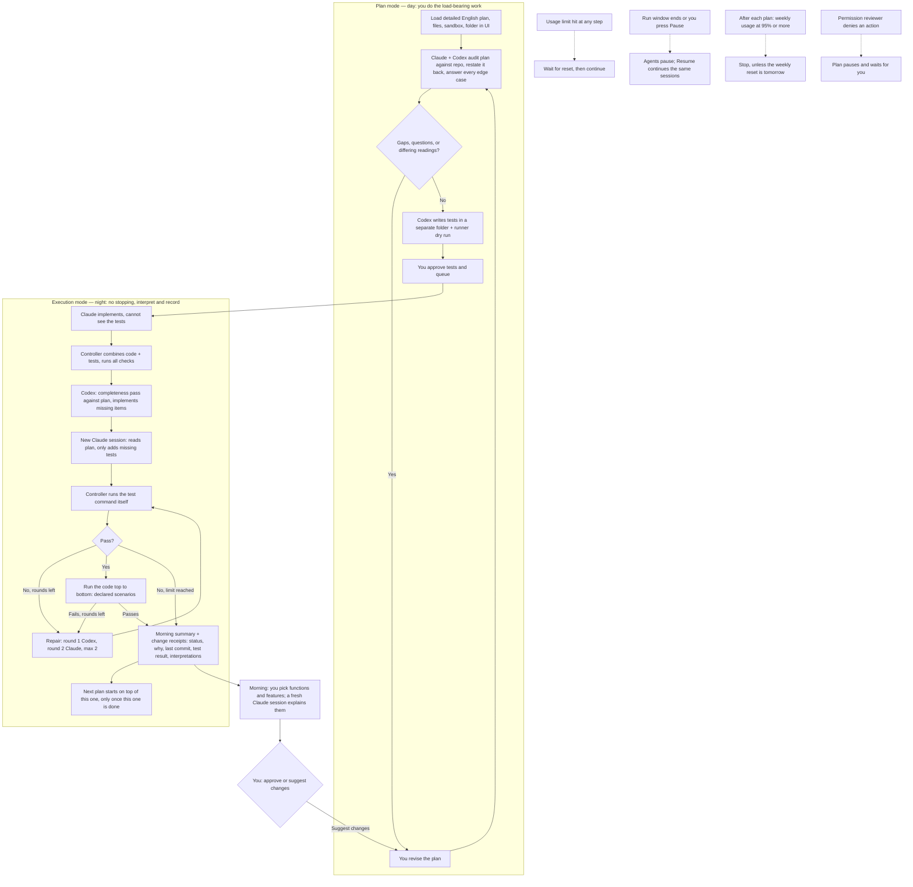

# Codex + Claude: Scheduled Development Workflow

Status: revised design draft, version 0.2  
Created: October 9, 2026  
Purpose: a working design to discuss and revise before building.

[MY COMMENTS ARE IN CAPS AND BRAKCETS] 

## The intended outcome

Capture rough ideas and bugs in a local backlog [BUILDING THIS LOCAL BACKLOG IS FOR LATER, WE DONT NEED TO DO IT NOW, TO DO THIS, FOR NOW WE ONLY FOCUS ON MAJOR LEVEL REWWIRTES OR A PLAN BEING FED VIA UI]  . Agents inspect the repository, refine them into executable plans [THE HUMAN SHOULD DO THE REFINEMENT, NEED TO FIGURE OUT A WORKFLOW TO GIVE TO CLAUDE AND CODEX TO TAKE MY PLANS AND ENSURE THAT THEY ARE FULLY EXECUTABLE SO I DONT GET ANY SUPRISES IN THE CODE AND ITS ALL MADE THE WAY I WANT IT TO BE MADE] , and surface consequential questions before queueing. A manually launched or scheduled controller produces isolated candidates, executes checks, coordinates independent review and bounded repairs, and returns a runnable branch with evidence for human acceptance [ARE ALL THESE STEPS REQUIRED AND ARE THEY RELEVANT ?] . Parallel acceptance-test writing is optional [I THINK YOU SHOULD DO PARALLEL TEST WRITING BECAUSE THAT WILL BE THE BEST WAY TO WRITE TESTS IN MY OPINON]. Dependent plans build on recorded checkpoints and may require human acceptance before continuing.

> **Revised Oct 9 after your comments:** see “Direction set in user review” below (D-20 to D-26). Your comments are kept in place as the record.
>
> **Revised Oct 10 after your comments on [02](02-architecture-and-omnigent.md):** v1 is cut to the minimum so it can be used quickly (D-38 to D-56, table below). The controller is a simple Python loop: schedule, feed plans in sequence, run the tests itself, wait for usage resets and send “continue”, pause and resume. Agents run in script mode in a visible Terminal window. Coverage ledger, mechanical test-change check, and the random explain-back draw are parked; point 3 (stacking plans when verification is blocked or tests still fail) is parked as its own later plan ([17](17-later.md) L17).

This document set describes a proposed system. No controller, schedule, agent configuration, or execution environment has been installed by creating these documents.

## Documents and suggested reading order

| Section                                                                           | Focus                                                                                    |
| --------------------------------------------------------------------------------- | ---------------------------------------------------------------------------------------- |
| [01 — Intent and scope](01-intent-and-scope.md)                                   | What the system should accomplish and what remains your responsibility                   |
| [02 — Architecture and Omnigent](02-architecture-and-omnigent.md)                 | Controller design, agent adapters, and whether to reuse Omnigent                         |
| [03 — Plans and queue](03-plans-and-queue.md)                                     | How plans enter the system, dependencies, and readiness                                  |
| [04 — Workflow stages](04-workflow-stages.md)                                     | The complete execution sequence and its stage gates                                      |
| [05 — Roles and handoffs](05-roles-and-handoffs.md)                               | Codex and Claude responsibilities, contracts, and context                                |
| [06 — Workspaces and integration](06-workspaces-and-integration.md)               | Git worktrees, branches, ownership, and combining changes                                |
| [07 — Receipts and findings](07-receipts-and-findings.md)                         | Audit artifacts, review findings, and the morning report                                 |
| [08 — Verification and repair](08-verification-and-repair.md)                     | Actual test execution, failure classification, and repair loops                          |
| [09 — Scheduling and recovery](09-scheduling-and-recovery.md)                     | Overnight operation, persistence, interruptions, and limits                              |
| [10 — First build and validation](10-first-build-and-validation.md)               | A practical implementation sequence and proof of reliability                             |
| [11 — Decisions and exploration](11-decisions-and-exploration.md)                 | Cross-cutting questions and a decision log                                               |
| [12 — Sandboxing and access](12-sandboxing-and-access.md)                         | What each agent can see, where it writes, what it can reach, and how changes are checked |
| [13 — Workflow revision](13-workflow-revision.md)                                 | Discussion rationale behind the revision                                                 |
| [14 — Plan mode](14-plan-refinement-and-local-backlog.md)                        | Plan mode: agents audit and restate your plan against the repo until it is executable; backlog parked |
| [15 — Work modes](15-work-modes.md)                                               | Production and evidence requirements for bugs, features, refactors, and rewrites         |
| [16 — Plan loading UI](16-plan-ui.md)                                             | Where plans, files, sandbox, and working folder are defined; where results are read      |
| [17 — Later](17-later.md)                                                         | To-do list: everything parked as too advanced for v1, preserved verbatim                 |
| **Planning workflow (20–24)** | |
| [20 — Planning workflow overview](20-planning-workflow-macro.md) | How a drafted plan becomes executable with no surprises; open design points |
| [21 — Plan checklist and template](21-plan-checklist-and-template.md) | Everything a plan needs to be complete, as a fill-in template |
| [22 — Hardening workflow](22-hardening-workflow.md) | Plan mode steps, who does what, and the exit bar (replaces the step list in 14) |
| [23 — Agent prompts](23-agent-prompts.md) | Audit, compare, fold-in, and test-writing prompts, usable by hand now |
| [24 — Handoff to execution](24-handoff-to-execution.md) | What goes in the repo vs outside it; the queueing checklist; plans that build on each other |

See [14 — Plan hardening](14-plan-refinement-and-local-backlog.md) for making your detailed plans executable, and [15 — Work modes](15-work-modes.md) for bug fixes, features, refactors, and rewrites.

## Proposed workflow [ I THINK THE WORKFLOW IS TOO COMPLEX FOR NOW WE CAN MAKE A SIMLE DAG BASED SYSTEM THAT RUNS THROUGH MAJOR STEPS, BECAUSE SINCE CLAUDE AND CODEX ARE DOING THE AHRDEST REASONING ANYWAY, WHY DO I NEED TO MAKE SUCH A COMPLEX WORKFLOW, I GENERALLY HAVE MORE OF A REACTIVE APPROACH TO THIS BUT IF THE PLAN IS DETAILED ENOUGH, THE WRIITNG IS SIMPLE ENOUGH, AND CAN BE DONE IN AUTOMATION] 

Simplified October 9 (D-22): the hard thinking happens during the day, in your plan; the night runs a short fixed pipeline. The earlier, larger flow is preserved in [13](13-workflow-revision.md).

Revised Oct 9 after your comments on [01](01-intent-and-scope.md) (D-28 to D-36): the night now includes the swap after implementation, the top-to-bottom run, and the randomised explain-back, and it never stops for a question. It is still one linear pass with one bounded loop. The previous diagram is preserved in [17](17-later.md). The repair loop is a bounded cycle (≤2 since Oct 10, alternating Codex then Claude, D-46), not an open loop. After a report, the next eligible plan in the queue starts; dependent plans build on recorded checkpoints and follow their dependency gate and C6 ([03](03-plans-and-queue.md)).

## Proposed starting defaults

These are recommendations to evaluate, not accepted configuration.

- Build a small controller with replaceable agent adapters.
- Codex writes the independent tests from your plan before code, in a folder Claude cannot see (D-23, D-30). Claude implements code and local tests. Codex then checks completeness against the plan and implements anything missing; Claude adds missing tests (D-31). Repairs alternate Codex then Claude, at most 2 rounds, only when the controller's own test run fails (D-46).
- You write the detailed plan; agents harden it against the repository until no structural question is open (D-21).
- Use an isolated candidate workspace with per-plan checkpoint commits (D-24: isolation kept, worktree or C4 clone). [SINCE RIGHT NOW ALL WE ARE DOING IS MAJOR REWRITES AND NOT SMALL BUG FIXES, I DONT THINK WE NEED TO USE WORKTREES RIGHT NOW THE AGENTS CAN WORK DIRECTLY ON THE REPO, WHAT DO YOU THINK ?] 
  **→ Response (Oct 10, D-44):** one separate clone per run, not the repo directly and not a worktree per plan. Plans stack on each other inside it, it keeps agents apart from your own working folder (matters if a run is in the daytime while you edit), and you review, merge, and push.
- Give each role its own access profile: visible paths, writable paths, sandbox, and no network beyond the model API.
- Verify in an integration branch, then maintain an overnight review branch for successful plans.
- Leave merging into the usual main branch to morning review initially.
- Limit repair to two rounds, alternating Codex then Claude (D-46); 2-hour per-node timeout (D-52); run window set per plan (D-41); weekly usage check after each plan (D-43).
- Preserve blocked work; continue independent plans and hold dependent plans.
- Generate readable reports from controller-captured records plus agent judgments.
- ~~Use a local backlog, not Jira~~ Plans enter through the UI (D-20); prove one manually launched cycle before adding scheduling.
- Select bug-fix, feature, refactor, or rewrite mode and explicitly track human acceptance and provisional dependencies.

> **✅ DECISION C8 — Defined light path for small bug fixes** (accepted Oct 9; details to work through)  
> **Problem:** every task got the full process.  
> **Status: PARKED (D-26).** **Fix:** **Light path** (small bug fixes): no separate refinement stage, no findings tracker. One implementer writes a regression test that fails before and passes after, the controller runs the checks, one review pass follows, and the report is a single paragraph. **Full path**: features, refactors, rewrites, and any bug fix that crosses a module boundary or changes behavior beyond the reported defect. Refinement chooses the path and records why; a light-path task that grows beyond those limits moves to the full path. [PARK THIS FOR NOW, THIS IS FOR LATER, RIGHT NOW WE ARE ONLY WORKING ON MAJOR REFACTORS OR BIG NEW WRITES OR REWRITES] 

## Direction set in user review (October 9)

These override older wording anywhere in the set; logged as D-20 to D-37 in [11](11-decisions-and-exploration.md). The October 10 table below (D-38 to D-56) overrides both where they differ. Everything parked is kept, not dropped, in [17 — Later](17-later.md).

| ID | Direction |
| --- | --- |
| D-20 | **UI is the front door.** Plans, attached files, sandbox, and working folder are defined in a local UI ([16](16-plan-ui.md)). Local backlog parked. |
| D-21 | **The human writes the detailed plan in English.** Agents do not refine rough ideas; they audit your plan against the repository and return gaps and questions until it is executable with no surprises ([14](14-plan-refinement-and-local-backlog.md)). Then they convert the English to code. |
| D-22 | **Load-bearing work by day, simple work by night.** Night runs the short fixed pipeline above. Heavy state and recovery machinery are replaced by wait-and-continue (D-25); see [17](17-later.md) L8. |
| D-23 | **Independent tests come from the other vendor, before code.** This is C1 and satisfies “parallel test writing”: Codex writes the tests from your plan before Claude writes code. Concurrent writing is not needed. |
| D-24 | **Isolation stays.** Agents work in an isolated workspace (worktree or the C4 per-run clone), not your live checkout. |
| D-25 | **Usage limits: wait and continue.** When Claude or Codex hits its limit, the controller waits for the reset, then resumes the same session with “continue”. Usage-aware task routing is deferred ([09](09-scheduling-and-recovery.md)). |
| D-26 | **Scope: refactors, rewrites, and large new features only.** Bug-fix mode and the C8 light path are parked. |
| D-27 | **Test types: keep / change / remove.** Each touched behavior is labelled in your plan; the label sets what each test must do before and after. Planned edits to existing tests are settled by day so C2 can catch anything else at night ([15](15-work-modes.md)). |
| D-28 | **Plan mode and Execution mode.** Day hardening is its own workflow (Plan mode), including a restate-back step and an answer for every edge-case dimension; night is Execution mode ([01](01-intent-and-scope.md), [14](14-plan-refinement-and-local-backlog.md)). |
| D-29 | **Interpret, don't stop.** At night nothing pauses for a question: the agent interprets, builds, and records the interpretation. Interpretations lead the report. Limits (confirmed, will grow): frozen tests win; sandbox and protected paths unchanged; no test edits at night. Replaces the “stop and ask” part of D-21. |
| D-30 | **Tests hidden from the implementer.** Independent tests live outside Claude's workspace; Claude never sees them, not even read-only. They meet the code only in the controller's check workspace ([06](06-workspaces-and-integration.md), [12](12-sandboxing-and-access.md)). |
| D-31 | **Swap after implementation.** Codex checks completeness against the plan and implements missing items; then a **new** Claude session adds tests that don't exist yet, from your plan and a coverage list (names and item IDs, not test bodies), without changing any existing test (D-37) ([05](05-roles-and-handoffs.md)). |
| D-32 | **Finder fixes.** No hand-over for fixes: Codex fixes test-suite failures, each agent fixes its own verified findings; the controller's rerun is the verification. No agent changes existing or frozen tests at night (D-37). |
| D-33 | **Nothing silently unimplemented.** Every plan item has an ID and mapped tests; the controller's coverage ledger decides completeness; missing plan items are defects fixed the same night; only out-of-scope suggestions come to you ([01](01-intent-and-scope.md)). |
| D-34 | **Run it top to bottom.** Each plan declares end-to-end scenarios by day; at night the controller runs them and Codex drives the program through them ([08](08-verification-and-repair.md)). |
| D-35 | **Randomised explain-back, then your review.** After the code is final the controller draws a random sample of functions and features; a fresh **Claude** session explains them (you prefer its writing, and it balances Codex's load); nothing reveals the sample beforehand. You review every plan and approve or suggest changes (C6) ([07](07-receipts-and-findings.md)). |
| D-36 | **Scope confirmed.** One user, Claude and Codex only, one plan per v1 run; multiple layered plans after the first cycle works. |
| D-37 | **No test changes at night.** No agent edits or deletes an existing or frozen test at night; the C2 check rejects any such change outright, with no approval path. An agent that thinks a test is wrong files a test dispute in the report for you. Claude's missing tests are written in a new session told to read the plan and only add tests ([08](08-verification-and-repair.md)). |

## Direction set in review of 02 (October 10)

v1 is the minimum that can be used quickly. Logged as D-38 to D-56 in [11](11-decisions-and-exploration.md); the full v1 architecture is in [02](02-architecture-and-omnigent.md) and the intent in [01](01-intent-and-scope.md), both rewritten Oct 10 with your comments built in.

| ID | Direction |
| --- | --- |
| D-38 | **Controller is a simple Python loop.** It schedules, feeds plans one after another, runs the tests itself, waits for usage resets and sends “continue”, and pauses/resumes. No stage state machine, no per-stage gates, no allowed-action lists: agents decide how to work inside the plan. “Done” is when the agent says done; the controller's own test result is recorded beside it. May grow into a simple agent loop. |
| D-39 | **Script mode in a visible Terminal window.** `claude -p` / `codex exec` with JSON output, one visible window per node so you can toggle and watch. Not driving the interactive app. CLI only; SDK/app-server later (L16). Vendor terms on automated subscription use still to check once. |
| D-40 | **Minimal adapter.** `run_claude()` and `run_codex()`; predefined roles; given workspace; scope = the plan; new session per node. Session record = run date + plan + vendor session ID (no SQL). Three JSON fields read: status, session ID, limit hit. Output = Claude's change receipt at the place the prompt names. Vendor-specific data kept only for resume and limits. Usage info is for the controller only. |
| D-41 | **Run window per plan, plus Pause/Resume.** Set in the UI (e.g. 00:00–09:00 IST, or 9 AM–3 PM when you can watch). At window end agents pause; Resume continues the same sessions. Pause/Resume available any time. |
| D-42 | **Keep awake only for the run.** `caffeinate -i -w <controller PID>`; lid shut → the Mac sleeps whatever the time (heat, battery); no system power settings changed; start before bed with a delayed start. Mac mini / server later (L19). |
| D-43 | **Usage limits.** Short window: never stop, wait for the reset and continue. Weekly: check after each plan, using your existing tracker; at 95% or more stop, unless the weekly reset is tomorrow, then burn through; next run continues from the cut-off. |
| D-44 | **Plans in sequence in one run clone.** All queued plans run one after another (replaces D-36's one plan per v1 run). Plan N+1 starts only after plan N is confirmed done, on top of its commits. Controller commits after every node. Clone is separate from your working folder; no push credentials; you merge and push. |
| D-45 | **Hidden tests via a separate clone.** Revises D-30's mechanism: tests live in their own clone (a worktree would share `.git`, so `git log --all` would reveal them), Claude's settings deny reads of that path, and the controller copies tests into a check folder only. |
| D-46 | **Controller runs the tests; 2 alternating repair rounds.** After the agent says done the controller runs the test command (no AI usage). Only if it fails: round 1 Codex fixes, round 2 Claude fixes, then stop. Replaces D-04's three rounds and D-32's finder-fixes routing. |
| D-47 | **No test changes by prompt.** D-37 becomes a prompt line in every fix and missing-test prompt: don't edit, delete, or skip existing tests; put disputes in the change receipt. The mechanical C2 check is parked (L18). |
| D-48 | **Coverage ledger dropped for v1.** Revises D-33. Codex's completeness pass against the plan stays; plan item IDs are optional; the ledger is parked (L18). |
| D-49 | **You pick the explain-back.** Revises D-35. In the morning, after the code is final, you choose the functions and features; a fresh Claude session explains them (blind, then against the plan). Not run by the controller. The random draw is parked (L20). |
| D-50 | **Permission reviewer.** Claude: auto mode or `--permission-prompt-tool`; Codex: check for an equivalent hook, else a small reviewer of our own. Cheap model; when unsure it denies and logs. A denied action pauses the plan and waits for you, with a notification. Replaces D-29's “denial recorded, agent continues”. |
| D-51 | **Ended ≠ done.** A run that ends is classified: done → next node; usage limit → wait and continue; question → reply “interpret, proceed, record” up to N times (D-29 kept). |
| D-52 | **Process hygiene and timeout.** Each node runs in its own process group, killed when the node ends (dev servers, watchers, MCP servers). 2-hour per-node timeout, not counting time waiting for a reset or paused. |
| D-53 | **Morning summary.** One short controller-written file: per plan, done / stopped / skipped, why, last commit, controller test result. Claude's change receipts sit under it. |
| D-54 | **Daytime dry run first.** One trivial plan end to end before the first real run: limit-message wording, resume flags, JSON fields, permission-denial reporting, usage source, sleep behaviour. |
| D-55 | **Omnigent: borrow, don't depend.** Not a dependency, platform, or fork. Borrow code as and when required, after checking the license and keeping notices; look at its session lifecycle first. |
| D-56 | **Point 3 parked as its own later plan.** Stacking plans when verification is blocked (e.g. Chrome in Codex's sandbox) or tests still fail after repair, later plans fixing earlier code, and rerunning earlier plans' tests: for you to think through ([17](17-later.md) L17). |

## How to iterate on this set

Add questions or comments in the relevant section's exploration area. When a choice is settled, record it in the decision log and update any affected sections. Keep this macro document focused on the overall picture; put detailed schemas and implementation choices in their section.

## Success criterion

A queued plan can move from intent to verified, integrated changes without overnight supervision. Every completion claim is tied to a specific commit and captured checks. Unfinished work remains recoverable and clearly reported.

## Accepted fixes to work through (October 9)

Each gap found in review has an accepted fix, marked in place with `DECISION Cn` and logged as D-10 to D-19 in [11](11-decisions-and-exploration.md). The direction is agreed; each still needs detailed design, one at a time.

| ID  | Fix                                                                             | Where      | Detail status   |
| --- | ------------------------------------------------------------------------------- | ---------- | --------------- |
| C1  | Codex writes frozen acceptance tests before code; hidden from the implementer   | 05, 10, 15 | To work through; now the default (D-23); baseline rule splits by mode (15); hidden, not just read-only (D-30); mechanism: separate tests clone + deny-read (D-45) |
| C2  | Mechanical test-weakening detection plus test-change requests                   | 08         | Parked for v1 (D-47): a prompt instruction instead; disputes go to you in the change receipt |
| C3  | Per-repository runner profile with placeholder env, proven by a daytime dry run | 04, 08, 12 | To work through |
| C4  | Per-run `git clone --local`; read-only Git for agents; controller commits       | 06, 12     | To work through; isolation confirmed (D-24); one clone per run, plans stack in it, commit after every node (D-44) |
| C5  | Blocking = criterion ID + evidence; else advisory; test settles disputes        | 07         | To work through; untestable disputes no longer pause (D-29) |
| C6  | Invalidate all descendants; max 2 provisional; rejection → plan revision        | 03, 04, 06 | To work through |
| C7  | `quota_exhausted` state; check vendor terms                                     | 09         | Revised by D-25: wait for reset and continue; weekly rule D-43 |
| C8  | Defined light path for small bug fixes                                          | 00         | Parked (D-26) |
| C9  | Root-cause layer statement + test at that layer                                 | 15         | Refactor half active; bug-fix half parked |
| C10 | One controller state model                                                      | 14         | To work through; backlog states parked with the backlog; `paused: question` removed (D-29) |

