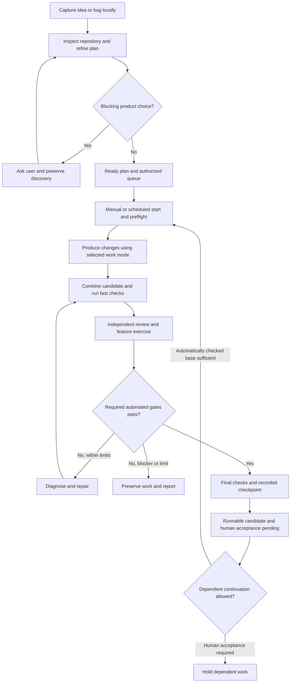
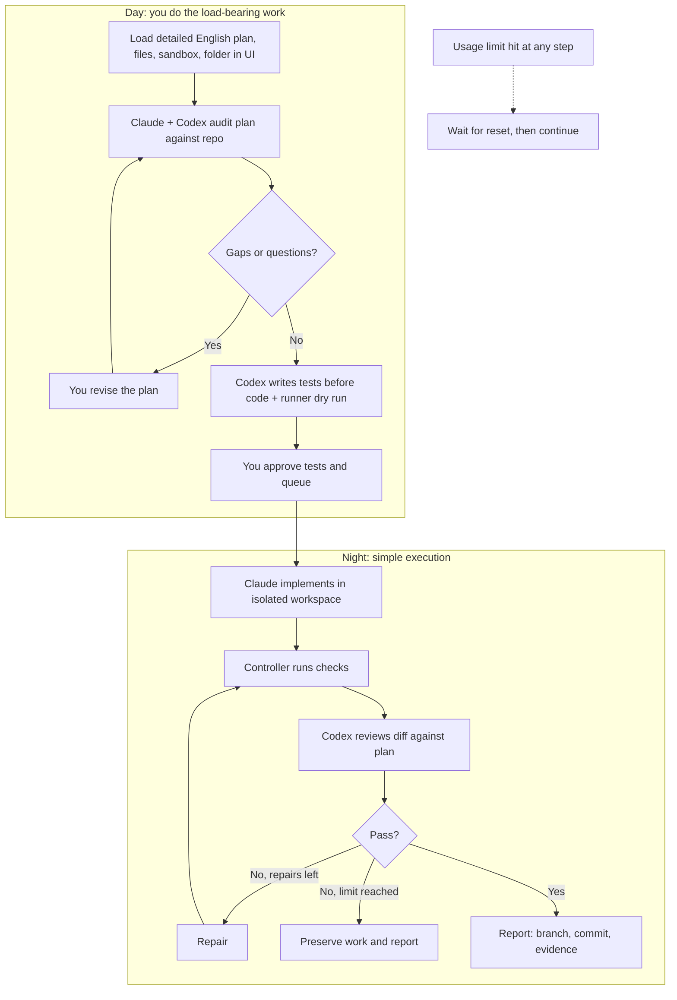

# 17 — Later: Parked and Deferred Work

[Back to macro](00-macro.md) · Status: to-do list for after the simplest version works

These ideas are **not rejected**. They were parked on October 9 because they are too advanced for the first version: build the simplest working system first, then bring these back one at a time. Text below is preserved **verbatim** from before the October 9 simplification so nothing is lost. Where a newer decision changes an item, a note says so.

Other to-do lists that remain in place: the **Backlog** section of [13](13-workflow-revision.md) and **Deferred features** in [10](10-first-build-and-validation.md).

## Index

| # | Parked item | Came from | Why parked | Bring back when |
| --- | --- | --- | --- | --- |
| L1 | Local backlog for rough ideas and bugs | 14 | UI-loaded detailed plans come first (D-20) | You want to capture ideas faster than you write plans |
| L2 | Agents refining rough captures into plans | 14 | You write the plan for now (D-21) | Backlog returns and you want agents to draft from rough input |
| L3 | Backlog states of the original C10 (captured, refining, awaiting_answer, deferred) | 14 | Belong to the backlog (L1) | Backlog returns. The rest of C10 is restored in 14 |
| L4 | Bug-fix mode and C9 bug-fix half | 15 | Scope is refactors/rewrites/large features (D-26) | Small bug fixes come into scope |
| L5 | C8 light path | 00 | Same as L4 | Same as L4 (text still in [00](00-macro.md), marked parked) |
| ~~L6~~ | ~~Plan-to-plan dependencies, C6~~ | — | **Restored to active design** (never rejected) | — |
| L7 | Concurrent test + code writing (expanded production) | 05, 15, 10 | Tests-first by Codex gives the same independence (D-23) | Wall-clock time matters more than coordination cost |
| L8 | Heavy persistence and restart recovery | 09 | Wait-and-continue plus one status file is enough (D-25) | Crashes or duplicate runs actually happen |
| L9 | Run-wide limits, usage reporting, full C7 run-window logic | 09 | Same as L8 | Runs need a hard morning deadline or cost tracking |
| L10 | Usage-aware routing between vendors | your Oct 9 note | Wait-and-continue first | Limits become the main bottleneck |
| L11 | Full 9-stage workflow with gates | 04, 00 | Simple fixed pipeline first (D-22) | The simple pipeline shows a concrete gap |
| ~~L12~~ | ~~Findings lifecycle~~ | — | **Restored to active design** in [07](07-receipts-and-findings.md) (never rejected) | — |
| L13 | Research as a plan type | 01 | Not in current scope | — |
| L14 | Advanced test types | 15 (D-27 discussion) | v1 test set first | The v1 tests miss real defects |
| L15 | Explain-back sample sizing and repeat audits | 01 (D-35) | Fixed small sample first (5 functions, 2 features) | The fixed sample misses problems you later find yourself |
| L16 | SDK / app-server integration | 02 (D-39) | v1 is CLI script mode only | You want live streaming into the UI, permission handling in code, or a server service |
| L17 | **Point 3: stacking plans when verification is blocked or tests still fail** (its own later plan) | 02 discussion (D-56) | You want to think it through properly | You sit down to write that plan; v1 runs plans strictly in sequence |
| L18 | Coverage ledger (D-33) and mechanical test-change check (C2) | 02 (D-47, D-48) | Take time you'd rather not spend before v1 | Agents leave plan items out or edit tests despite the prompt |
| L19 | Remote monitoring, Mac mini, server hosting | 02 (D-42) | Not wanted on the laptop | You get a Mac mini or move the controller to a server |
| L20 | Random explain-back draw (original D-35) | 02 discussion (D-49) | You pick the sample yourself | Your own picks miss problems you later find |
| L21 | Container (layer 3) and controller path / protected-path check (layer 4) | 12 (D-09) | v1 runs on your laptop in a visible terminal | Moving to a Mac mini or server, or a run damages something outside the plan |
| L22 | Richer structured results, artifact references, receipts machinery | 02 (D-40) | v1 reads three JSON fields | The morning summary isn't enough; borrow from Omnigent |
| L23 | Omnigent: what to borrow | 02 (D-55) | Borrow as and when required | Before writing resume/limit handling, and whenever a piece would save time |


## L1 — Local backlog (from 14)

### Local backlog, not Jira

The user does not use Jira. Start with Markdown files and a small local index using the same plan IDs as the execution queue. A capture can be an idea, bug report, future improvement, or question. Capture does not authorize immediate implementation.

Suggested arrangement:

```text
backlog/
  index.json
  items/<id>/
    original.md
    discovery.md
    questions.md
    plan-v1.md
    plan-v2.md
```

Keep one authoritative state record per item; derive readable lists from it. Do not introduce another issue-management system alongside the queue. An intake/refinement role can perform capture and discovery, but need not be a permanently running third agent.

Suggested lifecycle: captured → investigating → awaiting_answer / ready → queued → running → ready_for_review → accepted. Preserve blocked, failed, cancelled, and deferred outcomes. Readiness, scheduling, and human acceptance are separate fields; the lifecycle labels are a readable summary, not a complete state machine.

Minimum capture: what is wrong or wanted, why it matters, and repository if known. For a bug, include reproduction steps and expected versus actual behavior when available. Missing details become discovery work rather than mandatory intake fields. Priority and dependencies can be added later.


## L2 — Agent refinement of rough captures (from 14)

Accept rough ideas and bugs without requiring the user to write an exhaustive specification. Agents turn these into evidence-based execution plans by inspecting the repository, challenging assumptions, and asking a small number of consequential questions. This is a design document; no intake service or agent has been installed.

### How a rough plan becomes detailed

1. **Restate intent.** Preserve the original words. State the desired observable outcome, exclusions, and assumptions; distinguish user requirements from agent suggestions.
2. **Inspect the actual repository.** Trace affected entry points, callers, data flow, persistence, tests, configuration, and setup. Cite relevant paths and symbols. Do not invent an architecture from the narrative alone.
3. **Build a behavior inventory.** Identify existing behavior to preserve, intended changes, and adjacent behavior at risk. Separate facts observed in code or execution from hypotheses.
4. **Challenge the proposal.** A reviewer examines the draft against the repository and intent: missing cases, fragile boundaries, alternative approaches, dependencies, and likely verification gaps. For small tasks use a short critique; reserve a separate full review for substantial uncertainty.
5. **Investigate uncertainty.** Use a bounded read-only investigation, baseline run, or explicitly scoped disposable prototype where useful. Record the result and discard prototype code unless its inclusion is deliberately reviewed. Never treat a prototype as verified production work.
6. **Ask consequential questions.** Bundle the few unresolved choices that change user-visible behavior, compatibility, data handling, or scope. Present the recommended default, alternatives, and consequences. Agents decide routine implementation details within scope.
7. **Produce the execution plan.** Include criteria, boundaries, work mode, dependency policy, implementation checkpoints, test strategy, product evidence, permissions, and stopping conditions.
8. **Check readiness.** A reviewer checks for unresolved blockers and executable verification. Ready means sufficient information to start, not certainty that every problem has been predicted. Queueing requires the user's instruction or an already authorized scheduling policy.

Time-box discovery per item. Stop when remaining uncertainty is either an allowed technical assumption or a clearly stated question. Avoid repeated agent debate that produces no new evidence.

### Required output of refinement

- Problem and intended behavior, with user source and revision.
- Repository observations with paths, symbols, and recorded baseline commit.
- Work mode: bug fix, feature, refactor, or redesign/rewrite.
- Scope, exclusions, affected modules, and callers.
- Criteria with stable IDs and concrete examples; include negative cases where relevant.
- Behavior preserved, behavior changed, compatibility and migration requirements.
- Dependency edges and whether each requires automated checks or human acceptance.
- Proposed checkpoints and which choices need early human review.
- Verification commands, test-discovery expectations, feature exercise, and manual acceptance steps.
- Permissions, time/usage limits, repair limit, and unresolved assumptions.

Attach detail where it affects decisions or execution. A small patch does not need every possible edge case or a lengthy architecture document.

Original worked example opening:

Rough user capture: “Add CSV export for the table.”

Discovery should determine how filtering, column order, pagination, and permissions currently work. The agent might ask: “Should export include all filtered rows or only the current page? We recommend all filtered rows because it matches the current filter; large exports may need a different execution path.” This is an unresolved product choice, not a requirement the agent may silently add.

Original first-build note:

Begin with a local backlog and one manually requested refinement session. Compare the rough capture with the refined plan and record which later discoveries were missed. Add automated intake, duplicate suggestions, and scheduling only after the basic refinement improves execution. External issue trackers are outside the current scope.


## L3 — Original C10 state model (from 14)

> **✅ DECISION C10 — One controller state model** (accepted Oct 9; details to work through)  
> **Problem:** three overlapping status vocabularies (this lifecycle, section 04 terminal states, section 07 finding statuses).  
> **Fix:** One controller state model. A **plan item** has one `status`: captured, refining, awaiting_answer, ready, queued, running, paused (reason: question, quota, or human gate), ready_for_review, accepted, blocked, failed, cancelled, deferred. Separate fields record `acceptance` (pending, accepted, rejected) and `provisional` (true or false). **Findings** keep their own small set from section 07. Sections 04, 07, and 14 should point to this model rather than define their own; the full definition is still to be written.


## L4 — Bug-fix mode and C9 (from 15)

Reproduce the reported defect and record expected versus actual behavior. Create a regression check that fails on the baseline for the intended reason and passes with the fix where practical. If automation is unavailable, retain a reproducible manual check and disclose the limitation. Make a targeted patch, inspect other cases sharing the root cause, run focused checks, obtain independent diff review, and run required final checks. Do not equate the smallest diff with the correct fix if the defect is structural.

> **✅ DECISION C9 — Root-cause layer statement plus a test at that layer** (accepted Oct 9; details to work through)  
> **Problem:** “inspect lower layers” was an instruction with no evidence or gate.  
> **Fix:** Bug-fix and refactor modes must produce a short **root-cause statement** naming the layer where the fault lives (entry point, service, storage, or external boundary) and why the fix belongs there. A **test must exist at that named layer**, not only at the top-level symptom. The reviewer's checklist includes “a test exists at the stated layer”, which can be checked against the diff. A fix only at the symptom layer requires a recorded justification.

Related line from 08: “Bug fixes should include a failing-before/passing-after regression demonstration where practical.”


## L7 — Concurrent test + code writing (from 05, 15, 10)

Default production uses one implementer for code and local unit tests, followed by independent candidate review. In expanded production, give Codex the criteria, observable contract, repository, and test conventions; give Claude the same requirements and architecture. Keep independent drafts separate until integration, then run fast checks before review. Codex acceptance tests target stable observable behavior rather than guessing implementation internals. See [15](15-work-modes.md).

Before parallel writing, agree on observable behavior, entry points, signatures, data structures, errors, and relevant compatibility constraints. Give criteria stable IDs so tests and implementation changes can reference them.

Tests should derive from desired behavior and acceptance criteria. A mistaken implementation plan should remain challengeable. Interface changes require a recorded contract revision and coordinated updates to both branches.

Default: Claude implements code and implementation-specific tests; Codex independently reviews the combined candidate and diagnoses failures. Optional expanded path: Codex writes acceptance tests independently from the same base and agreed observable interface while Claude implements. Integrate before fast checks and review. Place tests in normal project locations, confirm discovery, preserve existing tests, and exercise the feature where possible. The controller captures authoritative check results.

Use expanded production when independent behavior checks justify the coordination cost. The two production branches need a shared interface, not an exhaustive frozen internal design. Changes to the agreed interface require a recorded revision.

From 10, implementation step 7: “Trial optional independent acceptance-test production and compare its coordination cost and defect detection.”

Original C1 wording (before D-23 and the keep/change split):

> **✅ DECISION C1 — Independent acceptance tests written before code** (accepted Oct 9; details to work through)  
> **Problem:** the implementer wrote the tests that judge it, so a misread requirement passed its own tests.  
> **Fix:** During daytime refinement, Codex writes a small executable acceptance test for each automatable criterion, before any implementation exists. The tests must fail on the baseline for the expected reason (missing feature, not a setup error). After plan approval they are frozen and **read-only to the implementer** (protected paths, section 12). Claude still writes implementation-specific unit tests. Any change to a frozen test goes through the C2 test-change request. This replaces optional parallel test writing as the default source of independence; parallel production stays optional.


> **Note (Oct 9, D-30):** the separate-folders part of this idea is now active: the independent tests live outside Claude's workspace and Claude never sees them. Only *concurrent* writing stays parked here.

## L8 / L9 — Persistence, recovery, limits, original C7 (from 09)

### Persistent state

For each run and stage, persist status, input hashes, base commit, contract revision, session identifiers, attempt count, artifacts, findings, and last verified checkpoint.

An append-only event log is useful for auditing, but recovery also needs dependable state updates. A small transactional store such as SQLite is a candidate; the choice remains open.

### Restart behavior

After interruption, reconcile recorded state with actual process status, Git commits, artifacts, and command logs. Do not assume a missing response means an agent made no edits. Resume a known session where supported or dispatch a recovery task with the saved evidence.

Before repeating an action, determine whether it already completed. Use run and stage IDs to avoid duplicate integration, duplicate reports, and concurrent controllers operating on the same queue. Add locking and atomic artifact writes.

### Limits and failure handling

Set per-stage timeout, per-plan repair limit, maximum concurrent agents, and run-wide time and usage limits. Permission prompts and required questions must have a defined outcome: preserve and block the affected stage instead of waiting indefinitely.

Usage reporting varies by vendor and authentication. Token counts are not automatically monetary cost. Track available metrics, disclose estimates, and define behavior when accurate usage data is unavailable. An in-flight agent may overshoot a controller's observed limit unless the underlying interface supports a stricter bound.

> **✅ DECISION C7 — Separate quota-exhausted state** (accepted Oct 9; details to work through)  
> **Problem:** a vendor usage limit mid-run was neither a failure nor a retry, and its handling was undefined.  
> **Fix:** Add a **`quota_exhausted`** stage state. If the reported reset time falls inside the run window, the plan pauses and resumes after the reset; otherwise it stops with work preserved and reported. It counts against neither repair rounds nor infrastructure retries. Other plans continue only if they don't need the exhausted vendor. Before relying on a subscription login, check each vendor's terms on unattended automated use and record the result in the decision log.

> Note: D-25 replaces the run-window behavior with wait-and-continue for v1. The vendor-terms check is still required.


## L10 — Usage-aware routing (your note, Oct 9)

Actively manage usage left: if one agent has more usage remaining and a big task is next, that agent does it; or one agent continues from where the other stopped.


## L11 — Full workflow with gates (from 04 and 00)

### Stage definitions

| Stage | Required result | Gate before advancing |
| --- | --- | --- |
| Capture and refinement | Repository observations, criteria, assumptions, and work mode | No unresolved blocking product choice; queue authorized |
| Preflight | Execution snapshot, setup status, baseline checks | Inputs available; earlier discovery still applicable |
| Production | Code and tests, or separate implementation and acceptance-test commits | Artifacts recorded and actual scope inspected |
| Integration and fast checks | Combined candidate and captured build/focused results | Candidate available for review; failures classified |
| Independent review and feature exercise | Findings against actual diff, execution evidence, and criteria | Blocking findings assigned; manual limitations explicit |
| ✅ C3 | Feature exercise = controller runs the runner profile's exercise command and captures output; agent claims are labelled agent-reported. UI exercise deferred. See [08](08-verification-and-repair.md) | — |
| Repair | Diagnosis, patch, and focused review | Return to combined execution; within limits |
| Final verification | Required full check results and finding dispositions | Exact candidate satisfies required automated gates |
| Finalization | Runnable candidate, report, checkpoint, acceptance status | Evidence complete; dependent continuation policy enforced |
| Human acceptance and manual promotion | User decision and any corrections | Required human gates satisfied; changed promotion result reverified |
| ✅ C6 | Morning rejection creates a new plan revision: local fixes → repair; behavior/interface changes → refinement, invalidating all descendants. See [03](03-plans-and-queue.md) | — |

Original controller invariants removed:

- Queue advancement uses a recorded verified checkpoint and satisfies each dependency's automated or human gate.
- Changed upstream assumptions invalidate affected downstream evidence.

Original macro diagram:




## L13 — Research plans (from 01)

Original question: “Which kinds of plans are suitable: features, refactors, bug fixes, research, or all four?”

## L14 — Advanced test types (from the D-27 discussion, Oct 9)

- **Old-vs-new comparison:** run the old and new code on the same inputs and compare outputs. The strongest check for refactors and rewrites; needs the old code runnable alongside the new (baseline checkout or sibling folder).
- **Performance:** measure on the baseline, then require the result to stay within a tolerance.
- **Property-based / fuzz:** generate many inputs to find edge cases no one wrote down.
- **Manual / UI acceptance:** human-run or browser-driven checks; UI exercise was already deferred in C3.


## L15 — Explain-back sizing (from 01, D-35)

v1 uses a fixed sample: 5 changed functions and 2 plan features per run, drawn at random by the controller after the code is final. Later options: weight the sample toward large or risky functions, scale it with the size of the diff, sample again when an explanation disagrees with the plan, or ask both vendors to explain the same sample and compare the two.

## L16 — SDK / app-server integration (from 02, D-39)

v1 invokes the CLIs in script mode (`claude -p`, `codex exec`). The Codex SDK, the Claude Agent SDK, or an app-server integration become worth it for: live streaming progress into the UI, handling permission requests in code instead of a reviewer hook, or running the controller as a server service. Your note: “if you can convince me for the laters maybe I will to do it.”

## L17 — Point 3: stacking plans when verification is blocked or tests still fail (from the Oct 10 discussion, D-56)

**Parked for you to think through as its own plan.** v1 meanwhile: plans run strictly one after another, and plan N+1 starts only once plan N is confirmed done (D-44).

**Your proposal (Oct 10, verbatim in substance):** one workspace for plan 1; verification is attempted and its result left for you; the code is still used to build plan 2, which will also find issues and fix them; verification is again left open-ended; the same for plan 3. Because of the simple nature of the cycles and how many times the code is seen, many issues get fixed as Claude and Codex stack code on top and read the previous code.

**Claude's view (Oct 10):** agree for verification that is **blocked**, not for tests that **fail**:

| Situation | What it means | Proposed handling |
| --- | --- | --- |
| Browser/e2e check **couldn't run** (e.g. sandbox blocked Chrome for Codex) | We don't know if it works | Record “not verified: blocked” in the receipt and continue to plan 2; you verify later |
| Controller's test run **fails** after the 2 repair rounds | We know it's broken | Stop the chain; don't build plan 2 on it |

Why later plans can't be relied on to fix earlier bugs:

- **Agents read only what they need:** plan 2 reads the plan 1 code it touches; a bug in a part plan 2 doesn't use stays.
- **Bugs get locked in:** plan 2 builds on buggy behaviour, so its code and tests treat the bug as correct; fixing it later breaks both.
- **Who changed what is lost:** if plan 2 quietly fixes plan 1 code, that change is outside plan 2's scope and its receipt won't show it. If allowed, the prompt should say “if you change code from an earlier plan, list it separately in the receipt.”

Cheap addition to consider: before each plan, the controller reruns **all earlier plans' tests** (no usage cost), catching plan 3 breaking plan 1 the moment it happens.

Open questions for the plan: blocked vs failing handling; stop the chain or skip to the next independent plan when tests still fail; may later plans fix earlier plans' code, and how is it receipted; rerun earlier tests before each plan; how you verify blocked checks afterwards.

## L18 — Coverage ledger and mechanical test-change check (from 02, D-47, D-48)

The full designs stay in place in [07](07-receipts-and-findings.md) (“Coverage ledger”) and [08](08-verification-and-repair.md) (C2). v1 replaces them with Codex's completeness pass against the plan and a prompt instruction (“do not edit, delete, or skip existing tests; put any dispute in your change receipt”). Your note: “might be useful but will require time I don't want to give… let's get the minimum made, I will take the issues along the way.”

## L19 — Remote monitoring, Mac mini, server (from 02, D-42)

Remote monitoring meant checking progress or failure from your phone. Not wanted now, especially not on the laptop. With a Mac mini or a server: always-on runs without `caffeinate` or lid concerns, the container (L21), and optionally one push notification on “finished” or “stopped: reason”. Your note on 02: “soon you will be running this off a server (to do this part) in which case this won't matter.”

## L20 — Random explain-back draw (original D-35)

The controller drew a random sample (5 changed functions, 2 plan features) after the final commit, with a recorded seed. Replaced by your own pick in the morning (D-49): “I don't see why I shouldn't do it, because I think I will automatically focus in on what I deem important.” Sizing ideas in L15 still apply if the draw returns.

## L21 — Container and controller path check (from 12, D-09)

Layer 3 (a container mounting only the workspace) and layer 4 (the controller's `writable_paths` and protected-path check with `scope_violation` retries) remain designed in [12](12-sandboxing-and-access.md) but are not built in v1. v1 relies on a per-run clone, vendor sandbox rules, the permission reviewer, no push credentials, and a commit after every node.

## L22 — Richer structured results (from 02, D-40)

v1 reads three JSON fields (status, session ID, limit hit) and Claude's change receipt. Richer structured results, artifact references, and receipt machinery can be borrowed from Omnigent when needed rather than written.

## L23 — Omnigent: what to borrow (from 02, D-55)

Kept on the to-do list. Look first at its session lifecycle (resume, limit handling, continue), then adapters and policies. Check the license before copying and keep required notices. Your note: “maybe stealing from Omnigent may be actually more efficient.”

## Original wording replaced by your direction (record)

These lines were rewritten on October 9 because of your explicit direction (D-20 to D-27), not deleted as ideas. They are kept verbatim so nothing is lost. Substantive ideas from them that are only deferred already have their own L-items above.

### From 00-macro.md

> | [14 — Plan refinement and local backlog](14-plan-refinement-and-local-backlog.md) | Repository-grounded discovery, consequential questions, and local intake                 |

> See [14 — Plan refinement and local backlog](14-plan-refinement-and-local-backlog.md) for turning rough input into detailed plans, and [15 — Work modes](15-work-modes.md) for bug fixes, features, refactors, and rewrites.

> The sections below describe the revised proposal. The discussion rationale is preserved in [13](13-workflow-revision.md).

> - Claude implements code and local tests; Codex reviews and diagnoses. For suitable tasks, Codex additionally writes independent acceptance tests.

> - Refine rough input through repository discovery; record criteria and assumptions, and agree on observable interfaces before optional parallel writing.

> - Use an isolated candidate worktree with per-plan checkpoint commits; optional parallel writers use separate worktrees from the same base. [SINCE RIGHT NOW ALL WE ARE DOING IS MAJOR REWRITES AND NOT SMALL BUG FIXES, I DONT THINK WE NEED TO USE WORKTREES RIGHT NOW THE AGENTS CAN WORK DIRECTLY ON THE REPO, WHAT DO YOU THINK ?] 

> - Use a local backlog, not Jira; prove one manually launched cycle before adding scheduling.

> | C1  | Codex writes frozen acceptance tests before code; read-only to implementer      | 05, 10, 15 | To work through |

> | C4  | Per-run `git clone --local`; read-only Git for agents; controller commits       | 06, 12     | To work through |

> | C7  | `quota_exhausted` state; check vendor terms                                     | 09         | To work through |

> | C8  | Defined light path for small bug fixes                                          | 00         | To work through |

> | C9  | Root-cause layer statement + test at that layer                                 | 15         | To work through |

> | C10 | One controller state model                                                      | 14         | To work through |

### From 01-intent-and-scope.md

> The system should let you capture rough work, have agents refine it through repository-grounded discovery, and hand off executable plans and recover time currently spent manually passing plans, changes, findings, and test failures between agents. You should be able to inspect the final implementation report, ask questions, and reverify the work afterward.

> 1. Capture ideas and bugs in a local backlog, then queue authorized ready plans.

> 2. Inspect the repository, refine the plan, and ask consequential product questions.

> 3. Produce changes according to work mode, with optional parallel independent acceptance tests.

> The workflow should make routine technical decisions within the plan's declared scope. Missing product requirements, contradictory acceptance criteria, and changes beyond that scope should become recorded questions rather than silent guesses.

> The user supplies intent, examples, exclusions, and consequential product decisions; agents investigate technical details and likely edge cases. Unknowns found during execution cause a recorded revision or an affected-plan pause, not an expectation that the user should have predicted them. Reports distinguish automated verification, agent feature exercise, and human acceptance. See [14](14-plan-refinement-and-local-backlog.md) and [15](15-work-modes.md).

> - Which kinds of plans are suitable: features, refactors, bug fixes, research, or all four?

### From 03-plans-and-queue.md

> ## Capture and refinement

> Use a local backlog for rough ideas, bugs, and deferred work; Jira is outside scope. Capture does not automatically authorize implementation. Agents inspect affected repository paths, challenge assumptions, investigate relevant edge cases, and derive execution details before queueing. Preserve the raw capture separately. See [14](14-plan-refinement-and-local-backlog.md).

> A useful plan contains:

> - Work mode: bug fix, feature, refactor, or redesign/rewrite.

### From 05-roles-and-handoffs.md

> | Specification drafting | Configurable; initial choice remains open |

> | Specification review | Other vendor |

> | Repository discovery and plan refinement | Configurable drafting agent; other vendor critiques substantial uncertainty |

> | Optional independent acceptance tests | Codex |

> These assignments reflect the requested workflow. They should remain configurable and can be evaluated against actual results.

> Before parallel writing, agree on observable behavior, entry points, signatures, data structures, errors, and relevant compatibility constraints. Give criteria stable IDs so tests and implementation changes can reference them.

> Tests should derive from desired behavior and acceptance criteria. A mistaken implementation plan should remain challengeable. Interface changes require a recorded contract revision and coordinated updates to both branches.

> Default production uses one implementer for code and local unit tests, followed by independent candidate review. In expanded production, give Codex the criteria, observable contract, repository, and test conventions; give Claude the same requirements and architecture. Keep independent drafts separate until integration, then run fast checks before review. Codex acceptance tests target stable observable behavior rather than guessing implementation internals. See [15](15-work-modes.md).

> > **Fix:** During daytime refinement, Codex writes a small executable acceptance test for each automatable criterion, before any implementation exists. The tests must fail on the baseline for the expected reason (missing feature, not a setup error). After plan approval they are frozen and **read-only to the implementer** (protected paths, section 12). Claude still writes implementation-specific unit tests. Any change to a frozen test goes through the C2 test-change request. This replaces optional parallel test writing as the default source of independence; parallel production stays optional.

> Agents develop technical detail through repository inspection and evidence-based critique; the user decides consequential product choices. See [14](14-plan-refinement-and-local-backlog.md). For difficult repair, optionally use a bounded diagnosis → other-vendor critique → revised proposal exchange. Require new evidence or a changed hypothesis; stop repeated no-progress debate. This exchange is deferred until the basic repair path works.

### From 06-workspaces-and-integration.md

> Default: use one isolated candidate worktree with checkpoint commits. For optional parallel implementation and acceptance-test production, create separate worktrees from the same recorded base:

### From 10-first-build-and-validation.md

> Prove one manually launched cycle before adding parallel production or an overnight queue: refine one rough capture, produce implementation and tests in an isolated candidate, execute checks, obtain independent review, repair within limits, and generate a report with human acceptance pending. Keep minimal durable records and checkpoints.

> 1. Use a local Markdown backlog and manually refine one item through repository discovery and consequential questions.

> 7. Trial optional independent acceptance-test production and compare its coordination cost and defect detection.

> | Rough capture refinement | Agent supplies repository evidence and actionable criteria; asks only unresolved consequential choices |

> | Frozen acceptance test (C1) | Written by Codex before code, fails on baseline for the expected reason, unchanged by the implementer; it catches the faulty implementation |

> | Quota exhausted (C7) | Plan enters `quota_exhausted`, resumes or stops per window; repair count unchanged |

### From 11-decisions-and-exploration.md

> - Keep tests in normal project locations; isolate optional parallel writers in separate worktrees.

> - Use a local backlog for rough ideas and bugs; the user does not use Jira.

> - Have agents refine input through repository discovery and consequential questions.

> - Support bug-fix, feature, refactor, and redesign/rewrite modes; keep main promotion manual.

> | D-16 (C7) | Usage limits | `quota_exhausted` state; vendor terms checked | Accepted; detail pending |

> | D-19 (C10) | State model | One plan status plus acceptance/provisional fields | Accepted; detail pending |

> 3. Who drafts the refined plan, and which tasks justify optional parallel acceptance-test writing?

### From 12-sandboxing-and-access.md

> | Optional acceptance-test writer (Codex) | `visible_paths` + artifacts | assigned acceptance-test paths | model API only |


## Second review round (Oct 9, D-28 to D-36): original wording replaced

Rewritten because of your comments on [01](01-intent-and-scope.md): interpret instead of stopping (D-29), hidden tests (D-30), the swap after implementation (D-31), the finder fixes (D-32), the coverage ledger (D-33), the top-to-bottom run (D-34), and the explain-back audit (D-35). Kept verbatim so nothing is lost. These are records, not to-do items.

### From 01-intent-and-scope.md

> 2. Audit your plan against the repository and return gaps and questions until it is executable.

> 3. Codex writes independent tests from the plan before code; Claude produces the changes according to work mode.

> 4. Produce change receipts and perform cross-vendor review.

> 5. Collate findings and coordinate fixes.

> 6. Integrate changes and actually execute the configured checks.

> 7. Repeat verification and repair within explicit limits.

(Item 8 and the two autonomy paragraphs are still in 01 next to your comments, marked as superseded.)

### From 00-macro.md

> - Codex writes the independent tests from your plan before code (D-23); Claude implements code and local tests; Codex reviews and diagnoses.

> | C1  | Codex writes frozen acceptance tests before code; read-only to implementer      | 05, 10, 15 | To work through; now the default (D-23); baseline rule splits by mode (15) |

Night pipeline diagram before D-31 to D-35:



### From 03-plans-and-queue.md

> Planning may expose unclear acceptance criteria. The planner records questions and permissible assumptions. The controller proceeds only where policy allows assumptions; otherwise it saves the question for you.

### From 04-workflow-stages.md

> | 2 | Harden plan | Day | Claude + Codex audit; you revise | No open structural questions ([14](14-plan-refinement-and-local-backlog.md)) |
> | 3 | Write tests + dry run | Day | Codex writes tests (C1); controller runs runner profile (C3) | Tests behave correctly on baseline per keep/change/remove label ([15](15-work-modes.md)); affected existing tests rewritten or pre-approved for deletion; you approve and queue |
> | 4 | Implement | Night | Claude, in an isolated workspace | Controller commits the result and checks scope |
> | 5 | Run checks | Night | Controller | Results captured, including frozen tests and C2 weakening check |
> | 6 | Review | Night | Codex, against your plan and the diff | Findings listed; blocking only per C5 |
> | 7 | Repair (≤3 rounds) | Night | Claude fixes, Codex diagnoses | Back to stage 5; stop at the limit |
> | 8 | Report | Night | Controller | Branch, exact commit, checks, findings, questions, ready for your review |

### From 05-roles-and-handoffs.md

> | Implementation and implementation-specific tests | Claude by default |
> | Independent candidate review | Codex; Claude reviews separately authored tests or Codex repairs |
> | Integration and failure diagnosis | Codex |
> | Repair verification | Other vendor plus executed checks |

> Tests derive from your plan's criteria and keep/change/remove labels. A plan that looks wrong is challenged **during daytime hardening**, not silently overridden at night; at night the deviation rule in [14](14-plan-refinement-and-local-backlog.md) applies. Interface changes require a recorded contract revision and coordinated updates to both branches.

> Default production (revised Oct 9): Codex writes the independent tests from your plan before code; Claude implements code and unit tests against the frozen tests; Codex reviews. Concurrent writing is no longer needed (D-23). Codex acceptance tests target stable observable behavior rather than guessing implementation internals. See [15](15-work-modes.md).

> > **Fix:** During daytime refinement, Codex writes a small executable acceptance test for each automatable criterion, before any implementation exists. The tests must fail on the baseline for the expected reason (missing feature, not a setup error). After plan approval they are frozen and **read-only to the implementer** (protected paths, section 12). Claude still writes implementation-specific unit tests. Any change to a frozen test goes through the C2 test-change request. This replaces optional parallel test writing as the default source of independence (confirmed by D-23). Whether a test must fail or pass on the baseline depends on its keep/change/remove label; Codex also rewrites existing tests for changed behavior during the day; see [15](15-work-modes.md).

> If Codex fixes implementation after integration, give Claude a review task for that patch. If tests are corrected, require justification tied to the contract and review by the other agent.

### From 06-workspaces-and-integration.md

> Isolation confirmed Oct 9 (D-24): agents never work in your live checkout. Default: one isolated candidate workspace with checkpoint commits. With tests written by Codex before code (D-23), concurrent writers are no longer the default, so one workspace per plan run is enough. The layout below applies only if concurrent production returns:

### From 07-receipts-and-findings.md

> > **Fix:** A finding **blocks** only if it names a criterion ID (or a protected-behavior item) **and** includes evidence: a reproducing test or command, or a cited line that demonstrably breaks the criterion. All other findings are **advisory** and are listed in the report. On a dispute, a reproducing test settles it; without one, the finding becomes a question for you and the plan follows the pause policy.

### From 08-verification-and-repair.md

> | Contract ambiguity | Record a question; proceed only under allowed assumption policy |

> Record failure signatures, attempted hypotheses, and whether evidence changed. Repeated failure without progress requires a different diagnosis, optionally a bounded other-vendor critique, or a preserved blocker. Infrastructure retries remain separately limited. Unresolved product semantics go to the user rather than indefinite agent debate.

> Capture failure evidence, ask an agent for diagnosis and a minimal repair proposal, apply the fix, produce a new receipt, and request focused cross-review. Run focused checks first, then the required final verification set.

### From 09-scheduling-and-recovery.md

> Plans are hardened during the day ([14](14-plan-refinement-and-local-backlog.md)); the night run revalidates baseline and setup at start. Dispatch only authorized queued items whose automated/human dependency gates are met. A newly discovered product decision pauses the affected plan while independent work may continue. Provisional continuation is recorded explicitly. Before human edits to a candidate, pause its writer or use a separate correction worktree; reconcile revised checkpoints before resuming.

> Keep two simple limits: a per-stage timeout, and the repair limit (3). A permission prompt or question from an agent must never hang the run: the stage stops, work is committed, and the question goes into the report.

### From 11-decisions-and-exploration.md

> | D-21 | Plan authorship | Human writes detailed English plan; agents harden it until no structural question is open; deviation at night on structural matters stops and asks | Accepted Oct 9 |

### From 12-sandboxing-and-access.md

> | Independent test writer (Codex, before code) | `visible_paths` + artifacts | assigned acceptance-test paths | model API only |
> | Implementer (Claude) | `visible_paths` + artifacts | implementation plus assigned local-test paths | model API only |
> | Independent reviewer | combined candidate diff, fast-check results, and artifacts | none | model API only |

### From 14-plan-refinement-and-local-backlog.md

> **Fix:** One controller state model. A **plan item** has one `status`: draft, hardening, ready, queued, running, paused (reason: question, usage reset, or human gate), ready_for_review, accepted, blocked, failed, cancelled. Separate fields record `acceptance` (pending, accepted, rejected) and `provisional` (true or false). **Findings** keep their own small set from section 07. Sections 04, 07, and 14 should point to this model rather than define their own; the full definition is still to be written. Backlog states (captured, refining, awaiting_answer, deferred) return with the backlog ([17](17-later.md) L3).

> ## Deviation rule during execution
>
> If the implementer finds at night that the plan is wrong or incomplete:
>
> - **Structural** (interface, data shape, architecture, behavior change, scope): stop this plan, preserve work, write the question into the report. Do not guess.
> - **Local** (a helper name, an internal detail the plan genuinely does not care about): proceed and record it in the report.
>
> Because the plan was hardened during the day, structural stops should be rare; each one is a signal that hardening missed something.

> Inspect relevant dimensions: empty/missing/invalid input; duplicate actions and retries; interruption and partial completion; concurrent activity; large inputs and resource limits; permissions; schema compatibility; external-system failure; and downstream assumptions. Include a dimension only when it applies to the feature. Record why a relevant case is deferred or unverified.

> Technical detail within authorized scope: record and continue. New user-visible decision, expanded scope, or incompatible behavior: preserve work, ask the user, and continue independent eligible work. On resolution, revise the plan and rerun affected evidence. An unanswered question is not approval of the recommended default.

### From 15-work-modes.md

> All Codex-written and pre-approved tests are frozen after your approval and read-only to the implementer.

> Default: Codex writes the acceptance tests from your plan before any code (C1); Claude then implements code and implementation-specific unit tests; Codex reviews the candidate and diagnoses failures. Concurrent test and code writing is not needed (D-23). Integrate before fast checks and review. Place tests in normal project locations, confirm discovery, preserve existing tests, and exercise the feature where possible. The controller captures authoritative check results.

> Your hardened plan pins the interfaces and structure you care about; the implementer may not change them without stopping and asking ([14](14-plan-refinement-and-local-backlog.md), deviation rule).

### Further originals from the second round (same edit)

From 00-macro.md:

> | [14 — Plan hardening](14-plan-refinement-and-local-backlog.md)                    | Agents audit your English plan against the repo until it is executable; backlog parked   |

> | C5  | Blocking = criterion ID + evidence; else advisory; test settles disputes        | 07         | To work through |

> | C10 | One controller state model                                                      | 14         | To work through; backlog states parked with the backlog |

From 03-plans-and-queue.md:

> - Acceptance criteria with IDs.

> - Known verification commands and any setup requirements.

> (3) **Rejection path:** your morning feedback creates a new plan revision on the same item. Local corrections enter repair; behavior or interface changes return to refinement, which triggers (1) for descendants.

From 04-workflow-stages.md:

> Day stages carry the load; night stages are simple and fixed. The original 9-stage table is preserved in [17](17-later.md) L11.

> | 1 | Load plan | Day | You, in the [UI](16-plan-ui.md) | Plan, files, sandbox, working folder, and mode saved |

> Any stage can pause for a usage reset (`paused: usage reset`) ([09](09-scheduling-and-recovery.md)). After stage 8 the controller starts the next eligible plan; a dependent plan waits for its dependency gate (automated or human acceptance) and builds on the recorded checkpoint.

From 05-roles-and-handoffs.md:

> - Who resolves a disagreement about expected behavior?

From 07-receipts-and-findings.md:

> Start with overall status and the exact branch and commit. For each plan show:

> The controller records task/stage IDs, invocation/session metadata where available, input/output commits, contract revision, changed paths, timestamps, and captured command results. Writers supply criteria addressed, design decisions, assumptions, and unresolved issues.

From 10-first-build-and-validation.md:

> Prove one manually launched cycle before adding an overnight queue: load one detailed plan through a minimal UI, harden it, have Codex write the tests before code, implement in an isolated candidate, execute checks, obtain independent review, repair within limits, and generate a report with human acceptance pending.

> 2. Define minimal plan, checkpoint, finding, and command-result records; generate the readable report from them.

> 4. Connect the two agent roles for one manual implement → check → review → repair cycle.

(Old steps 5–8 are unchanged in wording and renumbered 6–9.)

From 11-decisions-and-exploration.md:

> 5. Which actions and assumptions can be authorized before the run?

From 14-plan-refinement-and-local-backlog.md:

> # 14 — Plan Hardening (Local Backlog Parked)
>
> [Back to macro](00-macro.md) · Status: revised Oct 9 — human-authored plans, agent hardening (D-21)

> ## Plan hardening: how agents make your plan executable
>
> Run from the UI with “audit this plan”. Both vendors audit independently, then the controller merges their output into one gap report.

> 4. **Find conflicts and risks.** Where your plan contradicts existing code, tests, or itself; callers that would break; edge cases (empty, invalid, duplicate, partial, concurrent, large) that apply here.

> 5. **Testability check.** … 6. **Runner dry run.** … (unchanged in wording; renumbered 7 and 8)

> 7. **You revise.** Answer questions and edit the plan; each edit is a new revision. Repeat until both agents report no open gaps.

> 8. **Approve and queue.** You review the frozen tests (C1) and queue the plan.

> - Criteria with stable IDs and concrete examples; include negative cases where relevant.

> - Verification commands, test-discovery expectations, feature exercise, and manual acceptance steps.

> ## Edge-case discovery, not a universal checklist
>
> Inspect relevant dimensions:

> Begin with one plan loaded in the UI and one hardening session. Record which surprises still appeared at night despite hardening; each is a gap in the hardening prompts to fix.

From 15-work-modes.md: no lines replaced beyond those above; rows were added.

From 16-plan-ui.md:

> | Run plan hardening | Button: “audit this plan” | Gap report and questions from Claude and Codex ([14](14-plan-refinement-and-local-backlog.md)) |

> | See results | Morning report, branch, commit, findings, status (including “waiting for usage reset”) | Read-only view of run output |

>   tests/                      frozen acceptance / characterization tests (after approval)

>   runs/<run-id>/              report, logs, status

## Third round (Oct 9, your answers: explain-back by Claude, D-37, limits confirmed): original wording replaced

Kept verbatim. These are records, not to-do items.

### From 01-intent-and-scope.md

> To know which tests are missing, Claude gets a **coverage list**: test names and the plan item IDs they cover, but not the test bodies. That keeps Claude blind to the independent tests for any later repairs.

> One exception is kept for you to confirm: **changing a frozen test** still needs the other vendor's approval (C2). That rule guards against an agent weakening a test to make it pass, not against who does the fix.

> > - **Bounds** (not stated in your comment; please confirm): an interpretation never overrides a frozen test, because the approved test is your spec. It never widens the sandbox or touches protected paths. And it never changes a frozen test outside the C2 request.

> - **Open (D-35):** who writes the explain-back, and do they see your plan first? Recommendation: a fresh **Claude** session with no access to the build conversation. It first explains the sampled code from the code alone, and only then gets your plan and marks where its explanation disagrees with it. Explaining blind first is what exposes lost-in-translation; seeing the plan first would let it echo the plan back. Alternative: a fresh Codex session, which adds vendor diversity, but Codex has already reviewed the code.

> - **Open (D-32):** keep the other vendor's approval for frozen-test changes (C2)? Recommendation: keep it.

> - **Open (D-29):** confirm the three bounds on interpretation (frozen tests win, sandbox unchanged, no test edits outside C2).

### From 00-macro.md

> then Claude adds tests that don't exist yet, from a coverage list (names and item IDs, not test bodies) ([05](05-roles-and-handoffs.md)). |

> the controller's rerun is the verification. C2's other-vendor approval for frozen-test changes is kept (to confirm). |

> Bounds: frozen tests win; sandbox and protected paths unchanged. Replaces

> a fresh session explains them; nothing reveals

> | D-36 | **Scope confirmed.** One user, Claude and Codex only, one plan per v1 run; multiple layered plans after the first cycle works. |

> | C2  | Mechanical test-weakening detection plus test-change requests                   | 08         | To work through |

> These override older wording anywhere in the set; logged as D-20 to D-36

> T[Claude: adds tests that don't exist yet]

### From 04-workflow-stages.md

> | 7 | Missing tests | Night | Claude, from the coverage list (names + item IDs, not bodies) | Tests added for anything not yet covered, including Codex's additions (D-31) |

> | 8 | Verify + repair (≤3 rounds) | Night | Controller reruns everything; Codex fixes test failures; each agent fixes its own findings (D-32) |

> | 10 | Explain-back | Night, after the final commit | Controller draws the random sample; a fresh session explains it (D-35) |

### From 05-roles-and-handoffs.md

> | Tests that don't exist yet, after the completeness pass | Claude, from the coverage list, not the test bodies (D-31) |

> | Fixing a verified finding | The agent that found it (D-32); no hand-over |

> | Explain-back of the random sample | Fresh session, no build history; vendor open, Claude recommended (D-35) |

> Kept: a change to a frozen test still needs a C2 test-change request approved by the other vendor (open: confirm, [01](01-intent-and-scope.md)).

> - **For the missing-tests step:** a coverage list (test names and plan item IDs), not the bodies.

### From 07-receipts-and-findings.md

> - **Who.** A fresh session with no access to the build conversation. Vendor still open; recommended: Claude ([01](01-intent-and-scope.md)).

> 3. **What the swap changed.** Items Codex found missing and implemented; tests Claude added.

### From 08-verification-and-repair.md

> Any other flagged change is rejected unless it has a **test-change request**: the criterion ID, why the test is wrong against the contract, and approval from the other vendor's review. (Kept under D-32's “no hand-over” rule, because it guards against weakening a test rather than routing a fix; open for you to confirm in [01](01-intent-and-scope.md). The C2 check applies to every agent, including Codex, which wrote the tests.)

> (Codex's completeness findings to Codex; failures of Claude's newly added tests to Claude)

### From 10-first-build-and-validation.md

> | Test weakened (C2) | Edited assertion, new skip, or dropped test count is rejected without an approved test-change request |

### From 11-decisions-and-exploration.md

> frozen tests win; sandbox unchanged; `paused: question` removed from C10 | Accepted Oct 9; bounds to confirm |

> then Claude adds missing tests from a coverage list | Accepted Oct 9 |

> C2 other-vendor approval for frozen-test changes kept | Accepted Oct 9; C2 approval to confirm |

> you review every plan and approve or suggest changes (C6) | Accepted Oct 9; explainer vendor open (Claude recommended) |

> 8. Who writes the explain-back, and do they see the plan first? (D-35; Claude, blind first, recommended.)
> 9. Keep the other vendor's approval for frozen-test changes (C2) under D-32?
> 10. Confirm the bounds on night interpretation (D-29).

### From 12-sandboxing-and-access.md

> | Missing-test writer (Claude, after the completeness pass) | its clone with the final code + the coverage list (names and item IDs only) | new test paths in its clone | model API only |

> | implementation paths in `check/`; frozen tests only via C2 | model API only |

> | Explain-back session | final code; the plan only in its second pass (D-35) |

### From 14-plan-refinement-and-local-backlog.md

> Bounds:
>
> - A **frozen test wins** over any interpretation: the approved test is your spec.

> - Frozen tests change only through a C2 test-change request.

### From 15-work-modes.md

> | **Claude's missing tests** (D-31) | Claude, night, after Codex's completeness pass, from the coverage list | Don't exist | Pass | A failure is Claude's finding; Claude fixes it (D-32) |

> any other edit, deletion, new skip, or drop in the collected-test count at night is a C2 violation and needs a test-change request.

> Claude adds missing tests;

### From 06-workspaces-and-integration.md

> - Codex's fixes and additions in `check/` are committed by the controller **split by path**. Code changes are copied back into `implementation/` so Claude's missing-tests step sees the final code; test-path changes are never copied there.

### From 05-roles-and-handoffs.md

> Any change to a frozen test goes through the C2 test-change request.


### From 11-decisions-and-exploration.md

> | D-11 (C2) | Test weakening | Protected tests, diff/skip/count checks, test-change requests | Accepted; detail pending |

## Fourth review round (Oct 10, comments on 02, D-38 to D-56): original wording replaced

Kept verbatim. These are records, not to-do items.

### From 02-architecture-and-omnigent.md

> ## Proposed architecture
>
> ```text
> Plan files + queue + schedule
>              |
>       Workflow controller
>       /       |         State store  Artifacts  Git / verification runner
>       |                 |
>  Agent adapters         Integration workspace
>    /        Codex       Claude Code
> ```

> Three options:

> ## Starting recommendation
>
> Build the controller with direct adapters first, keeping an Omnigent adapter possible. This matches the adoption decision recorded in the existing local Omnigent guide. Prefer extension through documented interfaces before considering a fork.
>
> If source code is copied, inspect the license and preserve required notices. If a fork becomes justified, isolate custom changes and track upstream deliberately; upgrades should not require recreating all changes by hand, but conflicts and compatibility work remain possible.

> The design in this document is a proposal derived from those capabilities. Exact flags, schemas, account limits, and permission behavior must be checked when implementing.

> ## Exploration
>
> - What specifically should be borrowed from Omnigent: design ideas, adapters, policies, or the runtime?
> - Python or TypeScript for the controller? [YOU TELL ME, PYTHON I AM FAMILIAR WITH BUT OPEN TO SUGGESTION]
> - Is remote monitoring important enough to justify a server? [REMOTE MONITORING OF WHAT ?]
> - Which vendor capabilities must the adapter expose in version one? [CLAUDE CODE AND CODEX]

### From 00-macro.md

>         I --> T[New Claude session: reads plan, only adds missing tests]
>         T --> H2[Controller reruns all checks]
>         H2 --> J{Pass?}
>         J -->|No, rounds left| K[Finder fixes: Codex fixes test failures, each agent its own findings]
>         K --> H2
>         J -->|Yes| E2E[Run the code top to bottom: declared scenarios]
>         E2E -->|Fails, rounds left| K
>         E2E -->|Passes| X[Explain-back: random sample drawn now, fresh session explains]
>         J -->|No, limit reached| X
>         X --> M[Report: interpretations, coverage ledger, evidence, explanations]
>     end
>     F --> G
>     M --> R2{You: approve or suggest changes}
>     R2 -->|Suggest changes| D
>     Q[Usage limit hit at any step] -.-> R[Wait for reset, then continue]

> The repair loop is a bounded cycle (≤3), not an open loop.

> Whoever finds a problem fixes it (D-32).

> - Limit each plan to three repair rounds, plus configurable time and usage limits.

> These override older wording anywhere in the set; logged as D-20 to D-37 in [11](11-decisions-and-exploration.md).

> | C1  | Codex writes frozen acceptance tests before code; hidden from the implementer   | 05, 10, 15 | To work through; now the default (D-23); baseline rule splits by mode (15); hidden, not just read-only (D-30) |

> | C2  | Mechanical test-weakening detection plus test-change requests                   | 08         | To work through; no approval path at night, disputes go to you (D-37) |

> | C4  | Per-run `git clone --local`; read-only Git for agents; controller commits       | 06, 12     | To work through; isolation confirmed (D-24) |

> | C7  | `quota_exhausted` state; check vendor terms                                     | 09         | Revised by D-25: wait for reset and continue |

### From 03-plans-and-queue.md

> - Priority, time limit, usage limit, and repair limit.

### From 04-workflow-stages.md

> Day stages carry the load. The night is one linear pass with one bounded repair loop and no stopping for questions.

> Tests behave correctly on baseline per keep/change/remove label ([15](15-work-modes.md)); every plan item mapped to a test;

> | 5 | Combine + run checks | Night | Controller | Code and hidden tests combined in the check workspace; all checks run, including C2; coverage ledger updated (D-33) |

> | 7 | Missing tests | Night | A **new** Claude session, from your plan and the coverage list (names + item IDs, not bodies); told to change no existing test (D-37) |

> | 8 | Verify + repair (≤3 rounds) | Night | Controller reruns everything; Codex fixes failures of the independent and existing tests; the implementing Claude session fixes code that fails the new missing tests; each agent fixes its own other findings (D-32) | All checks pass, or the limit is reached |

> | 10 | Explain-back | Night, after the final commit | Controller draws the random sample; a fresh Claude session explains it (D-35) | Explanations saved; disagreements with the plan listed |
> | 11 | Report | Night | Controller | Interpretations first, coverage ledger, branch, exact commit, checks, findings, explanations ([07](07-receipts-and-findings.md)) |

> Any stage can pause for a usage reset (`paused: usage reset`) ([09](09-scheduling-and-recovery.md)). After stage 11 the controller starts the next eligible plan. Once several plans run in one night, stage 10 runs once after all of them (as you asked), sampling from each plan. In v1 there is one plan, so it runs per plan.

> - Completeness comes from the coverage ledger, never from an agent's summary (D-33).

> - The implementer's workspace never contains the independent tests or any commit that includes them (D-30).

> - The explain-back sample is drawn only after the final commit (D-35).

### From 05-roles-and-handoffs.md

> | Tests that don't exist yet, after the completeness pass | A new Claude session: reads your plan and the coverage list, adds tests only, changes no existing test (D-31, D-37) |

> | Integration, test-suite failure diagnosis and fixes | Codex (D-32) |
> | Fixing a verified finding | The agent that found it (D-32); no hand-over. Exception: failures of the new missing tests are fixed by the implementing Claude session, because the missing-tests session only adds tests |
> | Repair verification | Controller reruns all checks (D-32) |

> | Explain-back of the random sample | Fresh Claude session, no build history (D-35); chosen for its writing and to balance load against Codex |

> - **When a hidden test fails:** Codex fixes it (D-32). If Claude must act on one, it gets the plan item ID and the failure message, not the test source.

> read the plan document and the coverage list (test names and plan item IDs, not bodies);

### From 06-workspaces-and-integration.md

>   missing-tests/             New Claude session (D-37): base repository for test conventions + plan + coverage list; adds new test files only; no implementation from tonight

>   artifacts/                Reports, receipts, findings, coverage ledger, explain-back, command logs
> ```

### From 07-receipts-and-findings.md

> 4. **Test disputes (D-37).** Any test an agent believes is wrong, with its reasoning. Nothing was changed at night; you decide.

> 6. **Explain-back** (see below), including where an explanation disagrees with your plan.

> ## Coverage ledger (D-33)
>

> - **When.** After the final commit. In v1 that is per plan; once several plans run in one night, once after all of them, sampling from each.
> - **Random, and unknown beforehand.** Only then does the controller draw the sample, with a recorded random seed: v1 default **5 changed or added functions and 2 plan features** (sizing ideas in [17](17-later.md) L15). The sample appears in no prompt, file, or workspace before that, so no agent can prepare for it. The implementer's prompt says that a random part of its code will be audited, never which part.

> Artifacts: `runs/<run-id>/explain-back/` with `sample.json` (seed and selected items), `blind.md`, `against-plan.md`.

> - Is 5 functions + 2 features the right explain-back sample to start with?

### From 08-verification-and-repair.md

> Proposed default: three repair rounds per plan.

### From 09-scheduling-and-recovery.md

> For v1 the controller keeps one small status file per plan run: plan ID and revision, current stage, session ID per agent, last commit, repair count, and status (including `paused: usage reset` and the reset time). That is enough to wait, continue, and report.

> Keep two simple limits: a per-stage timeout, and the repair limit (3).

> A permission prompt (the sandbox refusing an action) is not a question: the action stays denied, the agent is told to continue within its limits, and the denial is recorded as a finding.

> - What time and timezone should the initial schedule use?
> - Local Mac or remote runner?
> - What should happen after a missed schedule?
> - Should the run stop at a fixed morning deadline?
> - How should you receive a completion report?

### From 10-first-build-and-validation.md

> 2. Define minimal plan, checkpoint, finding, coverage-ledger, and command-result records; generate the readable report from them.

> 5. Add the top-to-bottom run (D-34) and the explain-back audit with its random sample (D-35).

> | Test weakened (C2) | Edited assertion, new skip, or dropped test count is rejected outright at night; the agent's objection appears as a test dispute in the report (D-37) |
> | Missing-tests session touches an existing test (D-37) | Rejected; only added test files are kept |

> | Plan item left unimplemented by Claude (D-33) | Coverage ledger shows it failing; Codex's completeness pass implements it; report shows it as fixed, not as a question |

> | Explain-back sample (D-35) | Drawn after the final commit with a recorded seed; absent from every earlier prompt, file, and workspace |

### From 11-decisions-and-exploration.md

> | D-01 | Execution integration | Direct adapters; allow Omnigent later | Proposed |

> | D-04 | Repair limit | Three rounds per plan | Proposed |

> | D-07 | State store | Transactional state plus append-only event log | Proposed |

> | D-09 | Isolation | Vendor sandboxes for supervised trials; container before unattended overnight runs; controller-side diff check always | Proposed |

> | D-11 (C2) | Test weakening | Protected tests, diff/skip/count checks; at night any flagged change is rejected and objections become test disputes for you (D-37) | Accepted; detail pending |

> | D-30 | Test independence | Independent tests hidden from the implementer (separate folder, never in its clone or history), not just read-only; combined only in the controller's check workspace | Accepted Oct 9; detail pending |

> | D-32 | Who fixes | The finder fixes; Codex fixes test-suite failures; the controller's rerun is the verification; no other-vendor approval path for test changes (D-37) | Accepted Oct 9 |

> | D-33 | Unimplemented items | Plan item IDs + controller coverage ledger decide completeness; a missing plan item is a defect fixed the same night; only out-of-scope suggestions go to the user | Accepted Oct 9 |

> | D-35 | Explain-back and review | Random sample (v1: 5 functions, 2 features) drawn after the final commit; fresh session explains blind, then against the plan; explainer is a fresh Claude session; you review every plan and approve or suggest changes (C6) | Accepted Oct 9 |

> | D-36 | Scope | One user; Claude and Codex only; one plan per v1 run; multiple layered plans after the first cycle | Accepted Oct 9 |

> 2. Is this a local workflow initially, or must it run remotely?

> 6. Should Omnigent be a dependency, an optional adapter, or only a design reference?

### From 12-sandboxing-and-access.md

> **Hiding the independent tests from Claude (D-30).** Claude's clone is created from the base commit before any test is written, and the controller only ever copies code commits into it. The tests never enter that clone's files *or* history, so this is real hiding, not the sparse-checkout kind that `git show` can defeat.

> | Missing-test writer (new Claude session, after the completeness pass, D-37) | your plan, the coverage list (names and item IDs only), and the repository's existing test conventions; not tonight's implementation | new test files only; existing tests read-only | model API only |

> | Explain-back session (fresh Claude) | final code; the plan only in its second pass (D-35) | its explain-back artifacts only | model API only |

> Proposed default: use vendor sandboxes (layer 2) for the first supervised trials. Move to a container before the first unattended overnight run on a repository you care about.

### From 14-plan-refinement-and-local-backlog.md

> Every plan item (criterion, labelled behavior, migration step) gets a stable ID for the coverage ledger (D-33).

> - No existing or frozen test is changed at night by any agent; an objection is a test dispute for you (D-37).

> Every plan item has an ID and at least one mapped test or declared manual check (D-33).

### From 15-work-modes.md

> | **Missing tests** (D-31, D-37) | New Claude session, night, after Codex's completeness pass, from your plan and the coverage list; adds only |

> - **Everything else stays protected:** any other edit, deletion, new skip, or drop in the collected-test count at night is a C2 violation and is rejected outright; objections become test disputes for you (D-37).

> They meet the code only in the controller's check workspace ([06](06-workspaces-and-integration.md)).

> Codex checks completeness against the plan, implements missing items, and fixes test failures;

### From 16-plan-ui.md

> | See results | Morning report (interpretations first), coverage ledger, branch, commit, findings, top-to-bottom run output, status (including “waiting for usage reset”) | Read-only view of run output |
> | Review the explain-back | The random sample's explanations, blind and against the plan (D-35) | Read alongside the report |

>   config.json                 repo, base, working folder, sandbox, mode, limits

>   tests/                      frozen independent tests; never copied into Claude's workspace (D-30)
>   runs/<run-id>/              report, logs, status, coverage ledger, explain-back, your review

> Start as a local web page served by the controller on your Mac (localhost only). Remote access is deferred; see [09](09-scheduling-and-recovery.md).
