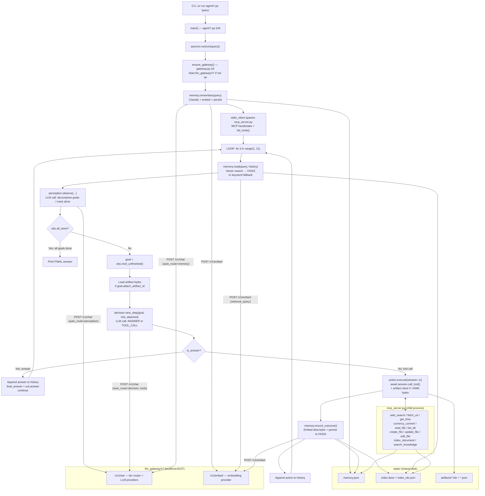

# EAG V3 Session 7 Agent — Workflow

## Overview

The Session 7 agent is a goal-decomposition LLM agent built around a typed
five-layer loop: Memory Read → Perception → Decision → Action → Memory Write.
A user query is decomposed into ordered goals by the Perception layer (one LLM
call per iteration), and the loop continues until Perception declares all goals
done, which requires Decision to have produced a substantive answer that appears
in the iteration history. Tool execution is delegated to an MCP subprocess via
a stdio JSON-RPC pipe; both the agent process and the MCP subprocess share
disk-persisted state in `state/`.

## Entry point(s)

- `agent7.py:164` — `main()` collects CLI args and calls `asyncio.run(run(query))`
- `agent7.py:60` — `run(query)` is the async coroutine containing the full loop
- `mcp_server.py:391-392` — `mcp.run(transport="stdio")` launches the MCP
  subprocess (invoked as a child process by `stdio_client`, not run directly)

## Main thread (step-by-step)

1. **Gateway boot** (`gateway.py:33-54`) — `ensure_gateway()` checks if
   `http://localhost:8107/v1/routers` is up. If not, launches
   `llm_gatewayV7/main.py` via `subprocess.Popen` and polls for up to 45
   seconds. The gateway is a FastAPI server exposing `/v1/chat` and `/v1/embed`
   across multiple LLM providers with a rate-aware failover router.

2. **Query classification into memory** (`memory.py:223`) — Before the loop
   starts, `memory.remember(query)` makes one LLM `/v1/chat` call (the
   classifier) to extract kind/descriptor/keywords from the raw query text,
   then one `/v1/embed` call to vectorize the descriptor. The resulting
   `MemoryItem` is appended to `state/memory.json` and to `state/index.faiss`.
   This means iteration 1's memory read can already return the query itself.

3. **MCP subprocess launch and tool discovery** (`agent7.py:75-84`) —
   `stdio_client` spawns `mcp_server.py` as a child process, opens a
   bidirectional stdio pipe, and runs the MCP handshake. `session.list_tools()`
   returns 11 tool descriptors which are converted to gateway-format dicts by
   `_mcp_tools_for_decision()`. These tool dicts are passed to Decision on
   every iteration.

4. **Memory read** (`memory.py:161-172`) — `memory.read(query, history)` first
   tries vector search: embeds the query via `/v1/embed` with
   `task_type="retrieval_query"`, then runs `VectorIndex.search()` over
   `state/index.faiss` (cosine similarity via inner product on L2-normalized
   vectors). If vector search returns nothing, falls back to keyword overlap
   over `state/memory.json`. Returns up to 8 `MemoryItem` records as `hits`.
   The FAISS index is reloaded from disk each call to stay consistent with
   MCP subprocess writes.

5. **Perception** (`perception.py:147-265`) — `perception.observe(query, hits,
   history, prior_goals, run_id)` makes one LLM call per iteration. On
   iteration 1 (no prior goals), the model decomposes the query into ordered
   goals. On subsequent iterations, it copies prior goal texts verbatim, marks
   goals done based on run history, and may append new goals if a discovery
   action revealed new work. A synthesis-keyword guard (`perception.py:231-242`)
   prevents a goal from being marked done unless `history` contains a matching
   `answer` event for that `goal_id` with text length > 60. Returns an
   `Observation` with a list of `Goal` objects. The agent breaks the loop if
   `obs.all_done` is True (agent7.py:102), or if no unfinished goal exists.

6. **Artifact attachment** (`agent7.py:112-116`) — For the next unfinished goal,
   if Perception set `attach_artifact_id`, the raw bytes are read from
   `state/artifacts/<hash>.bin` and added to the `attached` list. These bytes
   are passed to Decision so it can answer directly from the content without
   making another tool call.

7. **Decision** (`decision.py:158-194`) — `decision.next_step(goal, hits,
   attached, history, mcp_tools)` makes one LLM call per iteration with
   `temperature=0`. The model chooses exactly one of: (a) reply with a plain
   text answer (semantic work including summarization, comparison, extraction),
   or (b) call exactly one MCP tool. Returns `DecisionOutput`. When the result
   is an answer, the outer loop appends it to history with `kind="answer"` and
   calls `continue` — NOT `break`. Termination is still controlled by Perception
   on the next iteration.

8. **Action** (`action.py:38-79`) — Called only when Decision chose a tool call.
   `action.execute(session, tc)` first validates that no `art:...` handle was
   passed as a `path` or `url` argument, then calls `await session.call_tool()`
   over the stdio pipe. If the result exceeds 4096 bytes, the bytes are written
   to `artifacts.put()` (content-addressed by SHA256) and a short descriptor
   plus the artifact handle are returned. Otherwise the full text is returned
   directly.

9. **Memory write (tool outcome)** (`memory.py:306-349`) — `memory.record_outcome()`
   is a zero-LLM write (kind is structurally known as `tool_outcome`). Builds
   keywords from the tool name and argument tokens, computes an embedding for
   the descriptor via `/v1/embed`, writes the `MemoryItem` to `memory.json` and
   `index.faiss`. Then the outer loop appends an `action` entry to the in-memory
   `history` list (agent7.py:148-156).

10. **Loop back to step 4** — The next iteration begins. Perception re-reads
    history, can now see the tool outcome recorded in step 9, and marks the
    goal done if appropriate. The loop continues until all goals are done.

## Branches & error handling

### Gateway fails to start
`ensure_gateway()` raises `RuntimeError` after 45 seconds. Run aborts.

### Memory classifier LLM fails
`memory.remember()` catches the exception and calls `_fallback_remember()`:
naive token extraction, kind defaults to `fact`. Item is still embedded and
persisted.

### Embedding fails
`_try_embed()` returns `None`. The item is persisted to `memory.json` without
an embedding and is only reachable via keyword fallback — it never enters FAISS.

### Perception emits empty goals
Falls back to `Observation(goals=[Goal(id=new_id("g"), text=query)])` — one
umbrella goal from the original query.

### Synthesis goal done-gate fails
If `decision` produces an answer for a synthesis goal but `text` length is < 60
characters or `goal_id` does not match, Perception refuses to mark the goal
done and another iteration runs.

### Decision is_answer path (critical non-obvious branch)
When `out.is_answer` is True (agent7.py:121), the loop calls `continue`, NOT
`break`. This means the answer is appended to history and Perception on the next
iteration decides whether to close the goal. Decision can also produce an answer
for a NON-synthesis goal (e.g., "what is 2+2") — those goals have no keyword
guard and will be marked done immediately by Perception.

### Action artifact handle as path/url
`action.execute()` intercepts `art:...` values in `path`/`url` arguments and
returns a descriptive error string with `art_id=None`. The error appears in
history and Decision can correct on the next iteration.

### Tool result > 4096 bytes
`action.execute()` writes the full bytes to `state/artifacts/` and returns only
a short descriptor + artifact handle. Memory records the descriptor; Perception
can attach the full bytes to a later synthesis goal.

### Tavily monthly cap (950 calls)
`_under_cap()` checks `usage.json`. If over cap, DuckDuckGo is used instead.
DDG tries three backends in order: "auto", "html", "lite".

### Sandbox path escape
`_safe(path)` in `mcp_server.py:57-62` raises `ValueError` if the resolved path
escapes `sandbox/`.

### Goal count invariant
Perception never drops or reorders prior goals. New goals may only be appended.
Duplicate appended goals are deduplicated by lowercased text.

## Assumptions made / not traced

- The gateway's `/v1/chat` provider-level failover logic (`main.py:321-400`)
  and streaming path were not traced in detail; they are not on the agent's
  critical path (the agent never uses streaming).
- The `embedders.py` module in `llm_gatewayV7` (which builds embedding
  providers) was not traced. The agent treats `/v1/embed` as a black box that
  returns `{embedding: [...]}`.
- The `db.py` module (call logging to SQLite) in the gateway was not traced;
  it is purely observability, not on the agent's execution path.
- The `GeminiCache` in the gateway (`cache.py`) was not traced; it is an
  optimization (`cache_system=True` in Decision hints at it) not a correctness
  concern.
- Only the "happy path" (query → multiple tool calls → answer) was traced.
  Multi-turn conversation (multiple `run()` calls) reuses the same persistent
  memory, but cross-run goal state is not retained (history is in-memory only).

## Data & side effects

### State mutated during a run:
| File                        | Written by                | Content                          |
|-----------------------------|---------------------------|----------------------------------|
| `state/memory.json`         | memory.remember, record_outcome, add_fact | All MemoryItem records |
| `state/index.faiss`         | VectorIndex.persist()     | Embedded MemoryItem vectors      |
| `state/index_ids.json`      | VectorIndex.persist()     | Row→id mapping for FAISS         |
| `state/artifacts/*.bin`     | artifacts.put()           | Raw bytes of large tool results  |
| `state/artifacts/*.json`    | artifacts.put()           | Artifact metadata                |
| `usage.json`                | _bump()                   | Monthly Tavily/DDG call counts   |
| `sandbox/<files>`           | create_file/update_file   | User-requested file writes       |

### External systems touched:
- LLM Gateway V7 (`http://localhost:8107`) — all LLM and embedding calls
- Tavily API (web_search) — web search
- DuckDuckGo (web_search fallback) — web search
- frankfurter.dev (currency_convert) — live FX rates
- Target URLs via crawl4ai headless Chromium (fetch_url) — page content
- System clock (get_time)

### In-memory only (lost at process exit):
- `history: list[dict]` — the per-run iteration log
- `prior_goals: list[Goal]` — the Perception goal state for this run

## Diagram

## Open questions / gaps

- The gateway's embedding provider selection (`embedders.py`) was not traced —
  the embedding model is fixed at the gateway level and changing it invalidates
  all FAISS indices (noted in `memory.py:19-21`).
- No mechanism exists to merge memory across multiple independent agent runs
  if they used different embedding model configurations.
- `memory.clear()` wipes both `memory.json` and the FAISS index; there is no
  incremental prune or TTL-based eviction.
- `MAX_ITERATIONS = 20` is the only loop termination guarantee if Perception
  never converges to `all_done`; there is no explicit stale-goal detection.
- The `search_knowledge` tool always restricts to `kind="fact"` items — it
  cannot search `tool_outcome` items even though those are also embedded.
