# podcast-brief — Workflow

## Overview

`podcast-brief` takes a podcast URL (YouTube, direct MP3, or RSS enclosure), downloads
the audio, transcribes it with Deepgram, extracts typed research claims with Claude
Sonnet, researches those claims via an external `research_mcp` package, synthesizes a
polished markdown brief with Claude Opus, converts it to HTML, and pushes the result
to Readwise Reader. The pipeline runs in a fixed, code-determined stage order — the
sequence is never left to a model or prompt. Every stage persists its output to disk
keyed by `episode_id` so stages are independently restartable and idempotent.

## Entry points

Three surfaces all funnel into the same `process_episode()` spine:

| Entry point | File | How to invoke |
|---|---|---|
| CLI `brief` | `interface/cli.py:29` | `podcast-brief brief <url> [--profile P] [--show Name]` |
| HTTP `POST /brief` | `interface/server.py:68` | FastAPI server on port 8765, used by iOS Shortcut |
| MCP `generate_brief` | `interface/mcp_server.py:46` | MCP client call; per-stage tools also available |

Additional CLI commands: `browse` (interactive RSS episode picker), `poll` (auto-process new episodes), `recent` (list history), `check` (config health check). All share the same `main()` entry at `interface/cli.py:217`.

## Main thread (step-by-step)

The trace below follows `podcast-brief brief <url>` — the primary interactive path.

---

### Step 1 — Argument parsing and environment bootstrap (`interface/cli.py:217–268`)

`main()` builds an `argparse` parser with five subcommands and calls `args.func(args)`.
Before dispatching, it calls `ensure_dirs()` (`core/config.py:37`) which creates the
five data directories (`data/audio`, `data/transcripts`, `data/briefs`,
`data/extractions`, `data/research_items`) if they don't exist. `load_dotenv()` runs
at module import time (line 19) so env vars are in place before any module that reads
them is imported.

For the `brief` subcommand, control goes to `cmd_brief()` at `interface/cli.py:29`.

---

### Step 2 — Show resolution (`interface/cli.py:29–50`)

`cmd_brief()` attempts to match the URL to a configured show in two ways:

- If `--show "Name"` was passed: walks `load_shows()` (`core/config.py:58`) which
  reads `config/shows.yaml` and returns `ShowConfig` Pydantic objects.
- If no `--show`: calls `find_show_by_url(url)` (`core/config.py:78`) which does a
  best-effort match — YouTube channel IDs and RSS domain names are compared against
  the URL.

`ShowConfig` carries the per-show `profile` (`academic` | `current_events` | `hybrid`),
`speakers_hint`, and RSS/YouTube channel URLs. If no show is found, defaults apply:
`profile="hybrid"`, empty `speakers_hint`, `show_name="Manual entry"`.

---

### Step 3 — Pipeline dispatch (`interface/cli.py:52–63` → `core/pipeline.py:13` → `core/orchestrator.py:30`)

`cmd_brief()` calls `pipeline.run_pipeline()`. `pipeline.py` is a thin backward-compat
wrapper — it immediately calls `process_episode()` in `core/orchestrator.py`. This is
where the actual stage sequencing lives for the remainder of the run.

The orchestrator instantiates `Console(stderr=True)` so all status output goes to
stderr, keeping stdout clean for MCP JSON-RPC transport.

---

### Step 4 — Stage 1: Ingest audio (`core/orchestrator.py:54` → `core/stages.py:27` → `ingestion/ingest.py:30`)

`stage_ingest(url, show_name, profile)` calls `fetch_audio(url, title)`.

**Episode ID derivation** (`ingestion/ingest.py:20`): For YouTube URLs the 11-character
video ID is extracted by regex and prefixed `yt_`. For all other URLs an MD5 hash of
the URL is taken and prefixed `ep_`. This is the stable key used for all downstream
file names and DB records.

**Cache check** (`ingestion/ingest.py:37`): If `data/audio/<episode_id>.mp3` already
exists and is larger than 1 KB, the download is skipped.

**Download strategy** (`ingestion/ingest.py:45–49`): If the URL path ends in a known
audio extension (`.mp3`, `.m4a`, `.ogg`, `.wav`, `.aac`), a direct streaming HTTP
download via `requests` is used (`_download_direct`). Everything else — YouTube, most
podcast hosts — goes through `yt-dlp` as a subprocess (`_download_ytdlp`), with a
900-second timeout.

**Dedup check** (`core/stages.py:44`): `state.episode_exists(episode_id)` queries the
SQLite DB at `data/state.db` for a `completed` row. If found, `IngestResult` is
returned with `already_processed=True` and the orchestrator exits immediately at
`core/orchestrator.py:62` with `{"skipped": True}` — nothing is reprocessed.

If the episode is new, a DB row is created via `state.create_episode()` with status
`pending`, and `stage_ingest` returns the `IngestResult`.

---

### Step 5 — Stage 2: Transcribe (`core/orchestrator.py:70` → `core/stages.py:66` → `transcription/transcribe.py:16`)

`stage_transcribe(episode_id, speakers_hint)` is called.

**Cache check** (`transcription/transcribe.py:30`): If `data/transcripts/<id>.json`
exists, it is loaded and returned immediately without calling Deepgram. This makes
re-running the pipeline after a crash cheap.

**Deepgram call** (`transcription/transcribe.py:44`): The full audio file is read into
memory and sent to Deepgram Nova-3 via the `deepgram-sdk`. Options set: diarization
(`diarize=True`), punctuation, utterances, smart formatting, no filler words. Timeout
is 600 seconds. The response is parsed by `_parse_deepgram()` into a `Transcript`
(list of `Segment` objects with `speaker`, `start`, `end`, `text`).

**Fallback parsing** (`transcription/transcribe.py:88`): If Deepgram returns no
utterances (rare), the parser falls back to reading the raw channel alternative
transcript as a single segment attributed to "Speaker 0".

**Speaker name resolution** (side quest, `transcription/transcribe.py:108`): If a
`speakers_hint` is provided and the transcript has 2+ distinct speakers, the first 30
segments are sampled and sent to Claude Haiku (via `core/llm.call_anthropic`) with a
prompt asking for a JSON mapping of "Speaker N" labels to real names. The mapping is
applied in place. This call is best-effort — failure is caught and logged, the generic
labels are kept. Returns to main thread: `transcript.segments` now have real names if
available; the `Transcript` object is saved to `data/transcripts/<id>.json`.

---

### Step 6 — Transcript-only branch (`core/orchestrator.py:85`)

If `--transcript-only` was passed, execution skips stages 3–5 entirely. `stage_deliver`
is called with `transcript_only=True`: the transcript is converted to HTML by
`summarisation/format.transcript_to_html()` (grouped speaker blocks), written to
`data/briefs/<id>_transcript.html`, and pushed to Readwise Reader with tags
`["podcast", "transcript", "podcast/<slug>"]`. The episode is marked `completed` and
the function returns. **Steps 7–10 below are only reached in the full-brief path.**

---

### Step 7 — Stage 3: Extract claims (`core/orchestrator.py:109` → `core/stages.py:94` → `extraction/extract.py:37`)

`stage_extract(episode_id)` loads the `Transcript` from disk, then calls
`extract_claims(tr, profile, show_name)`.

**Claim types by profile** (`extraction/extract.py:13`):
- `academic`: paper_reference, statistic, model_or_method, prediction
- `current_events`: political, statistic, historical, prediction
- `hybrid`: paper_reference, book_reference, historical, statistic, prediction, political

A single Claude Sonnet call is made (max 8000 tokens, `core/llm.call_anthropic`). The
prompt contains the full transcript (up to 150,000 characters; `Transcript.to_prompt_format`
truncates by keeping 60% start and 20% end with a notice if exceeded), the eligible
claim types, and an instruction to return a single JSON object containing `episode_description`
and a `claims` array.

Each claim has: `type`, `speaker`, `timestamp`, `quote` (verbatim), `summary`,
`search_query`. The response is parsed by `_parse_json_response()` which strips
markdown fences and falls back to a regex search for the JSON object.

The `ExtractionResult` is saved to `data/extractions/<id>.json` and `ExtractResult`
is returned to the orchestrator.

---

### Step 8 — Stage 4: Research claims (`core/orchestrator.py:121` → `core/stages.py:131` → `research/mcp_bridge.py:97`)

**This stage is skipped if `--skip-research` is passed.** If skipped, the orchestrator
prints a warning and moves straight to Step 9.

`stage_research(episode_id)` loads the `ExtractionResult` from disk and calls
`research_claims_via_mcp(extraction.claims)`.

**Asyncio isolation** (`research/mcp_bridge.py:97`): The bridge wraps the async
`_run_research()` coroutine in `asyncio.run()` submitted to a `ThreadPoolExecutor(max_workers=1)`.
This ensures a fresh event loop is always used, which is safe whether called from the
synchronous CLI or from FastMCP's event-loop-occupied tool dispatch.

**External dependency** (`research/mcp_bridge.py:23–53`): `_run_research()` imports
from an external `research_mcp` package (not listed in `pyproject.toml` — must be
installed separately). It instantiates clients for Semantic Scholar, arXiv, Wikipedia,
optionally Brave News (requires `BRAVE_API_KEY`) and Google Books (requires
`GOOGLE_BOOKS_API_KEY`). It calls `run_verify_presplit()` from the `research_mcp.engine`,
passing claim summaries. Results come back as `surfaced` items with triage verdicts
(`correctness`, `effort`, `confidence`, `rationale`) and `logical_sources`.

The bridge maps each result back to the originating `Claim` object and wraps them as
`SurfacedItemWithClaim` objects. Results are saved to `data/research_items/<id>.json`.

**Failure handling** (`core/orchestrator.py:137`): Research failure is the only stage
that does not raise — the exception is caught, a warning is printed, and the pipeline
continues without research data. All other stage failures propagate and mark the episode
`error`.

---

### Step 9 — Stage 5: Synthesize brief (`core/orchestrator.py:143` → `core/stages.py:165` → `summarisation/synthesize.py:13`)

`stage_synthesize(episode_id)` loads `Transcript`, `ExtractionResult`, and (if present)
`SurfacedItemWithClaim` items from disk. It reads `speakers_hint` from `shows.yaml` by
matching `show_name` from the DB record.

**Profile prompt** (`core/config.py:90`): The synthesis system prompt is loaded from
`config/prompts/<profile>.md` (falling back to `hybrid.md`). These Markdown files
define the structure and rigor requirements for the brief.

**Claude Opus call** (`summarisation/synthesize.py:52`): A single call to
`claude-opus-4-5` with `max_tokens=8000`. The user message bundles: show name,
speakers, episode description, all research findings formatted by
`_format_research_mcp()` (includes triage verdicts, sources with excerpts, essay
paths), and the full transcript (up to 170,000 characters). The model produces the
final markdown brief.

The markdown is written to `data/briefs/<id>.md`. `SynthesizeResult` with `char_count`
is returned to the orchestrator.

---

### Step 10 — Stage 6: Deliver to Readwise Reader (`core/orchestrator.py:157` → `core/stages.py:219` → `delivery/deliver.py:14`)

`stage_deliver(episode_id, transcript_only=False)` loads the markdown from
`data/briefs/<id>.md` and the `episode_description` from `data/extractions/<id>.json`.

**HTML conversion** (`summarisation/format.py:11`): `brief_to_html()` runs
`markdown.markdown()` with the `extra`, `sane_lists`, and `smarty` extensions, wraps
the result in a full HTML document with a header (show name, profile, generation
timestamp, source URL link). Written to `data/briefs/<id>.html`.

**Readwise Reader API call** (`delivery/deliver.py:14`): A `POST` to
`https://readwise.io/api/v3/save/` with the HTML body, title `"[mic] <title>"`, the
original audio URL as `source_url`, author as the show name, tags
`["podcast", "podcast/<slug>", "profile/<profile>"]`, and the `episode_description`
as `summary` (truncated to 500 chars). The API returns an `id` and `url`
(`read.readwise.io/...`).

`state.mark_completed(episode_id, reader_url, brief_path)` writes `completed` status
and `completed_at` to the DB. The orchestrator prints the Reader URL and returns a
summary dict.

---

## Branches and error handling

| Decision point | Condition | Path taken |
|---|---|---|
| Audio already cached | `data/audio/<id>.mp3` exists and > 1 KB | Skip download, reuse file |
| Episode already processed | `state.episode_exists()` returns `completed` in DB | Return `{"skipped": True}` immediately |
| URL type detection | Path ends in audio extension | `_download_direct` (requests); else `_download_ytdlp` (subprocess) |
| Speaker resolution | `speakers_hint` non-empty AND 2+ speakers | One Claude Haiku call; failure is silent best-effort |
| Transcript cached | `data/transcripts/<id>.json` exists (and `force=False`) | Skip Deepgram, load from disk |
| `--transcript-only` | Flag set by caller | Skip extract/research/synthesize; deliver raw transcript and exit |
| `--skip-research` | Flag set by caller | Skip `stage_research` entirely; synthesize without research findings |
| Research failure | `stage_research` raises | Warn and continue — synthesis runs with `surfaced_items=[]` |
| Research data absent at synthesize time | `data/research_items/<id>.json` missing | `synthesize()` gets empty list; brief notes "no external research" |
| Deepgram returns no utterances | `utterances` list is empty | Falls back to full channel transcript as single Speaker 0 segment |
| RSS yields no candidates in poll | `candidates` empty after RSS loop | Falls back to YouTube channel listing via yt-dlp |
| Any non-research stage fails | Exception raised | `state.mark_failed(episode_id, error)`, `state.log_run(..., "failed")`, exception re-raised to CLI |

## Data and side effects

### Files written to disk

| Path | Stage that writes it | Content |
|---|---|---|
| `data/audio/<id>.mp3` | Ingest | Downloaded audio |
| `data/transcripts/<id>.json` | Transcribe | `Transcript` model (segments, speakers, full_text) |
| `data/extractions/<id>.json` | Extract | `ExtractionResult` (claims, episode_description) |
| `data/research_items/<id>.json` | Research | List of `SurfacedItemWithClaim` (verdicts + sources) |
| `data/briefs/<id>.md` | Synthesize | Raw markdown brief |
| `data/briefs/<id>.html` | Deliver (full brief) | HTML version for Reader |
| `data/briefs/<id>_transcript.html` | Deliver (transcript-only) | HTML transcript for Reader |

### SQLite state (`data/state.db`)

Two tables: `episodes` (one row per episode: id, show_name, title, source_url, status,
reader_url, brief_path, research_run_id, timestamps) and `runs` (one row per stage
execution: episode_id, stage, status, message, started_at). Used for dedup, history
display, and per-stage status gating in MCP tool chains.

### External API calls

| Service | When | Auth |
|---|---|---|
| yt-dlp (subprocess) | Ingest — YouTube/podcast-host URLs | None |
| Deepgram Nova-3 | Transcribe | `DEEPGRAM_API_KEY` |
| Anthropic (Haiku) | Speaker name resolution (best-effort) | `ANTHROPIC_API_KEY` |
| Anthropic (Sonnet) | Extract claims | `ANTHROPIC_API_KEY` |
| `research_mcp` sources | Research (Semantic Scholar, arXiv, Wikipedia, optionally Brave, Google Books) | `BRAVE_API_KEY`, `GOOGLE_BOOKS_API_KEY` (optional) |
| Anthropic (Opus) | Synthesize brief | `ANTHROPIC_API_KEY` |
| Readwise Reader API v3 | Deliver | `READWISE_TOKEN` |

## LLM model assignments

All Anthropic calls route through `core/llm.call_anthropic()` (`core/llm.py:28`) which
applies tenacity retry logic: retries on `RateLimitError`, `InternalServerError`, and
`APIConnectionError` with exponential backoff (4s initial, 60s max, 5 attempts).

| Model | Configured name | Used in |
|---|---|---|
| `claude-haiku-4-5` | `MODEL_LIGHT` | Speaker name resolution (optional, best-effort) |
| `claude-sonnet-4-5` | `MODEL_EXTRACT` | Claim extraction (structured JSON output) |
| `claude-opus-4-5` | `MODEL_SYNTHESIS` | Final brief synthesis (quality-critical) |

## MCP and HTTP interfaces

Both are thin wrappers over the same stage functions:

**FastAPI HTTP server** (`interface/server.py`): `POST /brief` accepts `{url, profile, transcript_only, skip_research}`,
optionally checks `PODCAST_BRIEF_API_TOKEN`, then runs the pipeline in a FastAPI
`BackgroundTask` (fire and forget — returns `{"status": "queued"}` immediately). The
MCP server is mounted at `/mcp` using Streamable HTTP transport.

**MCP server** (`interface/mcp_server.py`): Exposes `generate_brief` (full pipeline)
and six per-stage tools (`ingest_audio`, `transcribe_episode`, `extract_claims`,
`research_claims`, `synthesize_brief`, `deliver_brief`) that call the matching
`stage_*` function directly. Also exposes `get_episode_status`, `list_recent_episodes`,
`list_shows`, `poll_shows`, `check_config`, and the `brief://{episode_id}` resource
for reading the raw markdown without bloating tool responses. The MCP server console
uses `stderr=True` so stdout stays clean for JSON-RPC.

## Assumptions made / not traced

- **`research_mcp` internals not traced.** The `run_verify_presplit()` engine, triage
  logic, and per-source clients live in a separate `research_mcp` package that is not
  part of this repository and not listed in `pyproject.toml`. The bridge in
  `research/mcp_bridge.py` is fully traced; what happens inside `research_mcp` is
  treated as a black box here.
- **`research/academic.py`, `research/news.py`, `research/books.py` are legacy.** None
  of these three files are imported anywhere in the live codebase. They appear to be
  an earlier generation of the research stage, superseded by the `research_mcp` bridge.
  They are not on the active execution path.
- **`scripts/index_transcript.py` not traced.** This standalone script is not called
  by any live path — it appears to be a utility for manually indexing transcripts
  into an external system.
- **Cron/LaunchAgent scheduling not configured in code.** `poll_all_shows()` is
  documented as intended for a cron schedule but no scheduling configuration lives in
  this repo.
- **`--force` flag on transcription exists but is not exposed via CLI.** `stage_transcribe`
  accepts a `force` parameter to bypass the transcript cache, but `cmd_brief` always
  passes `force=False` (default). The MCP `transcribe_episode` tool also does not
  expose it.

## Open questions / gaps

- `research_mcp` must be installed separately. Its package name, source, and install
  instructions are not documented in this repo's `pyproject.toml` or `README.md`.
  Without it, the research stage will raise on import and the pipeline will warn and
  continue, but no claim research will happen.
- `PODCAST_BRIEF_API_TOKEN` is optional: if the env var is unset, the HTTP server
  accepts all requests without authentication.
- The `--force` flag to reprocess an already-completed episode is referenced in
  orchestrator output (`"Use --force to redo"`) but is not implemented as a CLI
  argument on `brief` or `browse`.

## Diagram

```mermaid
flowchart TD
    A["CLI: podcast-brief brief URL\ninterface/cli.py:29"]
    B["CLI: podcast-brief browse\ninterface/cli.py:72"]
    C["HTTP: POST /brief\ninterface/server.py:68"]
    D["MCP: generate_brief\ninterface/mcp_server.py:46"]

    A --> E["Show resolution\nconfig/shows.yaml"]
    B --> E
    C --> E
    D --> E

    E --> F["pipeline.run_pipeline()\ncore/pipeline.py:13"]
    F --> G["process_episode()\ncore/orchestrator.py:30"]

    G --> H["state.init_db()\ndata/state.db created"]
    H --> I["stage_ingest()\ncore/stages.py:27"]

    I --> I1["make_episode_id(url)\ningestion/ingest.py:20"]
    I1 --> I2{Audio cached?}
    I2 -- Yes --> I3["Skip download"]
    I2 -- No --> I4{URL type?}
    I4 -- audio ext --> I5["_download_direct()\nrequests stream"]
    I4 -- other --> I6["_download_ytdlp()\nyt-dlp subprocess"]
    I3 & I5 & I6 --> I7{episode_exists in DB\nstatus=completed?}
    I7 -- Yes --> Z["Return skipped=True"]
    I7 -- No --> I8["state.create_episode()\nstatus=pending"]

    I8 --> J["stage_transcribe()\ncore/stages.py:66"]
    J --> J1{Transcript JSON\ncached?}
    J1 -- Yes --> J3["Load from disk"]
    J1 -- No --> J2["Deepgram Nova-3\ntranscription/transcribe.py:44"]
    J2 --> J4{speakers_hint\nand 2+ speakers?}
    J4 -- Yes --> J5["Claude Haiku\nspeaker resolution\nbest-effort"]
    J4 -- No --> J6["Keep generic labels"]
    J5 & J6 --> J7["Save transcript JSON\ndata/transcripts/"]
    J3 --> J7

    J7 --> K{transcript_only?}
    K -- Yes --> K1["stage_deliver transcript_only=True\nformat.transcript_to_html\nReadwise API POST"]
    K1 --> Z2["mark_completed\nReturn reader_url"]

    K -- No --> L["stage_extract()\ncore/stages.py:94"]
    L --> L1["Claude Sonnet\nextract_claims()\nextraction/extract.py:37"]
    L1 --> L2["Save ExtractionResult JSON\ndata/extractions/"]

    L2 --> M{skip_research?}
    M -- Yes --> N
    M -- No --> M2["stage_research()\ncore/stages.py:131"]
    M2 --> M3["research_claims_via_mcp()\nresearch/mcp_bridge.py:97"]
    M3 --> M4["ThreadPoolExecutor\nasyncio.run isolation"]
    M4 --> M5["research_mcp engine\nSemScholar / arXiv / Wiki\n+ optional Brave / GBooks"]
    M5 --> M6["Save SurfacedItems JSON\ndata/research_items/"]
    M6 --> N
    M5 -- Exception --> M7["Warn, continue\nno research data"]
    M7 --> N

    N["stage_synthesize()\ncore/stages.py:165"]
    N --> N1["Load transcript +\nextraction + research\nfrom disk"]
    N1 --> N2["Load profile prompt\nconfig/prompts/profile.md"]
    N2 --> N3["Claude Opus\nsynthesize()\nsummarisation/synthesize.py:13"]
    N3 --> N4["Save brief markdown\ndata/briefs/id.md"]

    N4 --> O["stage_deliver()\ncore/stages.py:219"]
    O --> O1["Load markdown\nformat.brief_to_html()\nsummarisation/format.py:11"]
    O1 --> O2["Save HTML\ndata/briefs/id.html"]
    O2 --> O3["POST readwise.io/api/v3/save/\ndelivery/deliver.py:14"]
    O3 --> O4["state.mark_completed()\nStore reader_url in DB"]
    O4 --> P["Return summary dict\nepisode_id, title,\nreader_url, brief_path"]
```

