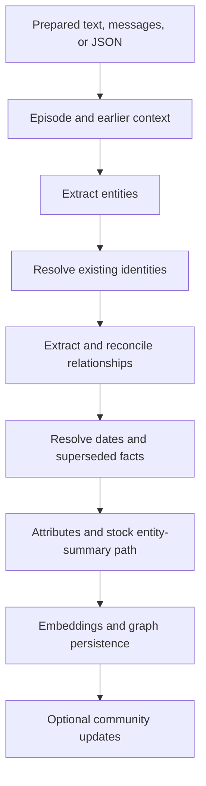
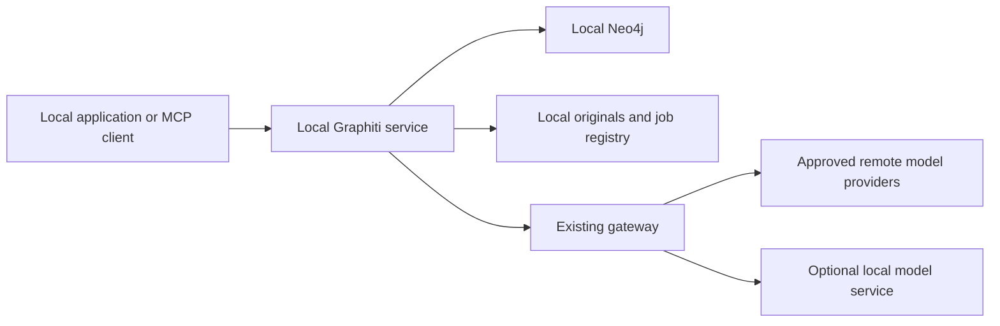

# Graphiti — Capabilities and Local Deployment Reference

Research date: 16 October 2026  
Purpose: consolidate the capabilities discussed in this conversation, the official Graphiti guides, relevant implementation details, and Aryaman’s requirements into one reusable reference.  
Status: research and proposed integration design. This document does not install, configure, or certify a running deployment.

## Contents

- [1. What we are choosing](#1-what-we-are-choosing)
- [2. Requirements agreed in the conversation](#2-requirements-agreed-in-the-conversation)
- [3. Data model and terminology](#3-data-model-and-terminology)
- [4. Input capabilities and preparation](#4-input-capabilities-and-preparation)
- [5. How text becomes triplets](#5-how-text-becomes-triplets)
- [6. Built-in processing flow](#6-built-in-processing-flow)
- [7. Temporal history and changing facts](#7-temporal-history-and-changing-facts)
- [8. Models, endpoints, and configuration](#8-models-endpoints-and-configuration)
- [9. Gateway-only access and local network boundaries](#9-gateway-only-access-and-local-network-boundaries)
- [10. Tracking calls, usage, and processing](#10-tracking-calls-usage-and-processing)
- [11. Concurrency, queues, retries, and bulk processing](#11-concurrency-queues-retries-and-bulk-processing)
- [12. Retrieval capabilities](#12-retrieval-capabilities)
- [13. Relationship to the existing vector store](#13-relationship-to-the-existing-vector-store)
- [14. Ontology now and later](#14-ontology-now-and-later)
- [15. Namespaces and graph organization](#15-namespaces-and-graph-organization)
- [16. Summarization: capability and current prohibition](#16-summarization-capability-and-current-prohibition)
- [17. Source preservation and provenance](#17-source-preservation-and-provenance)
- [18. CRUD, manual editing, and maintenance](#18-crud-manual-editing-and-maintenance)
- [19. Local MCP server](#19-local-mcp-server)
- [20. Python, REST, and agent integrations](#20-python-rest-and-agent-integrations)
- [21. Storage backends and operational dependencies](#21-storage-backends-and-operational-dependencies)
- [22. Graphiti, Zep, and GraphRAG](#22-graphiti-zep-and-graphrag)
- [23. Initial configuration contract](#23-initial-configuration-contract)
- [24. Verification before relying on the graph](#24-verification-before-relying-on-the-graph)
- [25. Deferred decisions and later investigations](#25-deferred-decisions-and-later-investigations)
- [26. Corrections and limits carried forward](#26-corrections-and-limits-carried-forward)
- [27. Source map and relationship to existing project documentation](#27-source-map-and-relationship-to-existing-project-documentation)

## 1. What we are choosing

Graphiti is an open-source Python framework for constructing and querying temporal knowledge graphs. It uses models to derive entities and relationships from supplied data, maintains connections to source episodes, and offers retrieval over the resulting graph. Neo4j supplies persistent graph storage; Graphiti supplies the knowledge-processing logic. [Official overview](https://help.getzep.com/graphiti/getting-started/overview)

The intended arrangement for this project is:

- Run Graphiti, its optional MCP interface, and Neo4j locally.
- Let Graphiti handle generic extraction, entity resolution, fact reconciliation, and graph retrieval.
- Route all remote model access through the existing gateway, using Aryaman’s provider credentials held by that gateway.
- Preserve original source material and submitted episode content locally.
- Start without designing a comprehensive custom ontology.
- Run no community, saga, or entity summarization for now. Entity summarization requires additional integration work; it is not solved merely by leaving communities disabled.
- Revisit detailed ontology, graph organization, and advanced summarization later.

These are user requirements and integration decisions, not claims about Graphiti defaults.

### Evidence labels used in this document

| Label | Meaning |
| --- | --- |
| Built in | Described by official guides or visible in inspected source. |
| Configurable | Available through settings, injected clients, or supported APIs. |
| Integration work | Something our application or deployment must implement. |
| Deferred | A capability to document but leave unused initially. |
| Verify on pinned version | Behavior depends on the actual package, backend, or API path installed. |

### Version boundary

The release page showed **v0.31.1** as the latest release on the research date. The preceding release introduced changes including the default OpenAI model and an opt-in model-routing runtime. Official guides, tagged files, and `main` can differ; retrieved source pages can also have different crawl dates. This reference uses guides for supported concepts and implementation files for details, without assuming every `main` detail is present in every release. [Release history](https://github.com/getzep/graphiti/releases)

Before implementation, record the exact Graphiti package version, source commit, MCP version, Neo4j version, and model IDs. Recheck the critical paths against those exact versions.

## 2. Requirements agreed in the conversation

| Requirement | What it means in practice | Status |
| --- | --- | --- |
| Local graph | Persist Graphiti data in Aryaman’s local Neo4j. | Supported; configuration required. |
| Local processing service | Graphiti orchestration executes on the local machine. | Supported. |
| Local MCP | Use a local process or local HTTP endpoint. | Supported; binding must be checked. |
| Gateway-only model traffic | No direct provider calls from Graphiti, including embeddings and optional ranking. | Client integration and network enforcement required. |
| Only approved data egress | Data may leave through authorized model calls via the gateway; no unrelated runtime egress. | Disable telemetry and verify the complete runtime. |
| Call visibility | Inspect calls, errors, latency, usage, and their associated ingestion job. | Gateway logging plus correlation integration. |
| Delegate processing | Supply prepared source data and let Graphiti derive the graph. | Built in. |
| Delegate retrieval | Use Graphiti search rather than recreate its graph retrieval machinery. | Built in; application result handling remains. |
| Defer ontology | Begin with generic extracted entities and relationships. | Supported. |
| No summarization | Prevent all summary-producing paths, including entity summary condensation. | Explicit integration requirement. |
| No source loss | Keep original files and complete submitted text independently of extracted facts. | Preservation architecture required. |
| Deeper graph-management review later | Start with existing graph APIs and namespaces, retain ability to inspect and revise. | Deferred review. |

“Runs locally” describes service location. An authorized gateway request to a remote model still sends its payload to that provider. Fully offline inference would require local models for every model-dependent stage as well.

## 3. Data model and terminology

| Object | Role | Example |
| --- | --- | --- |
| Entity node | A person, organization, product, project, concept, or other extracted thing. | Aryaman, AI OS, Neo4j. |
| Entity edge | A relationship with a fact sentence and supporting metadata. | AI OS uses Neo4j. |
| Episode node | A submitted input and its source/time information. | One conversation, note section, or JSON record. |
| Episodic connection | Connects an episode to entities it mentions. | This note mentioned AI OS. |
| Community node | A group of related entities with synthesized information. | A cluster concerning a project. |
| Saga node | Groups a sequence of related episodes. | A continuing project history. |
| `group_id` | Namespace used to organize and scope graph data. | A user or project namespace. |
| Embedding | Numerical representation used for similarity retrieval. | A vector for a fact sentence. |
| Ontology | Entity/relationship types and their attributes. | Person, Project, WORKS_ON. |

The implementation includes entity, episode, community, and saga node classes, along with entity, episodic, community, saga membership, and episode sequence edges. [CRUD guide](https://help.getzep.com/graphiti/working-with-data/crud-operations)

Graphiti’s internal graph schema is its own. A conceptual relationship such as `USES_DATABASE` should not be assumed to become a Neo4j relationship label of that exact name: the inspected entity-edge implementation persists generic `RELATES_TO` edges with the relationship name as a property. Existing custom graph consumers need an adapter or migration. [Edge persistence](https://github.com/getzep/graphiti/blob/main/graphiti_core/edges.py)

## 4. Input capabilities and preparation

Graphiti accepts three documented episode formats:

| Format | Appropriate input |
| --- | --- |
| `text` | Unstructured prose, prepared articles, notes, transcripts. |
| `message` | Conversations using speaker/role-prefixed message text. |
| `json` | Structured data serialized as a JSON string. |

An episode carries its body, name, source description, source type, and reference time. JSON can be nested, but inputs must remain within model limits. Single episodes and bulk episode loading are available. Episodes provide the provenance boundary for extracted knowledge. [Adding episodes](https://help.getzep.com/graphiti/core-concepts/adding-episodes)

### Work that remains outside Graphiti

Our ingestion system still needs to:

1. Discover or receive files and records.
2. Save the original input before transformation.
3. Parse formats such as PDF, HTML, email, or office documents.
4. Perform OCR or audio transcription where necessary.
5. Split large content while keeping section/page/time offsets.
6. Assign stable source and version identifiers.
7. Submit prepared content and track processing status.

These are integration responsibilities. The fact that Graphiti accepts text does not mean it contains an end-to-end parser for every source format.

### Choosing an episode boundary

A whole document supplies broad context but coarse provenance and larger model requests. A small chunk gives precise source links but can separate a statement from its explanation. A section often offers a useful compromise. This is a decision to test on the project’s diverse inputs rather than settle through one universal size.

Keep a mapping from each episode UUID to the original source version and exact text range. Overlap between chunks should be recorded so duplicate extraction can be understood.

## 5. How text becomes triplets

You do **not** need to extract triplets before calling Graphiti. It supplies extraction prompts and schemas, obtains structured model output, and translates that output into graph objects.

Illustrative input:

> On 10 October, Aryaman moved the podcast assistant from SQLite to Neo4j.

Possible derived relationships include:

```text
Podcast assistant → PREVIOUSLY_USED → SQLite
Podcast assistant → USES → Neo4j
Aryaman → WORKS_ON → Podcast assistant
```

These are illustrative outputs, not guaranteed extraction results. An extractor should distinguish explicit source statements from inferred relationships.

The node prompts identify entities and classify them where types are supplied. Relationship prompts describe links among entities, extract fact text, and request temporal information. Source text, reference times, and relevant earlier context may be included in prompts. [Node prompts](https://github.com/getzep/graphiti/blob/main/graphiti_core/prompts/extract_nodes.py), [relationship prompts](https://github.com/getzep/graphiti/blob/main/graphiti_core/prompts/extract_edges.py)

Structured output helps make responses machine-readable. It does not establish factual correctness, completeness, correct identity, or correct dates.

The inspected client also adds language instructions intended to preserve the language of extracted information. This is prompt behavior, not proof of equal extraction quality across languages. For mixed Hindi/English or other multilingual inputs, evaluate entity matching, transliteration, and retrieval using the selected extraction and embedding models. [Language instruction](https://github.com/getzep/graphiti/blob/main/graphiti_core/llm_client/client.py)

### Manual facts are also supported

`add_triplet` accepts source and target entities plus an edge. It attempts to deduplicate them against existing graph objects. This is useful for known structured relationships. Bypassing text extraction does not imply the complete operation is free of embeddings or model-assisted reconciliation. [Adding fact triples](https://help.getzep.com/graphiti/working-with-data/adding-fact-triples)

## 6. Built-in processing flow

The following explains the normal ingestion responsibilities. Bulk and combined-extraction paths can arrange the work differently.



The public ingestion path coordinates extraction, resolution, embeddings, invalidation, persistence, and optional community updates. `previous_episode_uuids` can select earlier context, and `custom_extraction_instructions` can guide extraction. Ingestion returns graph objects that allow the application to retain resulting UUIDs. [Episode processing](https://github.com/getzep/graphiti/blob/v0.31.1/graphiti_core/graphiti.py)

For our deployment, the stock summary path in this diagram must be changed or bypassed deliberately; it is shown to make the default processing boundary visible.

### Entity resolution

The inspected node operations gather candidate matches through exact names and semantic lookup, with optional identity-property support at an internal interface. Unresolved matches can be sent to an LLM for deduplication. Attribute extraction and summary maintenance are separate operations. [Node operations](https://github.com/getzep/graphiti/blob/main/graphiti_core/utils/maintenance/node_operations.py)

Consequences for this project:

- Similar names are not reliable identifiers.
- A merge can incorrectly combine distinct entities; a missed merge can split one entity.
- Stable external identifiers should remain in our source registry even while ontology work is deferred.
- Internal identity hooks are not evidence that a turnkey CIN/ISIN resolver is available through every public API.
- Keep source inputs so resolution decisions can be revisited by rebuilding a derived graph.

### Relationship reconciliation

The edge pipeline handles candidate duplicates, dates, and contradictory relationships. The inspected code applies chronology when deciding which edge becomes invalid and can extract missing temporal bounds with a lightweight model call. Some timestamp extraction failures are logged rather than causing the whole ingestion to fail. A successful job therefore does not prove every edge has complete time metadata. [Edge operations](https://github.com/getzep/graphiti/blob/v0.31.1/graphiti_core/utils/maintenance/edge_operations.py)

## 7. Temporal history and changing facts

Graphiti’s model distinguishes when a relationship applied from when the system recorded or retired it.

| Field | Interpretation |
| --- | --- |
| `valid_at` | Start of real-world validity, when known. |
| `invalid_at` | End of real-world validity, when known. |
| `created_at` | When the graph fact was recorded. |
| `expired_at` | When the system marked it superseded/expired. |

Invalidation retains an edge for historical retrieval rather than simply deleting it. These fields support questions about present state and historical validity. [Temporal overview](https://help.getzep.com/graphiti/getting-started/overview), [edge fields](https://github.com/getzep/graphiti/blob/main/graphiti_core/edges.py)

Example: a note received in October reports a database migration that happened in August. The event time is August; the ingestion time is October. Those dates should remain distinguishable.

### Practical limits

Our interpretation must remain “the source says this,” especially for opinions, forecasts, disputed statements, and hypotheticals. The graph is not an independent truth oracle. Temporal machinery can preserve and reconcile extracted assertions without making those assertions true.

Before relying on historical answers, test out-of-order arrivals, unknown dates, explicit end dates, overlapping roles, multiple simultaneous relationships, future plans, and corrections. A statement about a possible future migration should not automatically retire the current database choice.

Bi-temporal fields also do not automatically provide a full immutable event log of every database mutation. If every change must be auditable, add an application change ledger and backups.

## 8. Models, endpoints, and configuration

There are three independent model-related responsibilities:

| Responsibility | Input sent to the model | Initial direction |
| --- | --- | --- |
| Extraction/reconciliation | Source text, context, entities, candidate facts, schemas. | Explicit model through gateway. |
| Embeddings | Entity names, facts, and search queries as required by the path. | Gateway endpoint or approved local inference. |
| Cross-encoder ranking | Query plus retrieved candidates. | Leave model-based reranking unused initially. |

The stock constructor creates OpenAI extraction, embedding, and reranker clients when those components are not supplied. It also supports injected clients, raw episode retention, concurrency controls, and tracing. Omitting a component is therefore not a safe way to disable its remote capability. [Constructor](https://github.com/getzep/graphiti/blob/main/graphiti_core/graphiti.py)

### Default model versus selected model

The inspected native OpenAI client defaults to `gpt-6-luna` for both ordinary and small-model selections. The generic compatible client has a different fallback, `gpt-4.1-mini`. The OpenAI embedder defaults to `text-embedding-3-small`. These are observations about particular clients, not recommended choices for this project. Configure every model explicitly and record the effective model returned by the gateway. [Native defaults](https://github.com/getzep/graphiti/blob/main/graphiti_core/llm_client/openai_base_client.py), [generic client](https://github.com/getzep/graphiti/blob/v0.31.1/graphiti_core/llm_client/openai_generic_client.py), [embedder](https://github.com/getzep/graphiti/blob/v0.31.1/graphiti_core/embedder/openai.py)

### Provider choices

Official configuration covers OpenAI, Azure OpenAI, Anthropic, Gemini, Groq, and compatible endpoints including local Ollama. Provider compatibility must include the structured response behavior needed by the selected client. Smaller/local models may produce malformed or unsuitable output. [Provider configuration](https://help.getzep.com/graphiti/configuration/llm-configuration)

An API key identifies and authorizes the client. The endpoint determines where the request goes. Using your key does not by itself enforce your gateway boundary.

### Gateway compatibility

The generic client targets Chat Completions-compatible endpoints and supports `json_schema` or `json_object` responses. In JSON-object mode it puts the expected schema into the prompt. Its schema request does not universally enforce a strict subset on every provider. The native OpenAI client also uses the Responses parsing API for structured completions. We must match the adapter to the gateway’s actual contract rather than assume every OpenAI-shaped client uses the same endpoint. [Generic implementation](https://github.com/getzep/graphiti/blob/v0.31.1/graphiti_core/llm_client/openai_generic_client.py), [native implementation](https://github.com/getzep/graphiti/blob/main/graphiti_core/llm_client/openai_client.py)

This research did not audit the existing gateway’s endpoints. If they differ, inject a Graphiti-compatible adapter instead of adding a bypass to providers.

### Advanced routing and local extraction options

The opt-in `LLMRuntime` supports named model bindings, provider transports, and routes for individual prompt operations. Unrouted prompts use a default model. It cannot be supplied alongside the legacy `llm_client` or separate `prompt_library`; smaller-model selection on the runtime path must be expressed through routes. This is optional and can wait while the gateway remains the central policy layer. [Runtime specification](https://github.com/getzep/graphiti/blob/main/spec/llm-runtime.md)

An inspected GLiNER2 client can perform entity extraction locally, delegating other operations to a required general-purpose client. It is not a replacement for all relationship, deduplication, and other model work. Its pretrained weights must be provisioned deliberately for an offline runtime. Availability must be checked on the chosen package version. [GLiNER2 client](https://github.com/getzep/graphiti/blob/main/graphiti_core/llm_client/gliner2_client.py)

The release notes additionally mention Jev and OpenAI Decisions clients for deduplication. Their presence is a version-specific extension to investigate later, not a dependency of this initial design. [Release notes](https://github.com/getzep/graphiti/releases)

## 9. Gateway-only access and local network boundaries

This section is a proposed architecture for Aryaman’s requirement.



The remote boundary is crossed only by the gateway’s approved provider requests. The diagram does not claim this restriction has already been implemented.

### Enforceable integration rules

1. Keep remote provider secrets in the gateway; give Graphiti only a scoped gateway credential.
2. Explicitly inject every model-dependent component. Cover extraction, embeddings, optional ranking, alternative deduplication clients, and fallback paths.
3. Deny direct external traffic from the Graphiti runtime. Allow its local database and gateway destinations only.
4. Use no direct-provider fallback when the gateway is unavailable. The operation must fail visibly or remain queued.
5. Keep local database, HTTP, and administrative listeners private; use loopback bindings for host-facing ports.
6. Provision dependencies and local model assets before running sensitive ingestion. Runtime model downloads are also outbound traffic.
7. Keep monitoring exporters, logs, backups, and source storage local unless a separate policy authorizes otherwise.

For a containerized setup, the database or gateway may be addressed by an internal service name. `127.0.0.1` inside a container refers to that container, so local architecture must be verified at the actual network boundary.

### Telemetry

Graphiti sends anonymous initialization telemetry by default. Its guide describes an anonymous ID, version, architecture, and provider labels; it says graph content, queries, credentials, and file paths are excluded. That still violates the requested “no other outbound traffic” policy unless disabled. Set this before initialization:

```bash
GRAPHITI_TELEMETRY_ENABLED=false
```

The implementation uses PostHog for this telemetry. Disabling it is necessary but does not certify Neo4j, optional model libraries, or other dependencies as offline. [Telemetry guide](https://help.getzep.com/graphiti/other/telemetry)

### What an acceptance test should demonstrate

Run ingestion and search with provider destinations unavailable to Graphiti. Gateway calls should work, direct calls should be blocked, and gateway failure should produce a visible failure rather than a new destination. Observe startup and shutdown as well as steady-state processing. Inspect network activity instead of relying solely on configuration values.

## 10. Tracking calls, usage, and processing

Graphiti has token-usage tracking by prompt category and optional tracing. Its tracer defaults to a no-op without an injected tracer. Those facilities are useful, but the selected client path determines what usage is recorded. [Token tracker](https://github.com/getzep/graphiti/blob/main/graphiti_core/llm_client/token_tracker.py), [tracer](https://github.com/getzep/graphiti/blob/main/graphiti_core/tracer.py)

For this project, the gateway should be the record of actual provider traffic. Proposed records are:

| Record | Fields |
| --- | --- |
| Ingestion job | Job ID, source version, episode UUIDs, namespace, start/end time, result. |
| Model attempt | Request ID, job/episode correlation, operation, model, provider, attempt number. |
| Performance | Queue wait, provider latency, total duration, timeout/error category. |
| Usage | Reported input/output tokens, embedding usage, cost estimate and pricing basis. |
| Result | Created/reused entities, added/invalidated facts, warnings, retry outcome. |

These fields are proposed integration work, not a claim that Graphiti automatically supplies the complete ledger. Correlation must survive queued jobs and retries. If exact per-attempt billing matters, reconcile against provider usage rather than treating an internal counter as an invoice.

Payload logging should be a conscious local setting. A source document preserved locally does not need to be copied into every request log. Metadata-only records can show activity, while optional local payload captures support debugging.

## 11. Concurrency, queues, retries, and bulk processing

Graphiti uses asynchronous processing and configurable concurrency. Guides expose `SEMAPHORE_LIMIT`; the constructor also documents a per-instance `max_coroutines` cap. Nested work can have separate semaphores, so this should not be treated as a guaranteed global provider-request limit. Set overall request and spending limits at the gateway as well. Published default concurrency numbers differ between sources; choose an explicit value. [Quick start](https://help.getzep.com/graphiti/getting-started/quick-start), [concurrency semantics](https://github.com/getzep/graphiti/blob/main/graphiti_core/graphiti.py)

The native and generic model clients contain error/retry logic, but details differ by client and SDK. Avoid multiplying retries across Graphiti, SDK, and gateway without accounting for total attempts. [Native retry behavior](https://github.com/getzep/graphiti/blob/main/graphiti_core/llm_client/openai_base_client.py), [generic retry behavior](https://github.com/getzep/graphiti/blob/v0.31.1/graphiti_core/llm_client/openai_generic_client.py)

### Important correction about bulk ingestion

The older local migration plan says bulk ingestion skips invalidation entirely. Current episode documentation explicitly describes temporal date extraction and invalidated-edge resolution in the bulk path. Do not carry the blanket “bulk never invalidates” statement into implementation. Test incremental/bulk behavior on the pinned version and representative chronology. [Current bulk guide](https://help.getzep.com/graphiti/core-concepts/adding-episodes)

Application responsibilities remain: durable job status, resumption after restart, retry identity, ordering of related episodes, and preventing duplicate imports. A library coroutine or an in-process queue is not automatically a durable ingestion platform. A supplied UUID also should not be assumed to implement arbitrary overwrite/upsert semantics without testing that path.

## 12. Retrieval capabilities

Graphiti combines semantic similarity, full-text matching, and graph relationships. The simpler `search()` interface returns relevant facts. `search_()` offers configurable retrieval over edges, nodes, episodes, and communities, with scores, limits, and component settings. Entity-focused searches can prioritize information close to a chosen node. [Search guide](https://help.getzep.com/graphiti/working-with-data/searching)

| Retrieval mechanism | Useful for |
| --- | --- |
| Semantic similarity | Related meaning with different wording. |
| Full-text/BM25 | Explicit terms, names, and phrases. |
| Graph traversal/BFS | Facts connected to relevant entities. |
| Center-node focus | Context associated with a particular person or project. |

### Ranking options

| Ranker | Behavior | Generative LLM necessary? |
| --- | --- | --- |
| Reciprocal Rank Fusion | Merges ranked candidate lists. | No. |
| Maximal Marginal Relevance | Balances relevance and result diversity. | No; uses vector comparisons. |
| Node distance | Prioritizes graph proximity. | No. |
| Episode mentions | Uses episode-association signals. | No. |
| Cross encoder | Scores query/candidate relevance together. | Depends on the selected implementation. |

Documented cross encoders include OpenAI, Gemini, and local BGE. Therefore, the broad overview’s “no LLM-in-the-loop reranking” wording is not true of every selectable search configuration. Hybrid RRF provides a path without generative reranking, while semantic search can still need an embedding request. [Detailed search guide](https://help.getzep.com/graphiti/working-with-data/searching)

### Predefined recipe inventory

The inspected recipe module provides these combinations. Names below describe the public constants rather than promise every backend behaves identically. [Search recipes](https://github.com/getzep/graphiti/blob/v0.31.1/graphiti_core/search/search_config_recipes.py)

| Scope | Available suffixes | Constant naming pattern |
| --- | --- | --- |
| Combined | RRF, MMR, CROSS_ENCODER | `COMBINED_HYBRID_SEARCH_<suffix>` |
| Edge | RRF, MMR, NODE_DISTANCE, EPISODE_MENTIONS, CROSS_ENCODER | `EDGE_HYBRID_SEARCH_<suffix>` |
| Node | RRF, MMR, NODE_DISTANCE, EPISODE_MENTIONS, CROSS_ENCODER | `NODE_HYBRID_SEARCH_<suffix>` |
| Community | RRF, MMR, CROSS_ENCODER | `COMMUNITY_HYBRID_SEARCH_<suffix>` |

Our initial direction is fact retrieval with RRF and, where useful, an explicit focal entity. Community retrieval stays unused while summaries are disabled.

### Filters

The inspected `SearchFilters` includes node labels, relationship types, `valid_at`, `invalid_at`, `created_at`, `expired_at`, edge UUIDs, source/target entity UUIDs, and property comparisons. Operators cover equality, inequality, ordering, and null checks. Scope support and combinations should be verified for each chosen backend and search path. A historical question should be translated into explicit temporal constraints rather than relying only on the question’s wording. [Search filters](https://github.com/getzep/graphiti/blob/main/graphiti_core/search/search_filters.py)

### Work retrieval still leaves to us

Graphiti returns evidence and graph objects. Our application still decides which namespaces are allowed, how much evidence to return, how to fetch full source passages, and whether an answer model should generate a response. Graphiti search is not itself a guarantee of complete reasoning across every relevant source.

## 13. Relationship to the existing vector store

Graphiti’s semantic search can reduce custom graph retrieval code. It does not establish that the existing source-chunk vector store can be removed.

The project’s existing migration plan proposes graph and chunk retrieval side by side. Preserve that distinction until measured: entity/fact vectors and complete source-passage retrieval serve different needs. No Chroma removal or retrieval-router change is authorized by this reference.

If both paths remain, the integration should map graph facts to episodes and source ranges, retrieve passages when needed, merge evidence, and preserve identifiers through ranking. Compare answer quality, latency, and source recall before deleting an older retrieval path.

## 14. Ontology now and later

Custom Pydantic models can define entity and relationship types, attributes, and allowed type-pair mappings. Graphiti can extract and validate those attributes, filter by types, and exclude specified entity types. Types can be extended with additional attributes. Previously ingested generic data is not automatically reclassified merely because a new type definition exists; the guide describes re-ingestion for historical typing. Protected core field names cannot be reused as custom attributes. [Custom type guide](https://help.getzep.com/graphiti/core-concepts/custom-entity-and-edge-types)

**Initial decision:** use generic extraction. Diverse data should not be blocked on designing a universal taxonomy.

**Later review:** inspect recurring entity kinds and problematic predicates, add a small number of useful types, evaluate extraction quality, and decide which data merits reprocessing. Keep extraction configuration/version metadata so results from different schema generations are distinguishable.

Custom fields are not a complete claims system. A measured confidence score requires a defined calibration method; a model-authored decimal is not sufficient. Scenarios and hypotheticals need explicit handling before treating contradictory statements as successive real-world states.

## 15. Namespaces and graph organization

`group_id` organizes and scopes data into graph namespaces. Searches can be constrained to selected groups. Groups can represent users, projects, domains, or environments. The application must derive authorized groups from trusted state; namespace filtering does not replace authorization. [Namespacing guide](https://help.getzep.com/graphiti/core-concepts/graph-namespacing)

The physical representation depends on the backend. The MCP guide explicitly says FalkorDB uses separate graphs per group. Neo4j’s driver separately supports selecting a database. Do not conflate a group, a physical Neo4j database, and a security boundary. Verify routing and isolation for every write/read/delete path in the pinned setup. [MCP group behavior](https://github.com/getzep/graphiti/blob/main/mcp_server/README.md), [Neo4j driver](https://github.com/getzep/graphiti/blob/main/graphiti_core/driver/neo4j_driver.py)

For this project, defer a complicated namespace strategy. Decide first whether knowledge should be connected across projects. Too many compartments can fragment entity identity and require explicit multi-group queries. Keep namespace assignments in the source registry so they can be revisited.

## 16. Summarization: capability and current prohibition

| Summary layer | Capability | Initial policy |
| --- | --- | --- |
| Entity | Maintains compact information associated with an entity. | Must prevent summary generation/condensation. |
| Community | Synthesizes a cluster of related entities. | Do not build or update communities. |
| Saga | Maintains a running account of related episodes. | Do not invoke saga summarization. |
| Application answer | A separate model may formulate an answer from retrieved evidence. | Separate application decision; no background source summarization implied. |

Communities use label propagation to group connected entities and can be updated as episodes arrive; periodic rebuilds recalculate membership. They support broad synthesized graph context, but are deferred. [Communities](https://help.getzep.com/graphiti/core-concepts/communities)

Sagas group episodes into a sequence; the current implementation can incrementally summarize episodes added since a prior summary. This could support project timelines later. Saga grouping and running summary generation are distinct concepts. [Saga implementation](https://github.com/getzep/graphiti/blob/main/graphiti_core/graphiti.py)

### Why stock ingestion is not sufficient

The inspected entity-summary path first accumulates fact text in some cases and invokes a summarization model when condensation is needed. A lower-level summary filter exists, but the normal public `add_episode` signature inspected does not expose one universal “disable all summaries” switch. This is why `update_communities=False` alone is insufficient. [Summary operations](https://github.com/getzep/graphiti/blob/main/graphiti_core/utils/maintenance/node_operations.py)

The implementation task is to select a supported hook, adapter, or narrowly maintained patch on the pinned version that bypasses entity-summary work without breaking extraction and required embeddings. Do not fake summary responses at the gateway: that can hide errors or produce misleading stored state. Test normal ingestion, bulk ingestion, manual insertion, and all exposed tools for summary calls.

If the prohibition also includes maintaining any field named `summary`, clarify that in implementation criteria. The user’s current instruction already excludes LLM-generated summarization; this document does not silently relax it to “summaries are allowed if originals remain.”

## 17. Source preservation and provenance

No summarization and no data loss are separate requirements. Extraction can omit details, and parsing can lose formatting or content even before Graphiti sees an episode.

The proposed preservation layers are:

| Layer | Preserve | Purpose |
| --- | --- | --- |
| Original source | Original bytes, hash, source ID/version, acquisition metadata. | Recover the input exactly. |
| Prepared text | Full parsed text, parser version, page/section/time mapping. | Audit the transformation. |
| Submitted episodes | Complete bodies, UUIDs, source ranges, reference times. | Reproduce what Graphiti received. |
| Derived graph | Entities, facts, temporal metadata, episode associations. | Structured retrieval. |
| Job/change records | Processing attempts, configurations, warnings, mutations where required. | Explain how the graph was produced. |

Graphiti supports retaining raw episode content; keep that option enabled. It does not substitute for retaining the original PDF, audio, or other file. Exact quotations should be fetched from stored source text, not reconstructed from an extracted fact or entity description. [Raw-content setting](https://github.com/getzep/graphiti/blob/main/graphiti_core/graphiti.py)

Version source changes rather than overwriting originals. An updated document should remain distinguishable from its predecessor. Back up the source registry and graph together, and test restore/rebuild. Deleting a derived object must not inadvertently delete the independent original archive.

Provenance identifies supporting episodes; it does not necessarily provide precise byte offsets for every fact. Our episode-to-source-range mapping supplies that additional precision.

## 18. CRUD, manual editing, and maintenance

The guide exposes CRUD namespaces for entities, episodes, communities, sagas, and their edge classes. Operations include saving objects, loading by UUID, loading multiple objects or groups, deleting objects/groups, and obtaining relationships associated with entities. Some saves generate embeddings, so a direct data operation may still involve the configured embedder. [CRUD operations](https://help.getzep.com/graphiti/working-with-data/crud-operations)

The Neo4j driver handles database selection, index creation, connectivity checks, and transaction primitives. Startup index creation should be verified against the chosen database. A driver transaction capability is not proof that a complete multi-stage model ingestion is atomic across all its work. [Neo4j driver](https://github.com/getzep/graphiti/blob/main/graphiti_core/driver/neo4j_driver.py)

For the project, edits should retain an audit reason and relevant source IDs. Before implementing deletion, determine whether the operation removes one derived fact, an episode and sole dependencies, a namespace, or the complete store. Source retention is an application policy and must not depend on an agent choosing the correct deletion tool.

## 19. Local MCP server

The repository includes an MCP server, documented as experimental. It supports local HTTP at `/mcp/` and stdio, asynchronous queued ingestion, provider configuration, and configurable extraction types. The default Docker arrangement uses FalkorDB; Neo4j is an alternative. Our deployment should explicitly select Neo4j rather than assume every provided Compose file uses it. [MCP README](https://github.com/getzep/graphiti/blob/main/mcp_server/README.md)

The documented tool inventory is:

| Tool | Function | Initial exposure |
| --- | --- | --- |
| `add_memory` | Submit text/messages/JSON as an episode. | Enable after gateway and summary controls. |
| `add_triplet` | Submit a direct relationship. | Available where needed. |
| `search_nodes` | Find relevant entities. | Enable. |
| `search_memory_facts` | Retrieve facts with supported scope/type/date controls. | Enable. |
| `summarize_saga` | Generate/update a saga summary. | Disable. |
| `build_communities` | Build communities and their summaries. | Disable. |
| `get_episode_entities` | Inspect episode-derived knowledge. | Enable. |
| `get_entity_edge` | Fetch an edge by UUID. | Enable. |
| `get_episodes` | Retrieve recent episodes by group. | Enable. |
| `delete_entity_edge` | Delete a relationship. | Deliberately restrict. |
| `delete_episode` | Delete an episode and solely derived dependencies. | Deliberately restrict. |
| `clear_graph` | Clear specified graph groups. | Administrative only. |
| `get_status` | Inspect service/database status. | Enable. |

Tool names and availability must be checked against the installed server. [Documented tools](https://github.com/getzep/graphiti/blob/main/mcp_server/README.md#available-tools)

A local MCP server does not control what an assistant does with returned data. If the MCP client is backed by a remote model, retrieved material may enter that model’s context. For the stated privacy boundary, the caller’s model traffic must also follow the approved gateway route. Server locality alone cannot establish this.

## 20. Python, REST, and agent integrations

The Python library can run directly inside the ingestion service; MCP is optional. Direct library use may make explicit client injection and the no-summary modification easier to control.

The repository also contains a FastAPI service and published container workflow, with local Swagger/ReDoc interfaces. Treat its example configuration as a starting point, not the final gateway-only deployment. Some example database versions and `latest` tags differ from current requirements. [REST service](https://github.com/getzep/graphiti/blob/main/server/README.md)

An official LangGraph example demonstrates using Graphiti as part of an agent’s memory workflow. LangGraph is an integration option, not a requirement for using Graphiti. Memory capture, retrieval timing, and final response generation remain agent/application choices. [LangGraph guide](https://help.getzep.com/graphiti/integrations/lang-graph-agent)

## 21. Storage backends and operational dependencies

| Backend | Capability | Fit for the current requirement |
| --- | --- | --- |
| Neo4j | Supported primary graph provider; local Desktop/server/container deployment. | Intended backend. |
| FalkorDB | Supported Redis-protocol graph provider. | Alternative; no switch needed now. |
| FalkorDB Lite | Embedded option listed by the repository. | Possible later investigation. |
| Amazon Neptune Database / Analytics | AWS graph options; documented configuration uses OpenSearch for full-text needs. | Outside the local-only storage direction. |
| Kuzu | Legacy backend marked deprecated by the repository. | Do not select for this plan. |

The repository lists Python 3.10+ as the baseline; embedded extras can have higher requirements. Graphiti uses Apache 2.0 licensing; database editions and model services have their own terms and costs. [Repository requirements and license](https://github.com/getzep/graphiti)

The Neo4j guide specifies 5.26+ for full functionality and describes local Community and Enterprise setups plus cloud Aura. Aura is unnecessary for this project. Graphiti connects to and writes into a configured database; it does not by itself install or provision an arbitrary local Neo4j service. [Neo4j configuration](https://help.getzep.com/graphiti/configuration/neo4j-configuration)

A separate local instance can isolate initial experiments from the existing graph. If choosing a separate named database instead, verify the installed Neo4j edition’s database support and the exact driver routing. Preserve the current graph until migration evidence justifies a cutover.

## 22. Graphiti, Zep, and GraphRAG

Graphiti is the open-source framework we operate. Zep is the managed offering with surrounding user/thread management, developer interfaces, governance, and production operations. Zep’s proprietary graph infrastructure and hosted performance claims should not be attributed to a local Graphiti installation. [Graphiti/Zep comparison](https://github.com/getzep/graphiti#zep-vs-graphiti)

Graphiti emphasizes incremental, time-aware relationships. The project compares this with document-oriented GraphRAG workflows. These are workload distinctions, not proof that every GraphRAG implementation lacks time handling or every Graphiti workload is faster. Benchmark the chosen configuration with our corpus and questions.

Possible applications include personal/project memory, changing preferences, customer interactions, evolving business records, and relationships extracted across notes and conversations. In this project, the useful capability is connected evidence with time and provenance; reliable retrieval still depends on extraction quality and source coverage.

## 23. Initial configuration contract

This is a specification for future implementation, not a copy-and-run deployment file. Endpoint names, authentication, and embedding dimensions must match the actual gateway.

| Area | Required initial state |
| --- | --- |
| Version | Pin Graphiti, MCP if used, Neo4j, and client dependencies. |
| Neo4j | Explicit local URI, database, credentials, persistent data directory. |
| Extraction | Explicit adapter, gateway endpoint, model ID, output mode. |
| Embeddings | Explicit local or gateway-controlled endpoint, model, dimensions. |
| Ranking | Explicit RRF/focal-node recipes; no generative ranker requests. |
| Provider secrets | Held by gateway; absent from Graphiti runtime. |
| Fallback | No direct external-provider fallback. |
| Telemetry | Disabled before initialization. |
| Summaries | Community/saga tools disabled; entity path bypassed and tested. |
| Source storage | Originals, text, episode mapping, and version hashes retained locally. |
| Namespace | Chosen by application; consistent across all operation paths. |
| Network | Restrict Graphiti to required local destinations and gateway. |
| Observability | Local logs/traces, job/request correlation, visible errors. |
| Concurrency | Explicit Graphiti and gateway limits. |
| Recovery | Persistent job status and tested replay/restore. |

Never assume setting an extraction base URL configures embeddings or reranking automatically. Never assume omitting a reranker prevents a default client from being constructed. Use explicit wiring and tests of exercised paths.

## 24. Verification before relying on the graph

These are concrete acceptance cases for the user’s stated requirements. No live tests were run while producing this document.

| Area | Test | Expected evidence |
| --- | --- | --- |
| Local writes | Ingest one prepared episode and restart services. | Data persists in the intended local Neo4j. |
| Egress | Observe startup, ingestion, search, and shutdown. | Only permitted destinations; no telemetry. |
| Gateway enforcement | Block direct provider destinations, then stop gateway. | Requests cannot bypass gateway. |
| Embedding route | Ingest and run semantic search. | Embedding traffic uses only its approved route. |
| Summary prohibition | Exercise large/repeated entity updates, bulk input, manual facts, MCP. | No summary model operations; summary tools unavailable. |
| Preservation | Compare stored originals and prepared inputs with their hashes. | Complete source data and exact episode bodies recoverable. |
| Identity | Aliases and similarly named distinct entities. | Correct merges and separations on test cases. |
| Dates | Out-of-order updates, unknown dates, future plans, replacements. | Correct bounds or visible uncertainty. |
| Namespaces | Read/write/search/delete across two test groups. | Correct scope; no accidental cross-group mutation. |
| Provenance | Fetch a fact and resolve its supporting source. | Correct episode, version, and source range. |
| Retrieval | Representative keyword, semantic, entity, and historical questions. | Relevant facts and full supporting passages available. |
| Failure recovery | Model schema error, timeout, restart, repeated submission. | Visible job state; controlled retry and duplication. |
| Deletion | Delete one test episode and inspect shared dependencies. | Intended derived removal; independent originals retained. |
| Restore | Restore a test backup or rebuild from source. | Usable graph and intact source mapping. |

Measure per-document/model-call cost, ingestion duration, query latency percentiles, entity-resolution errors, extraction omissions, and source recall. Avoid replacing those measurements with generic “sub-second” or scalability claims.

## 25. Deferred decisions and later investigations

| Topic | Why deferred | What should trigger review |
| --- | --- | --- |
| Comprehensive ontology | Input variety is not yet understood. | Repeated extraction ambiguities and useful recurring types. |
| Entity/namespace organization | Start with working framework behavior. | Identity fragmentation or unwanted cross-domain connections. |
| Community/saga summaries | User currently prohibits summarization. | A new explicit requirement permitting them. |
| Advanced ranking | Adds model calls and tuning effort. | Retrieval quality gap measured against RRF. |
| Local extraction specialization | Another operational/model component. | Measured cost or privacy benefit. |
| Per-prompt model routing | Gateway already owns policy. | Clear differences in cost/quality by processing task. |
| Claims/scenarios | Requires semantics beyond generic relationships. | Forecast/opinion/hypothesis confusion in real inputs. |
| Chunk-store replacement | Graph retrieval is not complete source retrieval. | Evidence that another layout preserves required recall. |
| Native deduplication extensions | Version-specific new clients. | Demonstrated quality or latency benefit under gateway policy. |

## 26. Corrections and limits carried forward

1. **Local service location is supported; private runtime behavior requires configuration and enforcement.** This research does not certify an installation.
2. **Graphiti can extract triplets directly.** We do not need to build a separate generic triplet extractor first.
3. **There is no single model to configure.** Extraction, embeddings, and optional ranking are separate routes.
4. **No-summary is not a stock one-flag promise.** Entity maintenance is part of the ingestion path and must be addressed.
5. **Retaining originals and avoiding summaries do not guarantee extraction completeness.** Keep originals as the recovery authority.
6. **Bulk behavior changed.** The current guide contradicts the old local plan’s blanket invalidation warning.
7. **Hybrid retrieval can avoid generative reranking; all search configurations do not.** Explicitly choose recipes.
8. **Namespaces do not replace authorization.** Physical database routing and group filtering must be verified separately.
9. **Provenance is not automatically exact sentence-offset attribution.** Add source-range mapping where needed.
10. **Graphiti is not Zep’s full managed platform.** UI, durable job management, governance, and operations remain integration work.
11. **Source and API details are version-sensitive.** This reference intentionally distinguishes current guide descriptions, inspected source, and proposed project design.

## 27. Source map and relationship to existing project documentation

The existing [Knowledge Layer — Graphiti Migration Plan](Knowledge%20Layer%20%E2%80%94%20Graphiti%20Migration%20Plan.md) remains unchanged. It contains project migration ideas, including claims/scenarios and a separate chunk store. Those are proposals rather than verified implementation state. This reference records the later conversation’s constraints and current research; it does not silently execute or replace that plan.

### Official guides

- [Overview](https://help.getzep.com/graphiti/getting-started/overview) — purpose, temporal graph concepts, retrieval positioning.
- [Quick start](https://help.getzep.com/graphiti/getting-started/quick-start) — installation, initialization, basic ingestion/search.
- [Adding episodes](https://help.getzep.com/graphiti/core-concepts/adding-episodes) — source formats, reference times, bulk processing.
- [Custom entity and edge types](https://help.getzep.com/graphiti/core-concepts/custom-entity-and-edge-types) — schemas, attributes, exclusions, evolution.
- [Communities](https://help.getzep.com/graphiti/core-concepts/communities) — grouping and synthesized context.
- [Graph namespacing](https://help.getzep.com/graphiti/core-concepts/graph-namespacing) — group organization and authorization boundary.
- [Searching](https://help.getzep.com/graphiti/working-with-data/searching) — APIs, retrieval strategies, rankers.
- [CRUD operations](https://help.getzep.com/graphiti/working-with-data/crud-operations) — graph object operations.
- [Adding fact triples](https://help.getzep.com/graphiti/working-with-data/adding-fact-triples) — direct relationship insertion.
- [Neo4j configuration](https://help.getzep.com/graphiti/configuration/neo4j-configuration) — local database options.
- [FalkorDB configuration](https://help.getzep.com/graphiti/configuration/falkordb-configuration) — alternative backend.
- [Provider configuration](https://help.getzep.com/graphiti/configuration/llm-configuration) — model-client alternatives.
- [LangGraph integration](https://help.getzep.com/graphiti/integrations/lang-graph-agent) — agent memory example.
- [Telemetry](https://help.getzep.com/graphiti/other/telemetry) — collection and opt-out.

### Repository and implementation references

- [Repository](https://github.com/getzep/graphiti) and [releases](https://github.com/getzep/graphiti/releases).
- [Tagged episode processing](https://github.com/getzep/graphiti/blob/v0.31.1/graphiti_core/graphiti.py).
- [Core constructor and orchestration](https://github.com/getzep/graphiti/blob/main/graphiti_core/graphiti.py).
- [Node extraction/resolution/summary operations](https://github.com/getzep/graphiti/blob/main/graphiti_core/utils/maintenance/node_operations.py).
- [Tagged relationship operations](https://github.com/getzep/graphiti/blob/v0.31.1/graphiti_core/utils/maintenance/edge_operations.py).
- [Node prompts](https://github.com/getzep/graphiti/blob/main/graphiti_core/prompts/extract_nodes.py) and [relationship prompts](https://github.com/getzep/graphiti/blob/main/graphiti_core/prompts/extract_edges.py).
- [Generic compatible client](https://github.com/getzep/graphiti/blob/v0.31.1/graphiti_core/llm_client/openai_generic_client.py).
- [Native client](https://github.com/getzep/graphiti/blob/main/graphiti_core/llm_client/openai_client.py) and [native defaults/retries](https://github.com/getzep/graphiti/blob/main/graphiti_core/llm_client/openai_base_client.py).
- [Embedding client](https://github.com/getzep/graphiti/blob/v0.31.1/graphiti_core/embedder/openai.py).
- [Runtime specification](https://github.com/getzep/graphiti/blob/main/spec/llm-runtime.md) and [GLiNER2 client](https://github.com/getzep/graphiti/blob/main/graphiti_core/llm_client/gliner2_client.py).
- [Search recipes](https://github.com/getzep/graphiti/blob/v0.31.1/graphiti_core/search/search_config_recipes.py) and [filters](https://github.com/getzep/graphiti/blob/main/graphiti_core/search/search_filters.py).
- [Edge persistence](https://github.com/getzep/graphiti/blob/main/graphiti_core/edges.py), [Neo4j driver](https://github.com/getzep/graphiti/blob/main/graphiti_core/driver/neo4j_driver.py).
- [Token tracker](https://github.com/getzep/graphiti/blob/main/graphiti_core/llm_client/token_tracker.py) and [tracer](https://github.com/getzep/graphiti/blob/main/graphiti_core/tracer.py).
- [MCP server](https://github.com/getzep/graphiti/blob/main/mcp_server/README.md) and [REST service](https://github.com/getzep/graphiti/blob/main/server/README.md).

This is a consolidated capability and deployment reference, not a verbatim copy of upstream documentation or an exhaustive specification of every internal function. Primary links are placed beside the claims they support so implementation work can recheck the exact behavior that matters.
