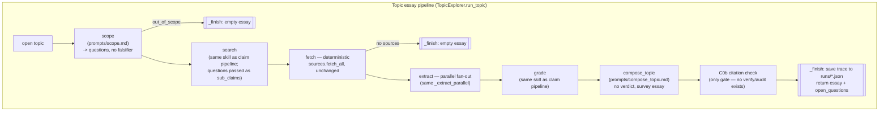

# Veritas — Workflow

## Overview

Veritas is a Python evidence-gathering agent with two front doors (`cli.py`,
`app.py`) [YOU CAN REMOVE THE OPTION OF CLI ENTRY, ITS NOT NEEDED AND WILL NOT BE USED]  that both drive the same orchestration module, `orchestrator.py`.
There are **two independent pipelines**, both built out of a shared catalogue
of LLM "skills" (`config.yaml` + one prompt-contract file per skill in
`prompts/`) plus two pieces of deliberately non-LLM code: `sources.py`
(retrieval) and `citations.py` (citation-integrity gating) [WHEN YOU SAY NON LLM, HOW DOES THIS WORK THEN ?]. The **claim pipeline** (`Veritas.run`) takes a checkable claim through decompose → search
→ fetch → extract → grade → synthesize → verify → compose, with a bounded
retry loop from `verify` back to `search [WHEN DOES THE RETRY LOOP GET TRIGGERED ??]`. The **topic pipeline**
(`TopicExplorer.run_topic`) takes an open subject through a single pass of scope → search → fetch → extract → grade → compose_topic, reusing the claim pipeline's plumbing but never reaching a verdict [WHAT DO YOU MEAN BY NEVER READCHING A VERDICT ?]. Both pipelines write a full JSON execution trace to `runs/` and are gated by a deterministic citation
check (`citations.py`) that can override the LLM's own judgment. [AGAIN WHAT DO YOU MEAN BY THIS ? 

## Entry point(s)

- **CLI**: `cli.py:126` `main()`. `python cli.py "<claim>"` runs the claim
pipeline (`Veritas().run(subject)`, `cli.py:144`); `python cli.py --topic "<topic>"` runs the topic pipeline (`TopicExplorer().run_topic(subject)`,
`cli.py:142`).
- **Streamlit UI**: `app.py`, run via `streamlit run app.py`. Module-level
code runs top-to-bottom on every Streamlit rerun (page config, sidebar
widgets); the actual pipeline call happens in `run_pipeline()`
(`app.py:304`), triggered from the `run_clicked` branch at `app.py:489`,
which calls `Veritas(verbose=False, on_log=on_log).run(subject)` or
`TopicExplorer(...).run_topic(subject)` depending on the sidebar radio.
- Both front doors do nothing but call into `orchestrator.py` and render the
returned `dict`. Neither duplicates pipeline logic.
- Both pipelines have a hard startup dependency confirmed by reading
`PROMPT.md` at the repo root: `Veritas.__init__` (`orchestrator.py:86`)
calls `_extract_master_prompt(ROOT.parent / "PROMPT.md")`
(`orchestrator.py:441-446`), which regex-extracts the first ````text`fence and raises`RuntimeError`if it's missing. Confirmed present at`/Users/aryamanchandak/Documents/EAG V3 Course/Assignment 5/PROMPT.md:9`. This master prompt is prepended as its own cached system block to every LLM call (`llm.py:79-106`).

---


# Pipeline 1 — Claim verification (`Veritas.run`)


## Main thread (step-by-step)

1. **Construction** (`orchestrator.py:80-86`) — `Veritas()` loads
  `config.yaml` into `self.cfg`, builds an `LLM` client (`llm.py:57-77`,
   provider auto-detected: `ANTHROPIC_API_KEY` preferred, else
   `OPENAI_API_KEY`, else `LLMError`), and loads the master prompt from
   `PROMPT.md`. This happens once per run object, not per skill call.
2. `decompose` (`orchestrator.py:131-145`, skill contract
  `prompts/decompose.md`) — the claim is split into 2-5 atomic P-I-O
   sub-claims plus a named **falsifier** (the finding that would refute the
   claim). Why: a claim with no falsifier isn't empirically checkable, and
   later steps (`search`, `verify`'s C6 check) depend on that falsifier
   existing. Branch: if `decomp["status"] == "out_of_scope"`, the run halts
   immediately via `_finish()` with `verdict: "out_of_scope"` — no round is
   ever entered. A second branch, `ambiguous_claim`, is only logged, not
   halted on — the pipeline proceeds with best-guess sub-claims.
3. **The retry loop begins** (`orchestrator.py:154`, `for round_no in
  range(1, max_rounds + 1)`).` max_rounds`comes from`config.yaml:14 `(currently`2`). This is the only bound on the loop — there is no other
   exit condition that limits iteration count.
4. `search` (`orchestrator.py:158-166`, `prompts/search.md`) — for every
  sub-claim, the LLM must emit at least one query of each of three
   *stances*: `confirming`, `disconfirming`, `baseline`. The disconfirming
   query is mandatory by contract, not optional — the prompt explicitly bans
   phrasing it as "confirming + not". Why: a verifier that only searches for
   agreement is a confirmation machine, not a checker. On round 2+,
   `VERIFIER_FEEDBACK` and `gaps_to_search` (carried from the prior round's
   audit) are passed in, and the prompt instructs the model not to reissue
   the previous round's queries.
5. `fetch` — deterministic, no LLM (`orchestrator.py:169-183`, handler
  `sources.fetch_all`, `sources.py:152-195`). This is the one skill the
   README and `config.yaml:29-32` are emphatic is pure code: PubMed
   E-utilities (`esearch` then `efetch`, XML, `sources.py:55-106`) and the
   arXiv Atom API (`sources.py:116-145`) are queried per generated query
   string, deduplicated by source id against a `seen_ids` set threaded
   across rounds, capped by `max_sources_per_query` (4) and
   `max_total_sources` (24) from `config.yaml:15-16`, with a `0.35s` sleep
   between queries to be polite to NCBI. Sources with no abstract are
   silently dropped (`sources.py:184`). Every HTTP/XML failure inside
   `search_pubmed`/`search_arxiv` is caught and returns `[]`
   (`sources.py:64-65, 74-75, 123-124`) — an API outage is indistinguishable
   from a zero-hit query at this layer; nothing surfaces that distinction
   upstream. Branch: if `all_sources` is still empty after fetch
   (`orchestrator.py:174-183`), and it's not the last round, the loop
   `continue`s with feedback to broaden queries; on the final round it
   returns `insufficient_evidence` directly.
6. `extract` **— parallel fan-out** (`orchestrator.py:186-189`, implemented
  in `_extract_parallel`, `orchestrator.py:293-317`, `prompts/extract.md`).
   One LLM call per sub-claim (or one call for the whole claim if
   `decompose` produced no sub-claims), run concurrently via
   `ThreadPoolExecutor(max_workers=min(4, len(targets)))` — capped at 4
   workers, not one thread per sub-claim, and `pool.map` preserves
   input order in the *returned results list* — but each worker also calls
   `trace.record()` (`orchestrator.py:118`) directly from its own thread, and
   those appends land in **completion order, not sub-claim order**, so the
   `extract` entries in the saved trace JSON (`runs/*.json`) do not
   necessarily read SC1, SC2, SC3 in sequence even though the aggregated
   `findings`/`unusable` lists back in `_extract_parallel` do. Each worker
   calls
   `self._invoke("extract", ...)` on a source subset filtered by
   `s.sub_claim_id == sc.get("id")` (`orchestrator.py:296-297`), **falling
   back to the full source list if that filter returns empty**. Since
   `sub_claim_id` on a `Source` is only populated in `fetch_all` from
   `q.get("sub_claim_id", "")` (`sources.py:188`), if `search` ever omits
   that field, every sub-claim's worker sees every source rather than a
   filtered slice. Per-worker failures are caught and degrade to an empty
   result (`orchestrator.py:305-307`, "one bad sub-claim must not kill the
   run") rather than aborting the pipeline. **Important cost detail: this
   call is over** `all_sources`**, the cumulative list across rounds, not just
   the sources fetched this round** — so a round-2 extract re-processes every
   source from round 1 as well as new ones (`orchestrator.py:187-189`,
   passing `all_sources`). Each source is graded on `direction`
   (`supports`/`contradicts`/`null_result`/`mixed`/`irrelevant`), and
   `irrelevant` is explicitly a first-class, expected outcome — the prompt
   calls padding tangential hits as `supports` "the failure mode this field
   exists to prevent." Branch: if every finding comes back `irrelevant`
   (`orchestrator.py:196-201`) and it's not the last round, the loop
   `continue`s with feedback to rewrite queries; **on the last round there is
   no** `continue` **and no early return — the pipeline falls through into**
   `grade`**/**`synthesize` **with** `usable == []`, i.e. it will synthesize over
   zero findings rather than crash.
7. `grade` (`orchestrator.py:204-212`, `prompts/grade.md`, not read in
  depth — one-line summary) — scores each usable finding 0-3 across
   design/power/directness/independence axes, producing a `weight` per
   source. Why its own skill: grading the study, not whether the conclusion
   is convenient, keeps a strong contradicting study from being outranked by
   a weak supporting one.
8. `synthesize` (`orchestrator.py:215-222`, `prompts/synthesize.md`,
  not read in depth) — weighs the graded findings into a `verdict`
   (`supported`/`refuted`/`mixed`/`insufficient_evidence`), a `confidence`,
   and prose `verdict_rationale` citing `source_id`s. `insufficient_evidence`
   is a legitimized output, not a fallback failure.
9. `verify` **— the adversarial audit** (`orchestrator.py:225-230`,
  `prompts/verify.md`) — runs six named checks (C1 citation_integrity, C2
   traceability, C3 no_unsupported_inference, C4 contradiction_handling, C5
   confidence_calibration, C6 falsifier_addressed), each independently
   pass/fail with a reason, and must always name a `weakest_link` even when
   approving. It returns one of `approved` / `needs_more_evidence` /
   `rejected`, plus `gaps_to_search` if it wants another round.
10. **C0 — deterministic citation gate overrides the LLM audit**
  (`orchestrator.py:232-246`, `citations.py`). Regardless of what `verify`
    concluded, the orchestrator independently computes `bad =   citation_violations(synthesis, {s.id for s in all_sources})` — a regex
    scan (`citations.py:23,40-43`) of **every string in the synthesis
    payload**, not just structured `source_id` fields, because the real
    defect this check was built for (see callout below) lived in prose. The
    resulting `C0` check row is *prepended* to `audit["checks"]` so it reads
    first, and **if** `bad` **is non-empty, it force-overwrites**
    `audit["verdict"] = "needs_more_evidence"` even if the LLM said
    `approved`, and appends a `required_changes` entry naming the bad ids.
    This is the concrete instance of the "deterministic code overrides LLM
    judgment" pattern used throughout the codebase (`fetch` over search
    results, `citations.py` over `verify`'s own C1).
11. **Loop exit or splice** (`orchestrator.py:255-260`) — if
  `audit["verdict"] == "approved"` **or** `round_no == max_rounds`, the
    `for` loop `break`s. Note the second condition: **the last round always
    exits regardless of the audit's verdict** — a `rejected` or
    `needs_more_evidence` synthesis on the final round still proceeds to
    `compose` rather than failing the run. That is a deliberate "always
    terminate, always produce output" design choice, not an oversight.
    Otherwise, `gaps = audit.get("gaps_to_search", [])` and `feedback =   "; ".join(required_changes + gaps)` are captured and the loop continues
    into another `search` round with that feedback. **State carried across
    rounds**: `seen_ids` (prevents re-surfacing rejected papers),
    `all_sources` (accumulates, `+=` each round), `gaps`/`feedback` (the
    splice payload). **State that is *not* carried**: `findings`/`usable`/
    `grades`/`synthesis`/`audit` are all recomputed from scratch each round
    (declared once before the loop, `orchestrator.py:151-152`, then
    overwritten every iteration) — the values that survive to `compose`
    after the loop are whatever the *final* round produced.
12. `compose` (`orchestrator.py:262-277`, `prompts/compose.md`) — runs
  once, after the loop, turning `{claim, decomposition, synthesis,   findings, grades, audit}` into a 600-1000 word explanatory essay with
    the verdict folded into the narrative rather than reported as a block,
    citing `(source_id)` inline. It must not silently drop the audit's
    `weakest_link`. A second, narrower citation check (**C0b**,
    `orchestrator.py:274-277`) runs against the essay's own citations —
    appended to `audit["checks"]` but explicitly **cannot re-route**: "Too
    late to re-route here — the loop is done — but the failure ships
    attached to the output rather than going unnoticed."
13. `_finish` **/ trace persistence** (`orchestrator.py:319-328`, called
  from every return path) — assembles the result dict
    (`verdict`, `essay`, `sources`, `rounds`, `audit`, etc.), calls
    `trace.save(result, self.llm.usage)` (`orchestrator.py:59-76`), which
    writes `runs/{unix_ts}-{mode}-{slug}.json` containing the claim, total
    wall-clock seconds, token usage (input/output/cache_read/cache_write),
    every recorded step (`skill`, `round`, `seconds`, `reasoning`, `output`),
    and the final result — then stamps `trace_path` and `tokens` onto the
    returned result for the CLI/UI to render.


## The `_invoke` skill-call mechanics (used by every LLM skill)

`_invoke` (`orchestrator.py:90-120`) is the single choke point every LLM
skill goes through: it builds a two-block system prompt (`[master, skill contract]` — kept separate specifically so the byte-identical master prompt
is a cache read on every call rather than being re-copied per skill,
`orchestrator.py:96-99`, `llm.py:83-97`), serializes the payload with
`ACTIVE_SKILL` tagged in, calls `self.llm.complete()`, and retries **once**
(`for attempt in range(2)`) if the response fails to parse as JSON
(`json.JSONDecodeError`) or raises `LLMError`, appending the parse error to
the user message on retry. If both attempts fail, it raises `LLMError`
uncaught. This means **provider/network errors from the underlying SDK
(rate limits, timeouts, auth failures) are not caught here at all** — they
propagate straight up through `run()` to `cli.main()`'s blanket
`except Exception` handler (`cli.py:148-150`), which prints `ERROR: <type>: <msg>` and exits 1. `_extract_parallel` is the one place that adds
its own try/except around `_invoke` so a single sub-claim's failure degrades
instead of killing the whole run.

## Callout — the C0 citation gate (a worked example, from README run 2)

The README documents a real defect: in the vitamin-C run, `synthesize`'s
prose `verdict_rationale` cited `PMID:4059230` while the actual retrieved
set contained `PMID:9059230` — a single corrupted digit — and the LLM
verifier's own **C1 citation_integrity** check passed it anyway (LLM audits
of LLM output share the LLM's failure modes). `citations.py` fixes this
deterministically: `cited_ids()` scans the whole JSON-serialized payload
with a regex (`_CITE`, `citations.py:23`) for any `PMID:`/`arXiv:`-shaped
token — case-insensitively, so a model writing `pmid:9999999` is still
caught — and `citation_violations()` reports whatever isn't in the
retrieved-id set. `_norm()` also strips arXiv `vN` version suffixes in both
directions so a citation dropping the API's minted `v2` isn't a false
positive (a false positive there would cost a whole retry round for no
reason).

Two details worth tracing precisely, confirmed against
`tests/test_pipeline_gate.py`:

- When C0 fires against an audit the LLM already marked `approved`, that
audit typically has **no** `gaps_to_search` (`verify` only fills that in
when it itself concludes `needs_more_evidence`). So round 2's `gaps` list
is empty, and `feedback` is just the C0-generated `required_changes`
string ("Synthesis cites sources that were never retrieved: pmid:999. Cite
only ids present in the evidence supplied to you."). The pipeline's only
lever for "you hallucinated a citation" is to re-run `search` and fetch
more papers — not obviously the right remedy for a citation bug rather
than an evidence gap, but it is the only splice mechanism the orchestrator
has.
- `_norm()` lowercases the scheme before comparison, so the id that shows up
in `required_changes` and in the check's `reason` is `pmid:999`, not
`PMID:999` — asserted directly in
`tests/test_pipeline_gate.py:86` (`self.assertIn("pmid:999", ...)`).

`tests/test_citations.py` replays the actual vitamin-C run trace
(`runs/1784487163-...json`) as a regression fixture, reconstructing the
retrieved-id set from the `extract`/`grade` step outputs (those traces
predate `result["sources"]` being persisted) and asserting both that
`pmid:4059230` is flagged and that the LLM's own C1 check is recorded as
`pass` in that same trace — i.e. it directly proves the LLM missed what the
deterministic check catches.

Note: both committed traces in `runs/` (`1784487078-...` and
`1784487163-...`) predate the `compose` step and the `mode` field in the
trace filename/JSON — they have no `essay` key and their `audit.checks` list
only ever contains C1-C6 plus C0, never C0b. `app.py`'s run-list loader
(`app.py:243`) accounts for this directly: `d.get("mode", "claim")` defaults
missing traces to claim mode.

---


# Pipeline 2 — Topic essay (`TopicExplorer.run_topic`)


## Overview

Added later (see `PLAN.md` Phase 2) as "exploration, not adjudication": no
verdict, no falsifier, no `verify`/retry loop — a single pass that produces
a survey essay citing what's established and what's contested.
`TopicExplorer.__init__` (`orchestrator.py:342`) composes a `Veritas`
instance internally (`self._v = Veritas(...)`) purely to reuse its
`_invoke`, `_extract_parallel`, and `_finish` methods rather than
duplicating the retry/parsing/trace-saving plumbing — `Veritas.run` itself
is untouched by this reuse.

## Main thread (step-by-step)

1. `scope` (`orchestrator.py:351-365`, `prompts/scope.md`) — the
  topic-mode counterpart to `decompose`: turns an open subject into 3-5
   specific, researchable `questions` (no falsifier, no P-I-O framing). At
   least one question must "invite disagreement" by contract — a topic that
   is "all safely settled produces a bland essay." Branches:
   `status: "out_of_scope"` halts immediately via `_finish` with an empty
   essay; `status: "too_broad"` self-narrows and logs a note but proceeds
   (not a halt).
2. `search` (`orchestrator.py:367-377`) — **the same skill and prompt
  as the claim pipeline**, called with a `decomposition_like = {"sub_claims":  questions}` dict — the topic's `questions` are passed in under the exact
   `sub_claims` key the claim pipeline uses, because `search` (and later
   `extract`/`grade`) only need `id`/`text`-shaped items and don't care what
   they're semantically called. `ROUND`/`MAX_ROUNDS` are hardcoded to `1, 1`
   since there is no retry loop in this pipeline. This key-aliasing is the
   whole mechanism that lets three skills be shared unmodified between the
   two pipelines.
3. `fetch` (`orchestrator.py:380-389`) — identical call into
  `sources.fetch_all`, unchanged from the claim pipeline. Branch: no
   sources retrieved → immediate `_finish` with an empty essay and a
   one-line explanation, no retry (there is nothing to retry into).
4. `extract` (`orchestrator.py:392-395`) — calls the shared
  `v._extract_parallel(topic, questions, sources, trace, 1, log)`, the
   exact same parallel fan-out described in step 6 of the claim pipeline
   above (same `ThreadPoolExecutor`, same per-worker degrade-on-failure).
5. `grade` (`orchestrator.py:398-403`) — same skill, same prompt, same
  call shape as the claim pipeline.
6. `compose_topic` (`orchestrator.py:406-411`, `prompts/compose_topic.md`,
  not read in depth) — the topic-mode essay writer: surveys the questions,
   cites findings per question, is explicit about open disagreement in the
   literature, and does **not** force a verdict. Decision documented in
   `PLAN.md` Phase 2: no verify-equivalent audit step for topic mode at all —
   "grade + the same citation discipline as the claim pipeline is enough for
   an exploratory essay that isn't adjudicating anything," with multi-round
   topic search left as an explicit backlog item.
7. **C0b-only citation gate** (`orchestrator.py:413-417`) — because there is
  no `verify` step to backstop, the deterministic citation check is "the
   only thing standing between a hallucinated citation and the reader" in
   this pipeline (comment, `orchestrator.py:413-414`). It runs once, against
   the composed essay, and is stored as a single check row under
   `result["citation_check"]` (`orchestrator.py:420-422`) rather than inside
   an `audit.checks` list, since there is no audit object in this pipeline.
   There is no retry — a violation is only ever reported, never corrected.
8. `_finish` (`orchestrator.py:431`, via the shared `Veritas` instance)
  — same trace-save mechanism as the claim pipeline, `mode="topic"`.


## The 8th skill, `compose` — not part of this pipeline

`compose` (used by the claim pipeline, step 12 above) and `compose_topic`
(used here) are two distinct, non-interchangeable skills: `compose` turns a
claim-verification **verdict** into an essay with the verdict woven in;
`compose_topic` turns a topic **survey** into an essay with no verdict at
all. They share no code path beyond both going through `_invoke`.

---


## Branches & error handling


| Decision point                             | Where                                                | Paths                                                                                                                                                                                                                                                                                                                                                                                                                                                                                                                                                                                                                                  |
| ------------------------------------------ | ---------------------------------------------------- | -------------------------------------------------------------------------------------------------------------------------------------------------------------------------------------------------------------------------------------------------------------------------------------------------------------------------------------------------------------------------------------------------------------------------------------------------------------------------------------------------------------------------------------------------------------------------------------------------------------------------------------- |
| `decompose`/`scope` scope check            | `orchestrator.py:134-139`, `354-359`                 | `out_of_scope` → immediate `_finish`, pipeline never enters its main loop; `ambiguous_claim`/`too_broad` → logged, proceeds with best-guess output                                                                                                                                                                                                                                                                                                                                                                                                                                                                                     |
| No sources fetched                         | `orchestrator.py:174-183` (claim), `384-389` (topic) | Claim: `continue` to next round if rounds remain, else return `insufficient_evidence`. Topic: immediate `_finish`, no retry mechanism exists                                                                                                                                                                                                                                                                                                                                                                                                                                                                                           |
| All findings `irrelevant`                  | `orchestrator.py:196-201`                            | Not-last-round: `continue` with rewrite-queries feedback. Last round: **falls through** to `grade`/`synthesize` with an empty `usable` list rather than returning early                                                                                                                                                                                                                                                                                                                                                                                                                                                                |
| `usable`/`grades` reach `compose` unbound? | `orchestrator.py:151-152, 264-268`                   | `usable` and `grades` are loop-local, declared once before the `for` loop and only ever assigned inside it. `compose` (after the loop) is only reachable via a `break`, and every `continue` path inside the loop (no-sources, all-irrelevant) is on a round `< max_rounds`; the corresponding last-round path is always an early `return` (no-sources) or a fall-through that binds both names (all-irrelevant), for any value of `max_rounds`. So there is no reachable path that reaches `compose` with `usable`/`grades` unbound — verified as an invariant across the branch structure, not just for the current `max_rounds: 2`. |
| `verify` audit result                      | `orchestrator.py:255-260`                            | `approved` → loop breaks, proceeds to `compose`. `needs_more_evidence`/`rejected` → splices back to `search` with `gaps`/`feedback`, unless `round_no == max_rounds`, in which case the loop breaks regardless and `compose` runs on the unapproved synthesis anyway                                                                                                                                                                                                                                                                                                                                                                   |
| C0 deterministic citation check            | `orchestrator.py:236-246`                            | Clean → no effect. Violations found → force-overwrites `audit["verdict"]` to `needs_more_evidence` even over an LLM `approved`, appends to `required_changes`, and (since this happens inside the loop) can trigger the splice in the same iteration it's detected                                                                                                                                                                                                                                                                                                                                                                     |
| C0b (claim `compose`)                      | `orchestrator.py:274-279`                            | Violations found → logged and recorded as a failing check row, but the loop has already exited — cannot force another round                                                                                                                                                                                                                                                                                                                                                                                                                                                                                                            |
| C0b (topic `compose_topic`)                | `orchestrator.py:413-417`                            | Same as above; this is the *only* citation gate topic mode has, since there is no `verify`/loop to override                                                                                                                                                                                                                                                                                                                                                                                                                                                                                                                            |
| `_invoke` JSON parse failure               | `orchestrator.py:104-115`                            | Retries once with the parse error appended to the user prompt; on second failure raises `LLMError` uncaught, propagating to `cli.main()`'s blanket exception handler (exit code 1) or to `app.py`'s `run_pipeline()` try/except (renders `st.exception`)                                                                                                                                                                                                                                                                                                                                                                               |
| `_extract_parallel` per-worker failure     | `orchestrator.py:305-307`                            | Caught, logged, degrades to `{"findings": [], "unusable_sources": []}` for that sub-claim rather than aborting the run                                                                                                                                                                                                                                                                                                                                                                                                                                                                                                                 |
| `sources.py` HTTP/XML failure              | `sources.py:64-65, 74-75, 123-124`                   | Caught per-database, returns `[]` — indistinguishable at this layer from a genuine zero-hit query                                                                                                                                                                                                                                                                                                                                                                                                                                                                                                                                      |


## Assumptions made / not traced

- `grade.md` and `synthesize.md` prompt contracts, and `compose_topic.md`'s
full body, were read at a summary level (skill catalogue role, inputs and
outputs) rather than line-by-line, per the depth-ceiling guidance — the
orchestration-level behavior (what's passed in, what's read back out) is
fully traced, but the internal grading rubric / synthesis logic prompt
text is not reproduced here.
- `evaluate.py` and `evaluations/` (the rubric-grading harness that scored
the qualified prompt 9/9) are outside this codebase's runtime flow — not
traced, since they evaluate `PROMPT.md`, not the pipeline itself.
- `app.py`'s ~180 lines of CSS/styling were skipped; its runtime thread is:
module-level `st.set_page_config()` (must run first) → CSS injection →
session-state init (`app.py:217-224`, guarded so it only initializes once
per session, since Streamlit re-executes the whole script top-to-bottom on
every widget interaction — `st.session_state` is what survives a rerun,
everything else is rebuilt) → sidebar widgets → on `run_clicked`,
`run_pipeline()` → `render_result()`. The `Trace.on_log` callback
(`orchestrator.py:35,43-47`) is the one live coupling between backend and
UI: it fires on every `log()` call inside the pipeline and is wired in
`app.py:320-323` to append lines into an `st.status()` block, so the UI
shows the identical step log the CLI prints to stdout.
- Not independently re-verified: the arithmetic/rubric behind `grade`'s
0-3 weight axes, and whether `compose`/`compose_topic`'s 600-1000 word
target is enforced anywhere beyond the prompt instruction (no code-level
word-count check was found in `orchestrator.py`).
- The claim that run 2's citation defect (`PMID:4059230` vs `PMID:9059230`)
is a *real* historical bug (not just a synthetic test fixture) is taken
from the top-level `README.md` narrative and corroborated by
`tests/test_citations.py`'s regression test replaying that exact trace —
not independently re-derived from raw API responses.
- Alternative entry paths not exercised: no live run was performed in this
trace (no API key invoked) — everything above is static-traced from
source and cross-checked against `tests/test_pipeline_gate.py`'s stubbed
run and the two committed `runs/*.json` traces. `PLAN.md` itself notes no
live end-to-end run through the UI has happened in that project's dev
environment either.


## Data & side effects

- **Network**: PubMed E-utilities (`esearch.fcgi`, `efetch.fcgi`) and the
arXiv Atom API — both free, keyless, hit only from `sources.py`. The LLM
provider API (Anthropic or OpenAI) is hit once per `_invoke` call, i.e.
once per skill per round (plus one call per sub-claim during `extract`'s
fan-out).
- **Filesystem writes**: one JSON trace file per run under `runs/`
(`orchestrator.py:59-76`), named `{unix_ts}-{mode}-{slug}.json`. Nothing
else in the pipeline writes to disk (the Streamlit "download essay"
button in `app.py:362-367` is a client-side download, not a server write).
- **In-memory state carried across claim-pipeline rounds**: `seen_ids`
(dedup across fetches), `all_sources` (cumulative, re-processed by
`extract` every round), `gaps`/`feedback` (the search splice). Discarded
and rebuilt each round: `findings`, `usable`, `grades`, `synthesis`,
`audit`.
- **Token/cost accounting**: `LLM.usage` (`llm.py:20-34`) accumulates across
every call in a run via `Usage.__iadd__`, tracking input/output/
cache_read/cache_write tokens; `_finish` reads it once at the end to stamp
the result and the trace file.


## Diagram

```mermaid
flowchart TD
  subgraph ClaimPipeline["Claim verification pipeline (Veritas.run)"]
    A[claim] --> B["decompose\n(prompts/decompose.md)"]
    B -->|out_of_scope| Z1[["_finish: verdict=out_of_scope"]]
    B -->|sub_claims + falsifier| C["search\n(prompts/search.md)"]
    C --> D["fetch — deterministic\nsources.py: PubMed + arXiv"]
    D -->|no sources, rounds left| C
    D -->|no sources, last round| Z2[["_finish: insufficient_evidence"]]
    D --> E["extract — parallel fan-out\nThreadPoolExecutor(max_workers<=4)\nover cumulative all_sources"]
    E -->|all irrelevant, rounds left| C
    E --> F["grade\n(prompts/grade.md)"]
    F --> G["synthesize\n(prompts/synthesize.md)\n-> verdict, confidence, rationale"]
    G --> H["verify — adversarial audit\n(prompts/verify.md)\nC1-C6 checks + weakest_link"]
    H --> I{"C0 deterministic\ncitation gate\ncitations.py"}
    I -->|citations invented: force override| J["audit.verdict = needs_more_evidence"]
    I -->|clean| K{"approved OR\nround == max_rounds?"}
    J --> K
    K -->|no: splice back| C
    K -->|yes| L["compose\n(prompts/compose.md)\nverdict folded into essay"]
    L --> M["C0b essay citation check\n(cannot re-route)"]
    M --> N[["_finish: save trace to runs/*.json\nreturn essay + verdict + audit"]]
  end
```







## Open questions / gaps

- Whether `verify`'s `C2 traceability` or `C3 no_unsupported_inference`
checks have any deterministic backstop analogous to C0 — from the prompt
contract and orchestrator code, they do not; they remain pure LLM
judgment, which `README.md`'s "Known limitations" section explicitly
flags ("`C0` catches invented ids, not misattributed ones... That remains
an LLM judgement").
- No live run against the real LLM/PubMed/arXiv APIs was performed as part
of this trace; all control-flow claims above are grounded in static
source reading plus the two committed `runs/*.json` traces and the
offline stubbed test in `tests/test_pipeline_gate.py`, not a fresh
execution.
- Whether `_extract_parallel`'s empty-filter fallback (every sub-claim
seeing every source when `sub_claim_id` isn't set) is ever actually
triggered in practice depends on whether `search`'s LLM output reliably
includes `sub_claim_id` on every query — not verified against a live
`search` response, only against the prompt contract's schema, which does
declare `sub_claim_id` as a required field.

